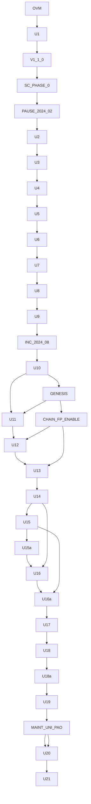

# RELEASE-DAG — OP Stack L1/L2 release lineage, OVM residue -> Bedrock (U1) -> Upgrade 21

Worker F2 (Track A, blind). Generated by `scripts/F2_build_dag.py` from `scripts/F2_dag_data.py` + `evidence/F2-*.json`; machine-readable twin: `RELEASE-DAG.json`.
All on-chain facts were read from the local L1 archive proxy `http://127.0.0.1:7545` (OP Mainnet L2: `:7546`) by bisected sampling (step 20,000 L1 / 200,000 L2 blocks), with the exact change block found by bisection. Model note: this resume ran on Opus 5.5 under the user-approved exception recorded in /home/user/Tracking_Body/CLAUDE.md (Mythos 5.2 quota exhausted until 2026-11-22 00:00 UTC).

Audit titles/commits: Titles, audited commits and 'Subsequent Release' are the Date | Reviewer | Focus and Scope | Commit | Subsequent Release columns of the index table in optimism@e5423ae6 docs/security-reviews/README.md (extracted to evidence/F2-audit-index.json; the Report Link column was not followed). Audited commits were mapped to op-contracts tags with `git ls-remote --tags origin 'op-contracts/*'`. Reports themselves were NOT opened (Track A). [Corrected on resume: an earlier draft of this note said the table had no commit column; it has one.]

## 1. Node summary (chronological on OP Mainnet)

| # | Node | Proposal | Class | op-contracts tag @ commit | OP Mainnet L1 execution | Ink | Soneium | Unichain |
|---|---|---|---|---|---|---|---|---|
| 0 | **OVM** Legacy OVM residue (OVM 1.0 mainnet beta 2021-06, OVM 2.0 re | — | residue (no governance upgrade number) | —  | 12686687 (2021-06-22) 0x8803c67a00… (+7 more) | n/a | n/a | n/a |
| 1 | **U1** Upgrade #1 — Bedrock | 1 | hardfork (re-genesis-less migration) + f | op-contracts/v1.0.0 @ `a12a09f7000f` | 17365801-17365804 (2023-05-29) 0x615bd360..., 0x8da60c6c..., 0x4c2e6326..., 0x17a29cb8... (+3 more) | genesis-inherited | genesis-inherited | genesis-inherited |
| 2 | **V1.1.0** op-contracts/v1.1.0 — tag without an OP Mainnet upgrade (Pro | — | tag only / new signalling contract (not  | op-contracts/v1.1.0 @ `c383eb880f30` | 18367300 / 18367320 (2023-10-17) 0x4ab7f052... / 0xa97289b1... | n/a | n/a | n/a |
| 3 | **SC-PHASE-0** Security Council Phase 0 — L1 ProxyAdmin owner becomes the 2 | — | authorization change (no code release) | —  | 19193284 (2024-02-09) 0xd2a7e63eb7… | genesis-inherited | genesis-inherited | n/a (own 3-of-3 authority until MAINT-UNI-PAO) |
| 4 | **PAUSE-2024-02** Mainnet pause rehearsal on the Bedrock portal (local `paused | — | operational event (state toggled and res | —  | 19233786 (2024-02-15) 0x374dc0d5ad… (+1 more) | n/a | n/a | n/a |
| 5 | **U2** Upgrade #2 — Canyon | 2 | hardfork (L2 only) | — (`6cce3728... `) | None (2024-01-11) - | genesis-inherited | genesis-inherited | genesis-inherited |
| 6 | **U3** Upgrade #3 — Delta | 3 | hardfork (consensus-layer only: span bat | —  | 19320684 (2024-02-27) 0x2c616fc821… (+1 more) | genesis-inherited | genesis-inherited | genesis-inherited |
| 7 | **U4** Upgrade #4 — SuperchainConfig and extended pause | 4 | contracts-only | op-contracts/v1.2.0 @ `856c08bf84d9` | 19314493 (2024-02-26) 0x3f7c36a1d6… (+1 more) | genesis-inherited | genesis-inherited | genesis-inherited |
| 8 | **U5** Upgrade #5 — Ecotone | 5 | hardfork | — (`f707883038d5`) | 19429571 (2024-03-14) 0xac827d7a12… (+2 more) | genesis-inherited | genesis-inherited | genesis-inherited |
| 9 | **U6** Upgrade #6 — Multi-Chain Prep (MCP) L1 | 6 | contracts-only | op-contracts/v1.3.0 @ `e6ef3a900c42` | 19634866 (2024-04-11) 0x4758bd6235… | genesis-inherited | genesis-inherited | genesis-inherited |
| 10 | **U7** Upgrade #7 — Fault Proofs | 7 | contracts-only | op-contracts/v1.4.0 @ `547ea72d9849` | 20062696 (2024-06-10) 0xbe810ed6e1… (+1 more) | genesis-inherited | genesis-inherited | genesis-inherited |
| 11 | **U8** Upgrade #8 — Guardian, Security Council threshold, L2 ProxyA | 8 | authorization change + Safe modules | op-contracts/v1.5.0 @ `9047beb54c66` | 20063224 (2024-06-10) 0xe361c0d4ae… 20063319 (2024-06-10) 0x50db9c1b9f… (+2 more) | genesis-inherited | genesis-inherited | genesis-inherited |
| 12 | **U9** Upgrade #9 — Fjord | 9 | hardfork + absolute-prestate rotation on | — (`f8143c8cbc4c`) | 20270847 (2024-07-09) 0x7abecacd8b… (+3 more) | genesis-inherited | genesis-inherited | genesis-inherited |
| 13 | **INC-2024-08** Permissioned fallback (respected game type 0 -> 1) | — | guardian action / incident response | —  | 20543021 (2024-08-16) 0x493e2f3354… | n/a | n/a | n/a |
| 14 | **U10** Upgrade #10 — Granite (hardfork + fault-proof contract fixes | 10 | hardfork + contracts (dispute system onl | op-contracts/v1.6.0 @ `33f06d2d5e40` | 20723924 (2024-09-11) 0x3bd2d811d0… 20728464 (2024-09-11) 0x592e73fdf5… (+4 more) | genesis-inherited | genesis-inherited | genesis-inherited |
| 15 | **U11** Upgrade #11 — Holocene | 11 | hardfork + contracts (SystemConfig, MIPS | op-contracts/v1.8.0 @ `2073f4059bd8` | 21580854 (2025-01-08) 0x22ab07b0bb… 21695024 (2025-01-24) 0x86da7386a2… (+3 more) | partial: hardfork 2025-03-19, SystemConfig 2.3.0 step SKIPPED | executed (hardfork 2025-02-03; SystemConfig task 030, 2025-02-28) | executed (SystemConfig unichain-001, 2025-03-19) |
| 16 | **U12** Upgrade #12 — L1 Pectra readiness | 12 | maintenance (node software + absolute pr | —  | NO dedicated L1 transaction: task 031-op-mainnet-pectra-defense is … | executed | folded into later node | folded into later node |
| 17 | **U13** Upgrade 13 — OPCM and incident response improvements | 13 | contracts-only (first OPCM upgrade) | op-contracts/v2.0.0 @ `8d0dd96e494b` | 22182531 (2025-04-02) 0x5f3530e593… (+3 more) | executed (shared tx/timestamp) | executed (shared tx/timestamp) | executed |
| 18 | **U14** Upgrade 14 — Isthmus L1 contracts + MT-Cannon | 14 | contracts-only | op-contracts/v3.0.0 @ `ef7a933ca7f3` | 22339996 (2025-04-24) 0xbe44244e35… | executed (shared tx/timestamp) | executed (shared tx/timestamp) | executed |
| 19 | **U15** Upgrade 15 — Isthmus hardfork | 15 | hardfork | —  | None (2025-05-09) - | executed (shared tx/timestamp) | executed (shared tx/timestamp) | executed (shared tx/timestamp) |
| 20 | **U15a** Upgrade 15a — absolute prestate for Isthmus activation + blo | 15a | maintenance (prestate rotation through O | —  | 22432368 (2025-05-07) 0xc4a7089a92… | executed (shared tx/timestamp) | skipped | executed |
| 21 | **U16** Upgrade 16 — Interop contracts, Stage 1, Go 1.23 in Cannon | 16 | contracts-only | op-contracts/v4.0.0 @ `54c19f6acb7a` | 22990599 (2025-07-24) 0x46acdce174… (+2 more) | executed (shared tx/timestamp) | executed | executed |
| 22 | **U16a** Upgrade 16a — maintenance release superseding U16 | 16a | maintenance (contracts-only) | op-contracts/v4.1.0 @ `594bc933a384` | 23491328 (2025-10-02) 0x744cf7d283… | executed (shared tx/timestamp) | executed (shared tx/timestamp) | executed |
| 23 | **U17** Upgrade 17 — Jovian hardfork and Fusaka readiness | 17 | hardfork + contracts | op-contracts/v5.0.0 @ `d09c836f818c` | 23877377 (2025-11-25) 0xf556934cb4… (+1 more) | executed (shared tx/timestamp) | executed (shared tx/timestamp) | executed |
| 24 | **U18** Upgrade 18 — Custom Gas Token v2, Cannon+Kona, creator-patte | 18 | contracts-only | op-contracts/v6.0.0 @ `018f5ae926ec` | 24421512 (2026-02-09) 0x8808cd5311… | executed (shared tx/timestamp) | executed | executed |
| 25 | **U18a** 'Upgrade 18a' — Arena-Z chain servicer migration | 18a | maintenance (single-chain configuration, | —  | not affected | n/a | n/a | n/a |
| 26 | **U19** Upgrade 19 ('19b') — Karst hardfork, contracts v7, OPCMv2, L | 19b | hardfork + contracts | op-contracts/v7.0.0 @ `a7c88c8d636c` | 25397811 (2026-06-25) 0xbfdac60c96… (+2 more) | executed (shared tx/timestamp) | executed (shared tx/timestamp) | executed |
| 27 | **MAINT-UNI-PAO** Unichain ProxyAdmin owner transition (and other 2026 single- | — | authorization change (single chain) | —  | not affected (see the 'other maintenance' list in RELEASE-DAG.md se… | executed (SystemConfig owner only) | n/a | executed |
| 28 | **U20** Upgrade 20 — Super Root dispute games, OPCM v8 | 20 | contracts-only | op-contracts/v8.0.0 @ `f45a5ccfebcd` | 26048619 (2026-09-24) 0x0a0fe86f7b… | executed (shared tx/timestamp) | executed (shared tx/timestamp) | executed (shared tx/timestamp) |
| 29 | **U21** Upgrade 21 — interop readiness, OPCM v9 | 21 | contracts-only | op-contracts/v9.0.0 @ `ba6fcadbc57e` | 26430859 (2026-11-16) 0x024770b5fb… | executed (shared tx/timestamp) | executed (shared tx/timestamp) | executed (shared tx/timestamp) |

Chain-local nodes (not on OP Mainnet): **GENESIS** (Ink 2024-12-06, Soneium 2024-12-02, Unichain 2024-11-04) and **CHAIN-FP-ENABLE** (Ink 2025-01-13/22, Unichain 2025-01-17/23). Details in section 4.

## 2. DAG

Edges other than the OP Mainnet chronological sequence:

- U10 -> GENESIS: branch: Ink/Soneium/Unichain are created with the U1..U10 state as genesis
- GENESIS -> CHAIN-FP-ENABLE: Ink, Unichain only
- CHAIN-FP-ENABLE -> U12: Ink: ink-003
- CHAIN-FP-ENABLE -> U13: Unichain: 002
- GENESIS -> U11: Soneium (task 030) and Unichain (unichain-001) SystemConfig 2.3.0; Ink SKIPS this edge
- U14 -> U16: Soneium skips U15a (prestate 0x03ee2917... kept across Isthmus)
- U15 -> U16a: alternate entry: chains that skipped U16 (Base, Zora, Metal, Mode, Arena-Z, Swell); none of the four chains
- MAINT-UNI-PAO -> U20: Unichain joins the single-transaction upgrade path

## 3. Per-chain path

**op-mainnet**: OVM -> U1 -> V1.1.0 -> SC-PHASE-0 -> PAUSE-2024-02 -> U2 -> U3 -> U4 -> U5 -> U6 -> U7 -> U8 -> U9 -> INC-2024-08 -> U10 -> U11 -> U12 [no L1 transaction] -> U13 -> U14 -> U15 -> U15a -> U16 -> U16a -> U17 -> U18 -> U19 -> U20 -> U21

**ink**: [inherited at genesis: U1, SC-PHASE-0, U2, U3, U4, U5, U6, U7, U8, U9, U10] => GENESIS -> U11 [partial: hardfork 2025-03-19, SystemConfig 2.3.0 step SKIPPED] -> CHAIN-FP-ENABLE -> U12 -> U13 -> U14 -> U15 -> U15a -> U16 -> U16a -> U17 -> U18 -> U19 -> MAINT-UNI-PAO -> U20 -> U21

**soneium**: [inherited at genesis: U1, SC-PHASE-0, U2, U3, U4, U5, U6, U7, U8, U9, U10] => GENESIS -> U11 -> CHAIN-FP-ENABLE [skipped] -> U12 [folded into later node] -> U13 -> U14 -> U15 -> U15a [skipped] -> U16 -> U16a -> U17 -> U18 -> U19 -> U20 -> U21

**unichain**: [inherited at genesis: U1, U2, U3, U4, U5, U6, U7, U8, U9, U10] => SC-PHASE-0 [n/a (own 3-of-3 authority until MAINT-UNI-PAO)] -> GENESIS -> U11 -> CHAIN-FP-ENABLE -> U12 [folded into later node] -> U13 -> U14 -> U15 -> U15a -> U16 -> U16a -> U17 -> U18 -> U19 -> MAINT-UNI-PAO -> U20 -> U21

## 4. Nodes in detail

### OVM — Legacy OVM residue (OVM 1.0 mainnet beta 2021-06, OVM 2.0 regenesis 2021-11, pre-Bedrock L1ERC721Bridge 2022-10)

- **Proposal**: — — none (pre-governance / pre-Bedrock) 
- **Classification**: residue (no governance upgrade number)
- **Release**: tag `None`, commit `None`. No op-contracts tag. The pre-Bedrock implementations are only identified by address.
- **Execution**:
  - op-mainnet [executed]: AddressManager 0xdE1FCfB0851916CA5101820A69b13a4E276bd81F deployed — L1 block 12686687, 2021-06-22 22:13:53, tx 0x8803c67a0032b8dea6b0e3a9d2ff1708346a41a8d2945d4e84e5d81862f1cb54 AddressManager name OVM_L1CrossDomainMessenger first set -> 0x16393737d09d2722ad13dca3ca8c3db957699f1d — L1 block 12686756, 2021-06-22 22:29:27, tx 0xd19d40f11c375feeea5fe47576ce98a3a08caac68b2a8a52fb95dd1a76dd205a L1StandardBridge L1ChugSplashProxy 0x99C9fc46... first implementation 0x9091dda480b232133a7d2e4cb23336b4f0293196 — L1 block 12686787, 2021-06-22 22:37:53, tx None OVM_L1CrossDomainMessenger -> 0xbfba066b5ca610fe70adce45fcb622f945891bb0 — L1 block 12706528, 2021-06-26 00:52:47, tx 0x98a05fb521b3349dd92cff2e104d78c6c318add003bb501c0d416b2b4d75df8a OVM 2.0 regenesis: OVM_L1CrossDomainMessenger set to address(0) (messenger disabled) — L1 block 13596294, 2021-11-11 17:37:56, tx 0x2625aa2013fd1a650fb0264d2746be597e12f846baa48a68fe14539c200ed6dc OVM 2.0: OVM_L1CrossDomainMessenger -> 0xd9166833ff12a5f900ccfbf2c8b62a90f1ca1fd5 — L1 block 13596781, 2021-11-11 19:29:14, tx 0xbabb37235bd38ae5a29717590eedfd9b02f84a12b890b2126feac68f223d7448 OVM 2.0: L1StandardBridge implementation -> 0x40e0c049f4671846e9cff93aaed88f2b48e527bb — L1 block 13596915, 2021-11-11 19:59:10, tx None L1ERC721Bridge proxy 0x5a7749f8... deployed (first impl 0x3268ed09..., version 1.0.0, set at block 15677648) — L1 block 15677422, 2022-10-04 21:23:11, tx 0x7583d011cf1593fb1ffc79b097b0a365192c87dfdccbf860e1ad3f1425a305ef
  - ink [n/a]: n/a (chain created 2024-12)
  - soneium [n/a]: n/a (chain created 2024-12)
  - unichain [n/a]: n/a (chain created 2024-11)
- **Chain set**:
  - op-mainnet
- **Changed L1 contracts**:
  - AddressManager (Lib_AddressManager) — still the resolver of the L1CrossDomainMessenger implementation today
  - L1CrossDomainMessenger ResolvedDelegateProxy 0x25ace71c... (proxy and its storage survive every later release)
  - L1StandardBridge L1ChugSplashProxy 0x99C9fc46... (proxy and its storage survive)
  - L1ERC721Bridge Proxy 0x5a7749f8... (deployed 8 months before Bedrock with a 1.0.0 implementation)
- **Changed L2 / clients**:
  - OVM l2geth; whole L2 state carried into Bedrock by the migration (see U1)
- **Initializer calls**:
  - n/a (legacy)
- **Headline storage changes**:
  - Storage created under OVM code and still present under the same proxies: L1CDM slot 0 held abi.encodePacked(initialized=true, libAddressManager) until U4; L1StandardBridge slot 0 held the legacy `messenger` address until U4; L1StandardBridge `deposits[l1Token][l2Token]`; L1CDM legacy relay bookkeeping (successful/blocked/relayed message mappings keyed by legacy hashes). Exact slots: F4.
- **Role changes**:
  - AddressManager owner / L1ChugSplashProxy owner = legacy Optimism multisig 0x9BA6e03D... until Bedrock handed both to the ProxyAdmin 0x543bA4AA...
- **Dispute game / prestate**:
  - none (OVM state commitment chain; not carried forward)
- **Proofs / messages invalidated**:
  - nothing explicitly; pre-Bedrock L2->L1 messages remain relayable only through the Bedrock migration path (U1)
- **Skipped / alternate paths**:
  - Only OP Mainnet has OVM ancestry. Ink, Soneium and Unichain proxies were created fresh in 2024 with a clean slot 0 and a per-proxy AddressManager entry (ResolvedDelegateProxy.addressManager[proxy], slot keccak(proxy,1)).
- **Implementation changes (on-chain, EIP-1967 / AddressManager)**:
  - op-mainnet: L1CrossDomainMessenger(AddressManager OVM_L1CrossDomainMessenger) ∅ -> ∅ (`0x00000000`, blk 12686687); L1CrossDomainMessenger(AddressManager OVM_L1CrossDomainMessenger) ∅ -> ∅ (`0x16393737`, blk 12686756); L1CrossDomainMessenger(AddressManager OVM_L1CrossDomainMessenger) ∅ -> ∅ (`0xbfba066b`, blk 12706528); L1CrossDomainMessenger(AddressManager OVM_L1CrossDomainMessenger) ∅ -> ∅ (`0x00000000`, blk 13596294); L1CrossDomainMessenger(AddressManager OVM_L1CrossDomainMessenger) ∅ -> ∅ (`0xd9166833`, blk 13596781); L1StandardBridge ∅ -> ∅ (`0x00000000`, blk 12686786); L1StandardBridge ∅ -> ∅ (`0x9091dda4`, blk 12686787); L1StandardBridge ∅ -> ∅ (`0x40e0c049`, blk 13596915); L1ERC721Bridge ∅ -> ∅ (`0x00000000`, blk 15677422); L1ERC721Bridge ∅ -> 1.0.0 (`0x3268ed09`, blk 15677648)
- **Audit index rows (title / audited commit / tags at that commit / 'Subsequent Release')**:
  - 2020-10 Trail of Bits — Rollup / `—` / no op-contracts tag / —
  - 2020-11 Dapphub — ECDSA Wallet / `—` / no op-contracts tag / —
  - 2021-03 OpenZeppelin — OVM and Rollup / `—` / no op-contracts tag / —
  - 2021-03 ConsenSys Diligence — Safety Checker / `—` / no op-contracts tag / —
- **Evidence**: IMPL(op) targets L1CrossDomainMessenger(AddressManager ...), L1StandardBridge, L1ERC721Bridge; OPS-OLD 004-add-superchainConfig/Validation.md (L1CDM slot 0 and L1StandardBridge slot 0 'Before' values)

### U1 — Upgrade #1 — Bedrock

- **Proposal**: 1 — [FINAL] Upgrade #1: Bedrock Protocol Upgrade - v2 (https://gov.optimism.io/t/5548)
- **Classification**: hardfork (re-genesis-less migration) + full L1 contract replacement
- **Release**: tag `op-contracts/v1.0.0`, commit `a12a09f7000ff785a4058998e09b366cbe5a3ed2`. Lightweight tag; commit dated 2023-06-06 12:31 -0400 ('Update b2.json'), i.e. tagged on the migration day.
- **Execution**:
  - op-mainnet [executed]: Proxies pre-deployed: L2OutputOracle, OptimismPortal, OptimismMintableERC20Factory, SystemConfig — L1 block 17365801-17365804, 2023-05-29 16:22:47..16:23:23, tx 0x615bd360..., 0x8da60c6c..., 0x4c2e6326..., 0x17a29cb8... Migration step A (Safe 0x9BA6e03D... execTransaction): SystemConfig impl 1.3.0 + first initialize; AddressManager OVM_L1CrossDomainMessenger set to address(0) (L1 messenger disabled for the migration window) — L1 block 17422444, 2023-06-06 15:58:47, tx 0x76bceccd7d44656f5a129a600a6120091570b897c1d45c18cd7134cfe67c2537 L2 Bedrock genesis block 105235063, timestamp 1686068903, L1 origin 17422590 (REG op.toml) — L1 block 17422590, 2023-06-06 16:28:23, tx None Migration step B (same Safe): OptimismPortal 1.6.0, L2OutputOracle 1.3.0, OptimismMintableERC20Factory 1.1.0, L1CDM 1.4.0 (AddressManager), L1StandardBridge 1.1.0 (ChugSplash); ProxyAdmin owner -> 0x9BA6e03D... — L1 block 17423158, 2023-06-06 18:24:11, tx 0xe2ff41f9bdf03d5455f55539b8b9c350276a179ca7f79322e2077d7c1ffb1268
  - ink [genesis-inherited]: genesis-active (chain genesis 2024-12-06 on L1 block 21344310)
  - soneium [genesis-inherited]: genesis-active (chain genesis 2024-12-02 on L1 block 21314185)
  - unichain [genesis-inherited]: genesis-active (chain genesis 2024-11-04 on L1 block 21116363)
- **Chain set**:
  - op-mainnet
- **Changed L1 contracts**:
  - NEW: OptimismPortal 1.6.0, L2OutputOracle 1.3.0, SystemConfig 1.3.0, OptimismMintableERC20Factory 1.1.0, ProxyAdmin 0x543bA4AA...
  - REPLACED IN PLACE (OVM proxies kept): L1CrossDomainMessenger 1.4.0, L1StandardBridge 1.1.0
  - L1ERC721Bridge stays at its 2022 implementation 1.0.0 (not touched by the migration transactions)
- **Changed L2 / clients**:
  - op-geth + op-node replace l2geth; L2 predeploys at Bedrock genesis versions on OP Mainnet: L2ToL1MessagePasser 1.0.0, L2CrossDomainMessenger 1.4.0, L2StandardBridge 1.1.0, L1Block 1.0.0, GasPriceOracle 1.0.0
  - ON OP MAINNET THESE BRIDGE PREDEPLOYS KEEP THEIR BEDROCK-GENESIS IMPLEMENTATION UNTIL KARST (U19): no implementation change is visible between L2 block 105235063 and 153963812 (evidence/F2-impl-history-op-mainnet-L2-predeploys.json)
- **Initializer calls**:
  - OptimismPortal.initialize(bool _paused) [initializer]
  - SystemConfig.initialize(owner, overhead, scalar, batcherHash, gasLimit, unsafeBlockSigner, resourceConfig) [initializer]
  - L1CrossDomainMessenger.initialize() [initializer]; L1StandardBridge has no initializer in v1.0.0 (immutables)
- **Headline storage changes**:
  - Portal: `paused` local flag, `provenWithdrawals[hash] -> {outputRoot, timestamp, l2OutputIndex}`, `finalizedWithdrawals`; immutables L2_ORACLE, GUARDIAN, SYSTEM_CONFIG
  - L1CDM/L1StandardBridge re-use the OVM proxies: legacy slots are kept as spacers (see OVM node); withdrawal hash / message nonce get a version field (v0 legacy, v1 Bedrock)
- **Role changes**:
  - ProxyAdmin 0x543bA4AA... owner: 0xb4453ceb33d2e67fa244a24acf2e50cef31f53cb at L1 block 17422590 -> 0x9BA6e03D... at 17423158 (CALL(op) proxyAdmin.owner())
  - Guardian = portal immutable GUARDIAN = 0x9BA6e03D...; SystemConfig owner = 0x9BA6e03D...; L2 ProxyAdmin owner = 0x7871d1187a97cbbe40710ac119aa3d412944e4fe (evidence/F2-call-history-op-mainnet-L2.json)
- **Dispute game / prestate**:
  - L2OutputOracle (permissioned proposer, challenger can delete outputs, 7-day finalization)
- **Proofs / messages invalidated**:
  - OVM-era withdrawal relays are replaced by the two-step prove/finalize flow; legacy L2->L1 messages are carried as migrated withdrawals (B02 owns the hash-domain question)
- **Skipped / alternate paths**:
  - Regolith is 'Genesis / at Bedrock' for mainnet (hardfork registry).
- **Implementation changes (on-chain, EIP-1967 / AddressManager)**:
  - op-mainnet: OptimismPortal ∅ -> ∅ (`0x00000000`, blk 17365802); OptimismPortal ∅ -> 1.6.0 (`0x28a55488`, blk 17423158); SystemConfig ∅ -> ∅ (`0x00000000`, blk 17365804); SystemConfig ∅ -> 1.3.0 (`0x5efa852e`, blk 17422444); L1CrossDomainMessenger(AddressManager OVM_L1CrossDomainMessenger) ∅ -> ∅ (`0x00000000`, blk 17422444); L1CrossDomainMessenger(AddressManager OVM_L1CrossDomainMessenger) ∅ -> 1.4.0 (`0x2150bc3c`, blk 17423158); L1StandardBridge ∅ -> 1.1.0 (`0xbfb731cd`, blk 17423158); OptimismMintableERC20Factory ∅ -> ∅ (`0x00000000`, blk 17365803); OptimismMintableERC20Factory ∅ -> 1.1.0 (`0xae849efa`, blk 17423158); L2OutputOracle(legacy) ∅ -> ∅ (`0x00000000`, blk 17365801); L2OutputOracle(legacy) ∅ -> 1.3.0 (`0xd2e67b6a`, blk 17423158)
- **Audit index rows (title / audited commit / tags at that commit / 'Subsequent Release')**:
  - 2022-05 Zeppelin — Bedrock Contracts / `—` / no op-contracts tag / —
  - 2022-05 Trail of Bits — OpNode / `—` / no op-contracts tag / —
  - 2022-08 Sigma Prime — Bedrock GoLang / `—` / no op-contracts tag / —
  - 2022-09 Zeppelin — Bedrock and Periphery: All contracts in `packages/contracts-bedrock/contracts` / `93d3bd411a8ae75702539ac9c5fe00bad21d4104` / no op-contracts tag / op-contracts/v1.0.0
  - 2022-10 Spearbit — Drippie: `Drippie.sol` / `2a7be367634f147736f960eb2f38a77291cdfcad` / no op-contracts tag / op-contracts/v1.0.0
  - 2022-11 Trail of Bits — Invariant Testing: `OptimismPortal.sol` / `b31d35b67755479645dd150e7cc8c6710f0b4a56` / no op-contracts tag / op-contracts/v1.0.0
  - 2022-12 Runtime Verification — Deposit Transaction: `OptimismPortal.sol` / `—` / no op-contracts tag / op-contracts/v1.0.0
  - 2023-01 Trail of Bits — Bedrock Updates: `SystemConfig.sol` / `ee96ff8585699b054c95c6ff4a2411ee9fedcc87` / no op-contracts tag / op-contracts/v1.0.0
  - 2023-01 Sherlock — Bedrock: All contracts in `packages/contracts-bedrock/src` / `3f4b3c328153a8aa03611158b6984d624b17c1d9` / no op-contracts tag / op-contracts/v1.0.0
  - 2023-03 Sherlock — Bedrock Fixes: All contracts in `packages/contracts-bedrock/src` / `9b9f78c6613c6ee53b93ca43c71bb74479f4b975` / no op-contracts tag / op-contracts/v1.0.0
- **Evidence**: IMPL(op); CALL(op); REG superchain/configs/mainnet/op.toml [genesis]; GOV 5548; SEMVER v1.0.0

### V1.1.0 — op-contracts/v1.1.0 — tag without an OP Mainnet upgrade (ProtocolVersions is its only footprint)

- **Proposal**: — — none found on gov.optimism.io for this tag 
- **Classification**: tag only / new signalling contract (not a governance-numbered upgrade)
- **Release**: tag `op-contracts/v1.1.0`, commit `c383eb880f307caa3ca41010ec10f30f08396b2e`. Lightweight tag, commit 2023-10-16. Its contract versions (OptimismPortal 1.10.0, SystemConfig 1.10.0, L1CDM 1.7.0, L2OO 1.6.0) were never set on an OP Mainnet proxy: every proxy goes directly from its v1.0.0 implementation to its v1.2.0 implementation at U4.
- **Execution**:
  - op-mainnet [executed]: ProtocolVersions proxy 0x8062AbC2... created, implementation 1.0.0 (0x42f0bd83...) set one day after the tag commit (attribution to this tag is an inference from the date and from ProtocolVersions first appearing in the v1.1.0 tree) — L1 block 18367300 / 18367320, 2023-10-17 03:05:11 / 03:09:35, tx 0x4ab7f052... / 0xa97289b1...
  - ink [n/a]: n/a
  - soneium [n/a]: n/a
  - unichain [n/a]: n/a
- **Chain set**:
  - op-mainnet (superchain-wide ProtocolVersions)
- **Changed L1 contracts**:
  - NEW ProtocolVersions 1.0.0 (required/recommended protocol version signals read by op-node; owner 0x9BA6e03D... -> Foundation Upgrade Safe on 2024-06-27; upgraded once to 1.1.0 at U13; dropped from OPCM at U20, proxy still deployed)
- **Changed L2 / clients**:
  - op-node reads ProtocolVersions to warn/halt on outdated software (off-chain behaviour)
- **Initializer calls**:
  - ProtocolVersions.initialize(owner, required, recommended) via upgradeToAndCall (0x4f1ef286)
- **Headline storage changes**:
  - none on bridge contracts
- **Role changes**:
  - ProtocolVersions owner (signalling only)
- **Dispute game / prestate**:
  - none
- **Proofs / messages invalidated**:
  - none
- **Skipped / alternate paths**:
  - SKIPPED on OP Mainnet as a contract release (implementation history IMPL(op): Portal 1.6.0 -> 2.4.0, SystemConfig 1.3.0 -> 1.11.0, L1CDM 1.4.0 -> 2.2.0).
- **Implementation changes (on-chain, EIP-1967 / AddressManager)**:
  - op-mainnet: ProtocolVersions ∅ -> ∅ (`0x00000000`, blk 18367300); ProtocolVersions ∅ -> 1.0.0 (`0x42f0bd83`, blk 18367320)
- **Audits**: no row in the index table
- **Cannot-matter verdict**: Marked 'cannot matter' for the bridge state machine. Checked against each criterion: (1) persistent state — creates only the ProtocolVersions proxy, which no bridge contract reads (no reference in OptimismPortal/SystemConfig/L1CDM/bridges at any tag; only OPCM v2..v7 upgraded it); (2) surviving object mutated — none (no OP Mainnet proxy ever pointed at a v1.1.0 implementation); (3) interpretation of current state — none; (4) authorization/dependency — none on-chain (op-node halting is an off-chain liveness signal owned by the Foundation Upgrade Safe); (5) proof validity — none; (6) residue — the orphaned ProtocolVersions proxy at 1.1.0; (7) canonical upgrade path — not part of it; (8) branch-specific history — none for the four chains; (9) prestate/game type/root format — none; (10) L1/L2 relationship — none. Residual risk stated: an op-node 'required version' halt is a liveness lever outside the contracts.
- **Evidence**: IMPL(op) ProtocolVersions, OptimismPortal, SystemConfig; SEMVER v1.1.0

### SC-PHASE-0 — Security Council Phase 0 — L1 ProxyAdmin owner becomes the 2-of-2 Safe

- **Proposal**: — — Security Council: Vote #1 - Change to Security Model (+ member ratification) (https://gov.optimism.io/t/6886)
- **Classification**: authorization change (no code release)
- **Release**: tag `None`, commit `None`. Safe configuration only.
- **Execution**:
  - op-mainnet [executed]: ProxyAdmin.owner(): 0x9BA6e03D... -> 0x5a0Aae59... (2-of-2: Foundation Upgrade Safe 0x847B5c17... + Security Council Safe 0xc2819DC7...) — L1 block 19193284, 2024-02-09 21:35:47, tx 0xd2a7e63eb76199234e4876c1c99dcdf73f0ed04eb8b8767e94809cc2de2629ca
  - ink [genesis-inherited]: inherits (PAO 0x5a0Aae59... from genesis)
  - soneium [genesis-inherited]: inherits (PAO 0x5a0Aae59... from genesis)
  - unichain [n/a (own 3-of-3 authority until MAINT-UNI-PAO)]: DIFFERENT: own 3-of-3 PAO 0x6d5B183F... (chain governor + Foundation + Security Council) until 2026-09-14 (MAINT-UNI-PAO)
- **Chain set**:
  - op-mainnet
- **Changed L1 contracts**:
  - none (ownership only)
- **Changed L2 / clients**:
  - none
- **Initializer calls**:
  - none
- **Headline storage changes**:
  - ProxyAdmin._owner
- **Role changes**:
  - Upgrade authority for every OP Mainnet L1 proxy moves to 0x5a0Aae59... and stays there through U21 (CALL(op) proxyAdmin.owner(): no later change)
- **Dispute game / prestate**:
  - none
- **Proofs / messages invalidated**:
  - none
- **Skipped / alternate paths**:
  - Unichain used a different upgrade authority for U13..U19 (separate transactions, different execution dates: see per-chain columns).
- **Audits**: no row in the index table
- **Evidence**: CALL(op) proxyAdmin.owner(); OPS-OLD 001-security-council-phase-0; TASKS

### PAUSE-2024-02 — Mainnet pause rehearsal on the Bedrock portal (local `paused` flag)

- **Proposal**: — — none (operational; superchain-ops task 002-pause-mainnet) 
- **Classification**: operational event (state toggled and restored)
- **Release**: tag `None`, commit `None`. Portal implementation 1.6.0 (v1.0.0).
- **Execution**:
  - op-mainnet [executed]: OptimismPortal Paused(account=0x9BA6e03D...) — the only Paused log of the portal in blocks 17365802..19320000 — L1 block 19233786, 2024-02-15 14:00:23, tx 0x374dc0d5ad3dd0683d92762c84c7038804dd987e9fd9bac7418dca5ff489e6b0 Unpause (tx hash from the task README; block not resolved here) — L1 block None, None, tx 0x7d6880954fd4df2a8da987b5d8500e07613e3549a3376bef94e951aab890fc54
  - ink [n/a]: n/a
  - soneium [n/a]: n/a
  - unichain [n/a]: n/a
- **Chain set**:
  - op-mainnet
- **Changed L1 contracts**:
  - none
- **Changed L2 / clients**:
  - none
- **Initializer calls**:
  - none
- **Headline storage changes**:
  - Portal slot 53 byte 0 (`paused`) set and cleared 11 days before U4 re-used slot 53 for `superchainConfig` (packed after a 1-byte spacer)
- **Role changes**:
  - Guardian (0x9BA6e03D...) pause authority exercised on mainnet for the first time
- **Dispute game / prestate**:
  - none
- **Proofs / messages invalidated**:
  - none (prove/finalize blocked while paused)
- **Audits**: n/a
- **Evidence**: evidence/F2-op-portal-paused-logs.json; OPS-OLD 002-pause-mainnet/README.md; CALL(op) portal.paused() == false at every 20k-block sample

### U2 — Upgrade #2 — Canyon

- **Proposal**: 2 — [FINAL] Upgrade Proposal #2: Canyon Network Upgrade (https://gov.optimism.io/t/7088)
- **Classification**: hardfork (L2 only)
- **Release**: tag `None`, commit `6cce3728... (monorepo commit named 'code complete' in the proposal; not an op-contracts tag)`. No op-contracts release.
- **Execution**:
  - op-mainnet [executed]: Canyon activation, L2 timestamp 1704992401 (first OP Mainnet block: 114696812, computed from 2 s blocks) — L1 block None, 2024-01-11 17:00:01, tx None
  - ink [genesis-inherited]: active from genesis (canyon_time = 0)
  - soneium [genesis-inherited]: active from genesis
  - unichain [genesis-inherited]: active from genesis
- **Chain set**:
  - op-mainnet (and Base, PGN, Zora at the time)
- **Changed L1 contracts**:
  - none
- **Changed L2 / clients**:
  - Shapella EIPs on L2; EIP-1559 denominator 50 -> 250; deposit nonce + nonce version added to the deposit receipt hash; create2Deployer predeploy at 0x13b0D85C...; channel ordering fix (op-node >= v1.3.1 / op-geth >= v1.101304.1)
- **Initializer calls**:
  - none
- **Headline storage changes**:
  - none on L1
- **Role changes**:
  - none
- **Dispute game / prestate**:
  - none (L2OutputOracle era)
- **Proofs / messages invalidated**:
  - none
- **Audits**: no row in the index table
- **Cannot-matter verdict**: L1-object lineage only: no L1 contract, storage, role, proof or root-format change. NOT skipped for the L2 side: it creates persistent L2 state (create2Deployer code) and changes the receipt-hash rule. It cannot be re-executed by any live dispute game: every chain's anchor was re-set to a super root at U20 (OP Mainnet: L2 block 156622039), far above the activation block. Kept in the DAG as an L2-rule node; no L1 edge originates here.
- **Evidence**: hardfork registry canyon.mdx; REG superchain.toml; GOV 7088

### U3 — Upgrade #3 — Delta

- **Proposal**: 3 — [FINAL] Upgrade Proposal #3: Delta Network Upgrade (https://gov.optimism.io/t/7310)
- **Classification**: hardfork (consensus-layer only: span batches)
- **Release**: tag `None`, commit `None`. No op-contracts release (op-node v1.4.1 / op-geth v1.101304.2 per the proposal).
- **Execution**:
  - op-mainnet [executed]: Delta activation, L2 timestamp 1708560000 — L1 block None, 2024-02-22 00:00:00, tx None ProtocolVersions required+recommended -> 5.0.0 (set AFTER activation) — L1 block 19320684, 2024-02-27 18:29:59, tx 0x2c616fc82192b85d245fe7bff1f4ed8015a6b3bfdbcbedf087fd7e6d25ffe814
  - ink [genesis-inherited]: active from genesis
  - soneium [genesis-inherited]: active from genesis
  - unichain [genesis-inherited]: active from genesis
- **Chain set**:
  - op-mainnet
- **Changed L1 contracts**:
  - none (ProtocolVersions values only)
- **Changed L2 / clients**:
  - span batches in derivation (op-node); no execution-engine change
- **Initializer calls**:
  - none
- **Headline storage changes**:
  - none
- **Role changes**:
  - none
- **Dispute game / prestate**:
  - none
- **Proofs / messages invalidated**:
  - none
- **Skipped / alternate paths**:
  - The proposal text quotes Unix time 1707922800 for 2024-02-22 00:00 UTC; the registry value is 1708560000 (the proposal number is a typo).
- **Audits**: no row in the index table
- **Cannot-matter verdict**: L1-object lineage only: derivation-format change, no L1 contract/storage/role/proof/root-format change and no persistent L2 contract state. Same anchor argument as U2. Kept as an L2-rule node.
- **Evidence**: hardfork registry delta.mdx; OPS-OLD 003-protocol-versions-delta; TASKS; GOV 7310

### U4 — Upgrade #4 — SuperchainConfig and extended pause

- **Proposal**: 4 — Upgrade Proposal #4 (https://gov.optimism.io/t/7534)
- **Classification**: contracts-only
- **Release**: tag `op-contracts/v1.2.0`, commit `856c08bf84d9aa829d1e764fc8e9a37d41960ba0`. Same commit as v1.2.0-rc.1. OUT OF ORDER: this commit is dated 2024-01-24, two days AFTER the v1.3.0 commit (2024-01-22) — v1.2.0 is a branch cut from pre-MCP code, not an ancestor-by-date of v1.3.0. The proposal text announces OptimismPortal 2.1.0; the tagged and deployed version is 2.4.0.
- **Execution**:
  - op-mainnet [executed]: SuperchainConfig proxy 0x95703e09... + implementation 1.1.0 (0x53c16516...) deployed and initialized (guardian 0x9BA6e03D..., paused=false) — L1 block 19064589, 2024-01-22 20:19:59, tx 0x3c23aae4..., 0x8ba0e42b..., 0xcde51cae... Upgrade transaction (Safe 0x5a0Aae59...): 7 proxies in one tx — L1 block 19314493, 2024-02-26 21:44:11, tx 0x3f7c36a1d636cdb23bf4f9171c27ebe58b73f4c0e6a33dbaac2c2f3c142faf50
  - ink [genesis-inherited]: genesis-included (SuperchainConfig 0x95703e09... is shared)
  - soneium [genesis-inherited]: genesis-included (shared SuperchainConfig)
  - unichain [genesis-inherited]: genesis-included (shared SuperchainConfig)
- **Chain set**:
  - op-mainnet
- **Changed L1 contracts**:
  - NEW SuperchainConfig 1.1.0 (guardian + global pause)
  - OptimismPortal 1.6.0 -> 2.4.0
  - SystemConfig 1.3.0 -> 1.11.0
  - L1CrossDomainMessenger 1.4.0 -> 2.2.0
  - L1StandardBridge 1.1.0 -> 2.0.0
  - L1ERC721Bridge 1.0.0 -> 2.0.0
  - OptimismMintableERC20Factory 1.1.0 -> 1.8.0 (decimals, CREATE2)
  - L2OutputOracle 1.3.0 -> 1.7.0
- **Changed L2 / clients**:
  - none
- **Initializer calls**:
  - OptimismPortal.initialize(SuperchainConfig) [initializer]
  - L1CrossDomainMessenger.initialize(SuperchainConfig) [initializer]
  - L1StandardBridge.initialize(SuperchainConfig) [initializer] — first time the bridge has an initializer
  - L1ERC721Bridge.initialize(SuperchainConfig) [initializer]
  - Because these use OZ `initializer`, the legacy non-zero slot-0 contents of the OVM-era proxies had to be rewritten in the same transaction (see storage).
- **Headline storage changes**:
  - Portal slot 53 (0x35): `superchainConfig` packed after the old 1-byte `paused` field (value 0x...95703e09...4a4c00)
  - L1CDM slot 0: 0x...01<AddressManager> -> 0x...01<zero> (legacy libAddressManager deleted, `_initialized` byte at offset 20 kept); slot 251 (0xfb) = superchainConfig
  - L1StandardBridge slot 0: legacy `messenger` address (0x25ace71c...) -> 0x...01 (`_initialized`); slot 50 (0x32) = superchainConfig
  - L1ERC721Bridge slot 0 = 1 (initialized), slot 50 = superchainConfig
- **Role changes**:
  - Guardian is now read from SuperchainConfig (0x9BA6e03D... at this point; CALL(op) portal.guardian())
  - Pause scope extended from portal prove/finalize to L1CDM.relayMessage, L1StandardBridge finalize*, L1ERC721Bridge.finalizeBridgeERC721
  - Portal-local `paused` flag is no longer the source of truth
- **Dispute game / prestate**:
  - none (L2OutputOracle re-implemented, same semantics)
- **Proofs / messages invalidated**:
  - none stated
- **Skipped / alternate paths**:
  - The proposal (not an audit report) states that the upgrade PATH itself had an issue that the upgrade scripts were changed to avoid — i.e. the order of operations of this transaction was security-relevant.
- **Implementation changes (on-chain, EIP-1967 / AddressManager)**:
  - op-mainnet: OptimismPortal 1.6.0 -> 2.4.0 (`0xababe635`, blk 19314493); SystemConfig 1.3.0 -> 1.11.0 (`0x33a032ec`, blk 19314493); L1CrossDomainMessenger(AddressManager OVM_L1CrossDomainMessenger) 1.4.0 -> 2.2.0 (`0xa95b24af`, blk 19314493); L1StandardBridge 1.1.0 -> 2.0.0 (`0x566511a1`, blk 19314493); L1ERC721Bridge 1.0.0 -> 2.0.0 (`0xc599fa75`, blk 19314493); OptimismMintableERC20Factory 1.1.0 -> 1.8.0 (`0x74e27322`, blk 19314493); SuperchainConfig ∅ -> 1.1.0 (`0x53c16516`, blk 19064589); L2OutputOracle(legacy) 1.3.0 -> 1.7.0 (`0xdb5d932a`, blk 19314493)
- **Audit index rows (title / audited commit / tags at that commit / 'Subsequent Release')**:
  - 2023-12 Trust — Superchain Config Upgrade: `SuperchainConfig.sol`, `L1CrossDomainMessenger.sol`, `L1ERC721Bridge.sol`, `L1StandardBridge.sol`, `OptimismPortal.sol`, `CrossDomainMessenger.sol`, `ERC721Bridge.sol`, `StandardBridge.sol` / `d1651bb22645ebd41ac4bb2ab4786f9a56fc1003` / no op-contracts tag / op-contracts/v1.2.0
  - 2024-02 Runtime Verification — Pausability / `—` / no op-contracts tag / —
- **Evidence**: IMPL(op) block 19314493; OPS-OLD 004-add-superchainConfig/Validation.md; GOV 7534; SEMVER v1.2.0

### U5 — Upgrade #5 — Ecotone

- **Proposal**: 5 — Upgrade Proposal #5: Ecotone Network Upgrade (https://gov.optimism.io/t/7669)
- **Classification**: hardfork
- **Release**: tag `None`, commit `f707883038d527cbf1e9f8ea513fe33255deadbc (monorepo 'code complete' commit per the proposal; op-node v1.7.0)`. No op-contracts release.
- **Execution**:
  - op-mainnet [executed]: ProtocolVersions -> 6.0.0 — L1 block 19420232, 2024-03-12 16:36:35, tx 0x29bb617fac8f49f5c934cc776b22d47e187ab482e86f21e4502a23ba1c9ad0da Ecotone activation, L2 timestamp 1710374401 = OP Mainnet L2 block 117387812 (L1Block 1.0.0 -> 1.2.0 and GasPriceOracle 1.0.0 -> 1.2.0 by upgrade deposit transactions in that block) — L1 block None, 2024-03-14 00:00:01, tx None SystemConfig gas config set for Ecotone scalars (task 005-2); task 005-3 CANCELLED — L1 block 19429571, 2024-03-14 00:03:11, tx 0xac827d7a1238dfd6f3cc81dba09f0a3e1d9dc685bcc6b22466d76bb2335db38b
  - ink [genesis-inherited]: active from genesis
  - soneium [genesis-inherited]: active from genesis
  - unichain [genesis-inherited]: active from genesis
- **Chain set**:
  - op-mainnet
- **Changed L1 contracts**:
  - none (SystemConfig value only: `scalar` re-encoded with version byte 1 = basefeeScalar/blobbasefeeScalar)
- **Changed L2 / clients**:
  - Cancun EIPs on L2, EIP-4788 beacon roots contract, blob DA in derivation, L1Block.setL1BlockValuesEcotone, new L1 fee formula
- **Initializer calls**:
  - none on L1
- **Headline storage changes**:
  - SystemConfig.scalar value semantics change (versioned encoding) — same slot, new interpretation by op-node/L1Block
- **Role changes**:
  - none
- **Dispute game / prestate**:
  - none
- **Proofs / messages invalidated**:
  - none
- **Audits**: no row in the index table
- **Evidence**: evidence/F2-impl-history-op-mainnet-L2-predeploys.json (L1Block, GasPriceOracle at L2 block 117387812); OPS-OLD 005-*; TASKS; GOV 7669

### U6 — Upgrade #6 — Multi-Chain Prep (MCP) L1

- **Proposal**: 6 — Upgrade Proposal #6: Multi-Chain Prep (MCP) L1 (https://gov.optimism.io/t/7677)
- **Classification**: contracts-only
- **Release**: tag `op-contracts/v1.3.0`, commit `e6ef3a900c42c8722e72c2e2314027f85d12ced5`. Same commit as v1.3.0-rc.1 ('feat: MCP L1 (#9058)', 2024-01-22). Committed BEFORE the v1.2.0 commit but executed after it.
- **Execution**:
  - op-mainnet [executed]: Upgrade transaction (Safe 0x5a0Aae59...), 7 proxies — L1 block 19634866, 2024-04-11 20:49:59, tx 0x4758bd62359bc69d7e8a0faaf5308d826379c23258d689a7430d5c0ad0361ad2
  - ink [genesis-inherited]: genesis-included
  - soneium [genesis-inherited]: genesis-included
  - unichain [genesis-inherited]: genesis-included
- **Chain set**:
  - op-mainnet (Metal, Mode, Zora 2024-04-19; Base 2024-06-28 by their own tasks)
- **Changed L1 contracts**:
  - OptimismPortal 2.4.0 -> 2.5.0
  - SystemConfig 1.11.0 -> 1.12.0
  - L1CrossDomainMessenger 2.2.0 -> 2.3.0
  - L1StandardBridge 2.0.0 -> 2.1.0
  - L1ERC721Bridge 2.0.0 -> 2.1.0
  - OptimismMintableERC20Factory 1.8.0 -> 1.9.0
  - L2OutputOracle 1.7.0 -> 1.8.0 (its last implementation; frozen since)
- **Changed L2 / clients**:
  - none (an 'MCP L2' counterpart was never executed on OP Mainnet: L2 bridge predeploys stay at Bedrock-genesis implementations until Karst)
- **Initializer calls**:
  - All seven contracts re-initialized with the values that used to be immutables (OZ `initializer`; the upgrade resets `_initialized` through a StorageSetter step — F4 owns the detail)
- **Headline storage changes**:
  - Immutables moved to storage: Portal l2Oracle (slot 54), systemConfig (slot 55); L1CDM otherMessenger (slot 207), portal (slot 252); L1StandardBridge messenger (slot 3), otherBridge (slot 4); L1ERC721Bridge messenger (slot 1), otherBridge (slot 2); OptimismMintableERC20Factory bridge (slot 1); L2OO submissionInterval/l2BlockTime/challenger/proposer/finalizationPeriodSeconds (slots 4..8)
  - SystemConfig gains address slots (l1CrossDomainMessenger, l1ERC721Bridge, l1StandardBridge, l2OutputOracle, optimismPortal, optimismMintableERC20Factory, batchInbox) and startBlock = 17422444
- **Role changes**:
  - No role change. Dependencies that were code constants become mutable storage reachable by the ProxyAdmin owner.
- **Dispute game / prestate**:
  - none
- **Proofs / messages invalidated**:
  - none stated
- **Skipped / alternate paths**:
  - Ink/Soneium/Unichain never held immutable-era values: they were deployed post-MCP.
- **Implementation changes (on-chain, EIP-1967 / AddressManager)**:
  - op-mainnet: OptimismPortal 2.4.0 -> 2.5.0 (`0x2d778797`, blk 19634866); SystemConfig 1.11.0 -> 1.12.0 (`0xba2492e5`, blk 19634866); L1CrossDomainMessenger(AddressManager OVM_L1CrossDomainMessenger) 2.2.0 -> 2.3.0 (`0xd3494713`, blk 19634866); L1StandardBridge 2.0.0 -> 2.1.0 (`0x64b5a5ed`, blk 19634866); L1ERC721Bridge 2.0.0 -> 2.1.0 (`0xae2af012`, blk 19634866); OptimismMintableERC20Factory 1.8.0 -> 1.9.0 (`0xe01efbeb`, blk 19634866); L2OutputOracle(legacy) 1.7.0 -> 1.8.0 (`0xf243bed1`, blk 19634866)
- **Audit index rows (title / audited commit / tags at that commit / 'Subsequent Release')**:
  - 2024-02 Cantina — MCP L1: `OptimismPortal.sol`, `L1CrossDomainMessenger.sol`, `L1StandardBridge.sol`, `L1ERC721Bridge.sol`, `OptimismMintableERC20Factory.sol`, `L2OutputOracle.sol`, `SystemConfig.sol` / `e6ef3a900c42c8722e72c2e2314027f85d12ced5` / op-contracts/v1.3.0, op-contracts/v1.3.0-rc.1 / op-contracts/v1.3.0
- **Evidence**: IMPL(op) block 19634866; OPS-OLD 006-MCP-L1/VALIDATION.md; GOV 7677; SEMVER v1.3.0

### U7 — Upgrade #7 — Fault Proofs

- **Proposal**: 7 — [FINAL] Protocol Upgrade #7: Fault Proofs (https://gov.optimism.io/t/8161)
- **Classification**: contracts-only
- **Release**: tag `op-contracts/v1.4.0`, commit `547ea72d9849e13ce169fd31df0f9197651b3f86`. Annotated tag created 2024-06-07 on the rc.4 commit (2024-05-16). v1.4.0-rc.2 = a6d4eeda = the op-program/v1.0.0 commit the first absolute prestate was built from.
- **Execution**:
  - op-mainnet [executed]: Pre-deployment: DisputeGameFactory proxy (impl 1.0.0), AnchorStateRegistry gen1 0x18DAc71c... (1.0.0), DelayedWETH gen1 0xE497B094... (1.0.0), FaultDisputeGame 0x4146DF64... and PermissionedDisputeGame 0xE9daD167... (1.2.0), MIPS 0x0f8EdFbD..., PreimageOracle 0xD326E10B...; gameImpls(0),(1) set and initBonds 0.08 ETH; DGF owner 0xf2fbae9b... -> 0x5a0Aae59... four minutes later — L1 block 19884569-19884592, 2024-05-16 19:17:23..19:21:59, tx 0x8104cc6e..., 0x2c16c813..., 0x49303e95..., 0x864c1af8... Upgrade transaction: OptimismPortal -> OptimismPortal2 3.10.0, SystemConfig -> 2.2.0 — L1 block 20062696, 2024-06-10 16:42:59, tx 0xbe810ed6e1e827930bd46cde42c4883662ddb6d244a26af2f0409cc2782bee61
  - ink [genesis-inherited]: genesis-included but started with respectedGameType = 1 (permissioned); CANNON implementation registered 2025-01-13, respected type switched to 0 on 2025-01-22 (L1 block 21682329)
  - soneium [genesis-inherited]: genesis-included, permissioned only: gameImpls(0) has never been set; respected type 1 until U20
  - unichain [genesis-inherited]: genesis-included, respectedGameType = 1 until 2025-01-23 (L1 block 21689135), then 0
- **Chain set**:
  - op-mainnet
- **Changed L1 contracts**:
  - OptimismPortal 2.5.0 -> OptimismPortal2 3.10.0 (DisputeGameFactory replaces L2OutputOracle as the source of roots)
  - SystemConfig 1.12.0 -> 2.2.0 (disputeGameFactory slot, 200M max gas limit, setResourceConfig removed)
  - NEW DisputeGameFactory 1.0.0, AnchorStateRegistry 1.0.0, DelayedWETH 1.0.0, FaultDisputeGame/PermissionedDisputeGame 1.2.0, MIPS 1.0.1, PreimageOracle 1.0.0
  - NOT changed: L1CrossDomainMessenger, L1StandardBridge, L1ERC721Bridge, OptimismMintableERC20Factory; L2OutputOracle left deployed and frozen (latestOutputIndex 8878, L2 block 121217263)
- **Changed L2 / clients**:
  - op-challenger, op-dispute-mon, op-proposer (dispute-game mode); op-program v1.0.0 (absolute prestate 0x037ef3c1...)
- **Initializer calls**:
  - OptimismPortal2.initialize(disputeGameFactory, systemConfig, superchainConfig) [initializer]; SystemConfig.initialize(...) [initializer]
- **Headline storage changes**:
  - Portal: disputeGameFactory at slot 56 (0x38); respectedGameType + respectedGameTypeUpdatedAt at slot 59 (0x3b) (updatedAt = 0x66672d13 = execution time); legacy `provenWithdrawals[hash]` mapping becomes a spacer and a new `provenWithdrawals[hash][submitter] -> {disputeGameProxy, timestamp}` mapping is used; l2Oracle getter removed
  - SystemConfig: L2OutputOracle slot cleared, DisputeGameFactory slot set
- **Role changes**:
  - Guardian gains blacklistDisputeGame / setRespectedGameType; proposing becomes permissionless
  - ORDER: U7 executed at 16:42:59, the guardian only moved to the Security Council guardian Safe at 18:29:23 (U8) — for 1h46m the fault-proof portal ran under the Foundation guardian
- **Dispute game / prestate**:
  - Game types 0 CANNON and 1 PERMISSIONED_CANNON; respected type 0; absolute prestate 0x037ef3c1a487960b0e633d3e513df020c43432769f41a634d18a9595cbf53c55 (op-program 1.0.0, cannon32)
  - proofMaturityDelaySeconds 604800, disputeGameFinalityDelaySeconds 302400 (unchanged since)
  - Starting anchor: L2 block 120059863
  - Games could be (and were allowed to be) created for 25 days before the portal upgrade
- **Proofs / messages invalidated**:
  - ALL pending withdrawal proofs (proofs against L2OutputOracle indices are unreadable by OptimismPortal2; users re-prove against a game)
  - L2OutputOracle outputs are no longer consumed
- **Skipped / alternate paths**:
  - Chains that stayed on L2OutputOracle used op-contracts/v1.5.0's OptimismPortal 2.8.0 line instead (not the four chains).
- **Implementation changes (on-chain, EIP-1967 / AddressManager)**:
  - op-mainnet: OptimismPortal 2.5.0 -> 3.10.0 (`0xe2f82632`, blk 20062696); SystemConfig 1.12.0 -> 2.2.0 (`0xf56d96b2`, blk 20062696); DisputeGameFactory ∅ -> ∅ (`0x00000000`, blk 19884569); DisputeGameFactory ∅ -> 1.0.0 (`0xc641a33c`, blk 19884570); AnchorStateRegistry gen1 (U7..Holocene) ∅ -> ∅ (`0x00000000`, blk 19884569); AnchorStateRegistry gen1 (U7..Holocene) ∅ -> 1.0.0 (`0x6b7da164`, blk 19884570); DelayedWETH gen1 shared (U7,Fjord) ∅ -> ∅ (`0x00000000`, blk 19884569); DelayedWETH gen1 shared (U7,Fjord) ∅ -> 1.0.0 (`0x97988d56`, blk 19884570)
- **Game implementations registered (DGF.gameImpls)**:
  - op-mainnet: type 0 `0x4146df64` v1.2.0 prestate `0x037ef3c1` blk 19884592; type 1 `0xe9dad167` v1.2.0 prestate `0x037ef3c1` blk 19884592
- **Audit index rows (title / audited commit / tags at that commit / 'Subsequent Release')**:
  - 2024-03 Sherlock — Fault Proofs / `—` / no op-contracts tag / —
- **Evidence**: IMPL(op) blocks 19884569..20062696; CALL(op) portal.respectedGameType(); GAMES(op); OPS-OLD 009-fp-upgrade/VALIDATION.md; GOV 8161

### U8 — Upgrade #8 — Guardian, Security Council threshold, L2 ProxyAdmin ownership (Stage 1)

- **Proposal**: 8 — [FINAL] Protocol Upgrade #8: Guardian, Security Council Threshold and L2 ProxyAdmin Ownership changes for Stage 1 Decentralization (https://gov.optimism.io/t/8157)
- **Classification**: authorization change + Safe modules
- **Release**: tag `op-contracts/v1.5.0`, commit `9047beb54c66a5c572784efec8984f259302ec92`. Annotated tag created 2024-06-07 (same day as v1.4.0) on the rc.1 commit of 2024-05-16. The release content that reached OP Mainnet is the Safe extensions (LivenessGuard, LivenessModule, DeputyGuardianModule); the v1.5.0 tree's OptimismPortal 2.8.0 / L1CDM 2.4.0 / L1StandardBridge 2.2.0 were NEVER set on OP Mainnet proxies.
- **Execution**:
  - op-mainnet [executed]: L2 ProxyAdmin owner 0x7871d118... -> 0x6B1BAE59... (L1->L2 alias of 0x5a0Aae59...) at OP Mainnet L2 block 121221987 — L1 block None, 2024-06-10 18:05:51, tx None 010-1: SuperchainConfig Upgraded -> StorageSetter 0xd81f43ed... -> back to the SAME implementation 1.1.0, re-initialize with guardian = Guardian Safe 0x09f7150D... (Initialized(1) emitted again) — L1 block 20063224, 2024-06-10 18:29:23, tx 0xe361c0d4ae3aebc94b3f281ee372fbb1cbdb0c33ca8b1b35e7f3b009b2fcbdb0 010-2: Security Council Safe threshold 4 -> 10 of 13, LivenessGuard 0x24424336..., LivenessModule 0x04540925...; DeputyGuardianModule 0x5dC91D01... enabled on the Guardian Safe — L1 block 20063319, 2024-06-10 18:48:23, tx 0x50db9c1b9f5a8616f982022429a1d75c35986bcfb67bd1e3358d97ddbe751144 011: SystemConfig and ProtocolVersions owner 0x9BA6e03D... -> Foundation Upgrade Safe 0x847B5c17... (bundled with the Fjord ProtocolVersions bump) — L1 block 20186225, 2024-06-27 23:11:47, tx 0xa324ca8056ff79064771df050d70df9d44deab56290916339d94fd11ea5ee3c0
  - ink [genesis-inherited]: genesis-included (guardian 0x09f7150D... from genesis)
  - soneium [genesis-inherited]: genesis-included
  - unichain [genesis-inherited]: genesis-included for the guardian; L2 ProxyAdmin owner was the alias of its own 3-of-3 until 2026-09-14
- **Chain set**:
  - op-mainnet (SuperchainConfig is shared, so the guardian change is superchain-wide)
- **Changed L1 contracts**:
  - SuperchainConfig: same implementation, guardian slot rewritten
  - Safe modules/guards only
- **Changed L2 / clients**:
  - L2 ProxyAdmin (0x4200...0018) owner
- **Initializer calls**:
  - SuperchainConfig.initialize(guardian, paused=false) re-run after a StorageSetter reset of `_initialized`
- **Headline storage changes**:
  - SuperchainConfig guardian slot (keccak('superchainConfig.guardian')-1): 0x9BA6e03D... -> 0x09f7150D...
- **Role changes**:
  - Guardian: Foundation Operations Safe -> 1-of-1 Guardian Safe owned by the Security Council; Foundation keeps guardian powers through DeputyGuardianModule (revocable)
  - L2 predeploy upgrade authority: Foundation -> alias of the L1 ProxyAdmin owner
  - SystemConfig owner: Foundation Operations Safe -> Foundation Upgrade Safe (2024-06-27)
- **Dispute game / prestate**:
  - DeputyGuardianModule can call setRespectedGameType / blacklistDisputeGame through the Guardian Safe
- **Proofs / messages invalidated**:
  - none
- **Skipped / alternate paths**:
  - [resume] The SuperchainConfig implementation swap (impl -> StorageSetter -> same impl) happened inside one transaction, so the EIP-1967 sampled history shows no change at 20063224; it is visible only in evidence/F2-superchainconfig-logs.json (Upgraded + Initialized events)
- **Audits**: no row in the index table for the Safe extensions (the proposal mentions a Cantina contest and a Spearbit reviewer)
- **Evidence**: evidence/F2-superchainconfig-logs.json (block 20063224); CALL(op) portal.guardian(), systemConfig.owner(); evidence/F2-call-history-op-mainnet-L2.json; OPS-OLD 010-1, 010-2, 011; GOV 8157

### U9 — Upgrade #9 — Fjord

- **Proposal**: 9 — Upgrade Proposal #9: Fjord Network Upgrade (https://gov.optimism.io/t/8236)
- **Classification**: hardfork + absolute-prestate rotation on L1
- **Release**: tag `None`, commit `f8143c8cbc4cc0c83922c53f17a1e47280673485 (monorepo 'code complete' commit per the proposal)`. No op-contracts release: the new games are v1.4.0 FaultDisputeGame code (version 1.2.0) redeployed with a new prestate.
- **Execution**:
  - op-mainnet [executed]: ProtocolVersions recommended 7.0.0 (011) / required 7.0.0 (012) — L1 block 20186225 / 20269315, 2024-06-27 / 2024-07-09 13:45:11, tx 0xa324ca80... / 0xea0bb21a... 013: DisputeGameFactory.setImplementation(0, 0xf691F8A6...) and (1, 0xc307e93a...) — prestate 0x03617abe... (op-program 1.2.0) — L1 block 20270847, 2024-07-09 18:52:47, tx 0x7abecacd8b1a54db8f0835a5c82edfab96ff922a41d2faa914c339e3e9319b43 Fjord activation, L2 timestamp 1720627201 (OP Mainnet L2 block 122514212; GasPriceOracle 1.2.0 -> 1.3.0 in that block) — L1 block None, 2024-07-10 16:00:01, tx None 014: Fjord gas config — L1 block 20277159, 2024-07-10 16:01:35, tx 0x220c443aebcd9bb04d6eb79e975c6bbe710104feddf8c4fffa3f13eb3c338af9
  - ink [genesis-inherited]: active from genesis
  - soneium [genesis-inherited]: active from genesis
  - unichain [genesis-inherited]: active from genesis
- **Chain set**:
  - op-mainnet
- **Changed L1 contracts**:
  - DisputeGameFactory.gameImpls only (two new game implementation contracts, same DelayedWETH gen1 and AnchorStateRegistry gen1)
- **Changed L2 / clients**:
  - RIP-7212 precompile, FastLZ L1 fee estimation (GasPriceOracle), Brotli channels, constant max sequencer drift; op-program 1.2.0
- **Initializer calls**:
  - none
- **Headline storage changes**:
  - DGF gameImpls[0], gameImpls[1]
- **Role changes**:
  - none
- **Dispute game / prestate**:
  - Absolute prestate 0x037ef3c1... -> 0x03617abec0b255dc7fc7a0513a2c2220140a1dcd7a1c8eca567659bd67e05cea for NEW games; games already created keep the old prestate (immutable in the implementation)
- **Proofs / messages invalidated**:
  - none (respected game type and its timestamp unchanged)
- **Skipped / alternate paths**:
  - First instance of the recurring pattern 'hardfork => new prestate => new game implementations registered a day before activation'.
- **Game implementations registered (DGF.gameImpls)**:
  - op-mainnet: type 0 `0xf691f8a6` v1.2.0 prestate `0x03617abe` blk 20270847; type 1 `0xc307e93a` v1.2.0 prestate `0x03617abe` blk 20270847
- **Audits**: no row in the index table
- **Evidence**: GAMES(op); OPS-OLD 013-fp-upgrade-fjord; TASKS; GOV 8236

### INC-2024-08 — Permissioned fallback (respected game type 0 -> 1)

- **Proposal**: — — none (guardian action; later described in Upgrade Proposal #10) (https://gov.optimism.io/t/8733)
- **Classification**: guardian action / incident response
- **Release**: tag `None`, commit `None`. No code change.
- **Execution**:
  - op-mainnet [executed]: 015: Foundation (via DeputyGuardianModule) -> OptimismPortal.setRespectedGameType(1); respectedGameTypeUpdatedAt = 0x66bf9c0f — L1 block 20543021, 2024-08-16 18:35:59, tx 0x493e2f3354e8c6c46fb37925a13c02364c1f3b38f88548b9bb4673e3fc762e69
  - ink [n/a]: n/a (not yet deployed)
  - soneium [n/a]: n/a
  - unichain [n/a]: n/a
- **Chain set**:
  - op-mainnet
- **Changed L1 contracts**:
  - none
- **Changed L2 / clients**:
  - op-proposer switched to permissioned games
- **Initializer calls**:
  - none
- **Headline storage changes**:
  - Portal slot 59: respectedGameType 0 -> 1 and timestamp bump
- **Role changes**:
  - DeputyGuardianModule used in production
- **Dispute game / prestate**:
  - Permissionless CANNON games created before this point stop being usable for withdrawals; they still resolve and pay bonds through DelayedWETH gen1
- **Proofs / messages invalidated**:
  - ALL in-progress withdrawal proofs (games must be of the respected type and created after respectedGameTypeUpdatedAt)
- **Skipped / alternate paths**:
  - Reverted by U10 task 019 on 2024-09-11.
- **Audits**: n/a
- **Evidence**: CALL(op) portal.respectedGameType(), respectedGameTypeUpdatedAt(); OPS-OLD 015-fallback-permissioned-game; TASKS

### U10 — Upgrade #10 — Granite (hardfork + fault-proof contract fixes)

- **Proposal**: 10 — Upgrade Proposal #10: Granite Network Upgrade (https://gov.optimism.io/t/8733)
- **Classification**: hardfork + contracts (dispute system only)
- **Release**: tag `op-contracts/v1.6.0`, commit `33f06d2d5e4034125df02264a5ffe84571bd0359`. Lightweight tag = rc.3; a merge commit of a release-proposal branch (2024-08-23). Only the dispute contracts of this tree were deployed; its OptimismPortal2 3.11.0-beta.2 / SystemConfig 2.3.0-beta.2 are betas that never reached a proxy.
- **Execution**:
  - op-mainnet [executed]: DelayedWETH gen2 proxies created (permissionless 0x82511d49..., permissioned 0x9F9b897e..., implementation 1.1.0) — L1 block 20637593-20637604, 2024-08-29 23:43..23:45, tx 0xd9f9b3f7..., 0xb1757756..., 0xb5cf8f61..., 0x25ff1420... 016: ProtocolVersions 8.0.0 — L1 block 20714426, 2024-09-09 17:04:23, tx 0x804fd189aad5c2caccf274235649905f0dd18c8a4f34c58ce471176fec3e34b7 018: gameImpls(0) -> 0xA6f3DFdb..., gameImpls(1) -> 0x050ed6F6... (version 1.3.0, prestate 0x038512e0...); AnchorStateRegistry gen1 proxy upgraded IN PLACE 1.0.0 -> 2.0.0 (0x1B5CC028...) through a StorageSetter, superchainConfig slot set — L1 block 20723924, 2024-09-11 00:54:59, tx 0x3bd2d811d0298313e6fb75f0e69fb54280c9b4f2e60f8f04472aaa166c285641 Granite activation, L2 timestamp 1726070401 (OP Mainnet L2 block 125235812) — L1 block None, 2024-09-11 16:00:01, tx None 019 (Security Council Safe): respectedGameType 1 -> 0 (updatedAt 0x66e1c083); DeputyGuardianModule 0x5dC91D01... replaced by 0xc6901F65... (adds setAnchorState) — L1 block 20728464, 2024-09-11 16:08:35, tx 0x592e73fdf57e7cc2c51cfaafa891fe91164d125b7943aa26a15285276de27509 020: SystemConfig gas limit 30M -> 60M (later 40M on 2025-05-22) — L1 block 21023675, 2024-10-22 21:02:23, tx 0x14ac2b3612fa27ac89f31d1d2174b4436c19b6721f1ecefce89b1f17c7be5e3c
  - ink [genesis-inherited]: genesis-included (Granite active from genesis; genesis PermissionedDisputeGame is 1.3.1-beta.3 with the op-program 1.3.1 prestate 0x038512e0...)
  - soneium [genesis-inherited]: genesis-included (same beta game version at genesis)
  - unichain [genesis-inherited]: genesis-included
- **Chain set**:
  - op-mainnet
- **Changed L1 contracts**:
  - FaultDisputeGame / PermissionedDisputeGame 1.2.0 -> 1.3.0, MIPS 1.0.1 -> 1.1.0, PreimageOracle 1.0.0 -> 1.1.2 (new singletons)
  - DelayedWETH 1.0.0 -> 1.1.0 as NEW proxies (gen2); gen1 proxy left at 1.0.0
  - AnchorStateRegistry gen1: implementation 1.0.0 -> 2.0.0 in place (the object games created since 2024-05-16 point at)
  - DeputyGuardianModule 1.1.0 -> 2.0.0
  - NOT changed: OptimismPortal2 (3.10.0), SystemConfig, messenger, bridges, DisputeGameFactory
- **Changed L2 / clients**:
  - bn256Pairing input limit 112687 bytes, channel timeout 300 -> 50; op-program 1.3.1
- **Initializer calls**:
  - AnchorStateRegistry (gen1) re-initialized with superchainConfig via StorageSetter (`initializer`)
- **Headline storage changes**:
  - ASR gen1: new superchainConfig slot; anchors mapping preserved
- **Role changes**:
  - Guardian / DeputyGuardian may set the anchor state to an existing resolved game
- **Dispute game / prestate**:
  - Absolute prestate -> 0x038512e02c4c3f7bdaec27d00edf55b7155e0905301e1a88083e4e0a6764d54c (op-program 1.3.1)
  - Respected type history on OP Mainnet: 0 (2024-06-10) -> 1 (2024-08-16) -> 0 (2024-09-11)
- **Proofs / messages invalidated**:
  - Second and third global proof invalidation: every proof made before 2024-08-16 18:35:59 (fallback) and every proof made against permissioned games before 2024-09-11 16:08:35 (re-enable)
- **Skipped / alternate paths**:
  - The proposal lists the fixed audit items; this file deliberately does not restate them (Track A).
- **Implementation changes (on-chain, EIP-1967 / AddressManager)**:
  - op-mainnet: AnchorStateRegistry gen1 (U7..Holocene) 1.0.0 -> 2.0.0 (`0x1b5cc028`, blk 20723924); DelayedWETH gen2 permissionless (Granite) ∅ -> ∅ (`0x00000000`, blk 20637593); DelayedWETH gen2 permissionless (Granite) ∅ -> 1.1.0 (`0x71e966ae`, blk 20637603); DelayedWETH gen2 permissioned (Granite) ∅ -> ∅ (`0x00000000`, blk 20637594); DelayedWETH gen2 permissioned (Granite) ∅ -> 1.1.0 (`0x71e966ae`, blk 20637604)
- **Game implementations registered (DGF.gameImpls)**:
  - op-mainnet: type 0 `0xa6f3dfdb` v1.3.0 prestate `0x038512e0` blk 20723924; type 1 `0x050ed6f6` v1.3.0 prestate `0x038512e0` blk 20723924
- **Audit index rows (title / audited commit / tags at that commit / 'Subsequent Release')**:
  - 2024-08 Cantina — Fault proof MIPS: `MIPS.sol` / `71b93116738ee98c9f8713b1a5dfe626ce06c1b2` / no op-contracts tag / op-contracts/v1.4.0
  - 2024-08 Spearbit — Fault proof no-MIPS: All contracts in the `packages/contracts-bedrock/src/dispute` directory / `1f7081798ce2d49b8643514663d10681cb853a3d` / no op-contracts tag / op-contracts/v1.6.0
- **Evidence**: GAMES(op); evidence/F2-impl-history-op-mainnet-legacy-dispute-proxies.json; CALL(op); OPS-OLD 018-granite-upgrade, 019-permissionless-games+upgrade-dgm; GOV 8733

### U11 — Upgrade #11 — Holocene

- **Proposal**: 11 — Upgrade Proposal #11: Holocene Network Upgrade (https://gov.optimism.io/t/9313)
- **Classification**: hardfork + contracts (SystemConfig, MIPS, games)
- **Release**: tag `op-contracts/v1.8.0`, commit `2073f4059bd806af3e8b76b820aa3fa0b42016d0`. Annotated tag created 2025-01-10 (after activation) on the rc.4 commit of 2024-12-16. There is no v1.7.0 release (only 'v.1.7.0-beta.1+l2-contracts', a typo-named L2-genesis tag) and v1.9.0 exists only as rc.1..rc.3. Released contracts: MIPS 1.2.1, FaultDisputeGame/PermissionedDisputeGame 1.3.1, SystemConfig 2.3.0; everything else in the tree is beta and was not deployed.
- **Execution**:
  - op-mainnet [executed]: DelayedWETH gen3 proxies created (0x323dFC63... permissionless, 0x21429aF6... permissioned; implementation 1.1.0) — L1 block 21379267-21379272, 2024-12-11 12:29..12:30, tx 0x70859ae1..., 0x6b9ad25c..., 0xdf99e2d8..., 0x01fcf030... 021: ProtocolVersions 9.0.0 — L1 block 21573148, 2025-01-07 14:20:11, tx 0x0c3cf835020aabd0d584a4f64f3f463edb9953c39504a1bf2f108024c327eb14 022: gameImpls(0) -> 0x27B81db4..., gameImpls(1) -> 0x91a66189... (1.3.1, prestate 0x03f89406..., MIPS 1.2.1 0x5fE03a12...) — L1 block 21580854, 2025-01-08 16:08:47, tx 0x22ab07b0bb1bc8504256835d555307ff522b78651dca33c9cd5b05591ca5b4f7 Holocene activation, L2 timestamp 1736445601 (OP Mainnet L2 block 130423412) — L1 block None, 2025-01-09 18:00:01, tx None 028: SystemConfig 2.2.0 -> 2.3.0 on op/metal/mode/zora/arena-z, FIFTEEN DAYS AFTER activation: ProxyAdmin.upgrade(StorageSetter) -> setBytes32(0,0) -> upgradeAndCall(initialize) — L1 block 21695024, 2025-01-24 14:41:35, tx 0x86da7386a26978c3db89e97c1f4feee613a8a0c07bbe4640624b05276f49c350
  - ink [partial: hardfork 2025-03-19, SystemConfig 2.3.0 step SKIPPED]: DIFFERENT: Holocene activated 2025-03-19 15:00:00 (holocene_time 1742396400). The SystemConfig 2.3.0 step was NEVER executed (2.2.0 -> 2.4.0 at U13). The Holocene game implementations came with the Pectra prestate in one task (ink-003, 2025-03-17, L1 block 22069032).
  - soneium [executed (hardfork 2025-02-03; SystemConfig task 030, 2025-02-28)]: DIFFERENT: Holocene activated 2025-02-03 09:00:00 (1738573200); SystemConfig 2.3.0 on 2025-02-28 (L1 block 21945575, task 030); permissioned game kept its genesis implementation until U13
  - unichain [executed (SystemConfig unichain-001, 2025-03-19)]: Holocene at the superchain time; SystemConfig 2.3.0 only on 2025-03-19 (L1 block 22081789, task unichain-001), ten weeks after activation
- **Chain set**:
  - op-mainnet, metal, mode, zora, arena-z (task 028); base (029); soneium (030); unichain (unichain-001)
- **Changed L1 contracts**:
  - SystemConfig 2.2.0 -> 2.3.0 (setEIP1559Params, new fee-scalar setters)
  - FaultDisputeGame/PermissionedDisputeGame 1.3.0 -> 1.3.1, MIPS 1.1.0 -> 1.2.1
  - DelayedWETH gen3 proxies (still implementation 1.1.0)
  - NOT changed: OptimismPortal2, messenger, bridges, DGF, ASR gen1
- **Changed L2 / clients**:
  - Holocene derivation (strict batch ordering, partial span batch validity, fast channel invalidation, steady block derivation), EIP-1559 params in block extraData; op-program 1.4.0
- **Initializer calls**:
  - SystemConfig.initialize(...) re-run after zeroing slot 0 with a StorageSetter (`initializer`), preserving parameters; basefeeScalar/blobbasefeeScalar storage populated (OP Mainnet: 5227 / 1014213)
- **Headline storage changes**:
  - SystemConfig: basefeeScalar + blobbasefeeScalar packed next to gasLimit; eip1559Denominator/eip1559Elasticity slot (zero until the owner calls setEIP1559Params)
- **Role changes**:
  - none
- **Dispute game / prestate**:
  - Absolute prestate -> 0x03f89406817db1ed7fd8b31e13300444652cdb0b9c509a674de43483b2f83568 (op-program 1.4.0, cannon32)
- **Proofs / messages invalidated**:
  - none
- **Skipped / alternate paths**:
  - Per-chain divergence: Ink skipped the SystemConfig re-initialization entirely; Soneium, Unichain and OP Mainnet ran it 15 to 70 days after their Holocene activation.
  - [resume] Ink SystemConfig storage scalars were 0/0 from U13 (2025-04-02) until 2025-07-15 (block 22924007, owner setGasConfig), because the Holocene re-initialisation that populates them never ran on Ink (cast calls in workers/F2-report.md)
- **Implementation changes (on-chain, EIP-1967 / AddressManager)**:
  - op-mainnet: SystemConfig 2.2.0 -> 2.3.0 (`0xab9d6cb7`, blk 21695024); DelayedWETH gen3 permissionless (Holocene..U15a) ∅ -> ∅ (`0x00000000`, blk 21379271); DelayedWETH gen3 permissionless (Holocene..U15a) ∅ -> 1.1.0 (`0x71e966ae`, blk 21379272); DelayedWETH gen3 permissioned (Holocene..U15a) ∅ -> ∅ (`0x00000000`, blk 21379267); DelayedWETH gen3 permissioned (Holocene..U15a) ∅ -> 1.1.0 (`0x71e966ae`, blk 21379268)
  - soneium: SystemConfig 2.2.0 -> 2.3.0 (`0xab9d6cb7`, blk 21945575)
  - unichain: SystemConfig 2.2.0 -> 2.3.0 (`0xab9d6cb7`, blk 22081789)
- **Game implementations registered (DGF.gameImpls)**:
  - op-mainnet: type 0 `0x27b81db4` v1.3.1 prestate `0x03f89406` blk 21580854; type 1 `0x91a66189` v1.3.1 prestate `0x03f89406` blk 21580854
- **Audit index rows (title / audited commit / tags at that commit / 'Subsequent Release')**:
  - 2024-10 3Doc Security — Fault proof MIPS: `MIPS.sol` / `52d0e60c16498ad4efec8798e3fc1b36b13f46a2` / no op-contracts tag / op-contracts/v1.8.0
- **Evidence**: IMPL(op) SystemConfig block 21695024; IMPL(ink|soneium|unichain) SystemConfig; GAMES(op); OPS-OLD 022, 028, 030, unichain-001, ink-003; REG ink.toml/soneium.toml; GOV 9313

### U12 — Upgrade #12 — L1 Pectra readiness

- **Proposal**: 12 — Upgrade Proposal #12: L1 Pectra Readiness (https://gov.optimism.io/t/9706)
- **Classification**: maintenance (node software + absolute prestate; no L1 contract code change)
- **Release**: tag `None`, commit `None`. No op-contracts tag. Components: op-geth v1.101500.0, op-node v1.11.0/1.11.1, op-program v1.5.0-rc.2 (later 1.5.0 = prestate 0x039facea...), kona v0.1.0-beta.9, op-challenger v1.3.1.
- **Execution**:
  - op-mainnet [no L1 transaction]: NO dedicated L1 transaction: task 031-op-mainnet-pectra-defense is 'DRAFT, NOT READY TO SIGN' at superchain-ops cccb99f8 and gameImpls(0)/(1) do not change between 2025-01-08 (U11) and 2025-04-02 (U13). The Pectra-ready prestate 0x039facea... reached OP Mainnet as the U13 prestate. (The draft would have used OPPrestateUpdater 0x6E34d06b... with prestate 0x035ac388... = 1.5.0-rc.2.)
  - ink [executed]: ink-003: gameImpls(0) -> 0x7e87B471..., (1) -> 0x8D9faaEb... (1.3.1) with prestate 0x039facea... (Holocene + Pectra in one step) and new DelayedWETH proxies — L1 block 22069032, 2025-03-17 20:36:23, tx 0xd80b96282ad4d71aeb29b25e0ceee2bdf0840b258fccffedc951ce0553b6800b
  - soneium [folded into later node]: via U13 (2025-04-02)
  - unichain [folded into later node]: via U13 (2025-04-12)
- **Chain set**:
  - all OP Stack chains (node software); L1 prestate updates per chain
- **Changed L1 contracts**:
  - none on OP Mainnet
- **Changed L2 / clients**:
  - EIP-7702 type-4 transactions excluded from batch sources; L1 header requestsHash; op-program/kona updated before L1 Pectra (mainnet 2025-05-07)
- **Initializer calls**:
  - none
- **Headline storage changes**:
  - none
- **Role changes**:
  - none
- **Dispute game / prestate**:
  - Prestate 1.5.0 (cannon32) 0x039facea52b20c605c05efb0a33560a92de7074218998f75bcdf61e8989cb5d9 — on OP Mainnet first used by the U13 games
  - [resume] Ink reached 0x039facea... from its chain-specific '1.3.1-ink' prestate 0x03c50b9f... in one task (ink-003), skipping the Holocene prestate 0x03f89406... that OP Mainnet used
- **Proofs / messages invalidated**:
  - none
- **Skipped / alternate paths**:
  - On OP Mainnet this numbered upgrade has NO on-chain node of its own; it is an edge label on U13.
- **Game implementations registered (DGF.gameImpls)**:
  - ink: type 0 `0x7e87b471` v1.3.1 prestate `0x039facea` blk 22069032; type 1 `0x8d9faaeb` v1.3.1 prestate `0x039facea` blk 22069032
- **Audits**: no row in the index table (the proposal cites an FMA)
- **Evidence**: CALL(op) dgf.gameImpls(0)/(1); GAMES(ink); OPS-OLD 031-op-mainnet-pectra-defense, ink-003-fp-holocene-pectra-upgrade; REG standard-prestates.toml; GOV 9706

### U13 — Upgrade 13 — OPCM and incident response improvements

- **Proposal**: 13 — Upgrade Proposal #13: OPCM and Incident Response improvements (https://gov.optimism.io/t/9739)
- **Classification**: contracts-only (first OPCM upgrade)
- **Release**: tag `op-contracts/v2.0.0`, commit `8d0dd96e494b2ba154587877351e87788336a4ec`. Lightweight tag = rc.1 ('do not alias 7702 addresses', 2025-02-25). OPCM 0x026b2F158255Beac46c1E7c6b8BbF29A4b6A7B76 (OPContractsManager semver 1.6.0). LATER MAINTENANCE TAGS ON THIS LINE: v2.1.0 (e45b33a0, 2025-08-14, OPCM '1.6.0-no-superchain-upgrade') and v2.2.0 (7fe5151a, 2025-08-15, OPCM 1.7.0) were created AFTER v3.0.0 and v4.0.0 so that chains still on v1.8.0 could run the U13 step without upgrading a shared SuperchainConfig/ProtocolVersions; identical L1 contract versions.
- **Execution**:
  - op-mainnet [executed]: 000: OPCM.upgrade for OP Mainnet + Soneium + Ink (one transaction, DELEGATECALL from 0x5a0Aae59...) — L1 block 22182531, 2025-04-02 16:50:23, tx 0x5f3530e593bbac37c61dc5b7755b6a40c06c20c1a3a1b13fca5b7d00cde65c29 007: DelayedWETH gen3 owner Foundation Operations Safe -> ProxyAdmin owner — L1 block 22349174, 2025-04-25 22:58:35, tx 0x0fa256d2f49d9bf94abf6bfcd3defcbb29dcd2edeb1e3750a68c3fa7993aea95 011: DeputyPauseModule 1.0.0-beta.2 (0x126a736B...) enabled on the Foundation Operations Safe — L1 block 22432200, 2025-05-07 13:58:11, tx 0x5580a50fd248f0d4034f5eb270636202e2d957b84a6975f7bd7b8c72ff541233 Mainnet Superchain-wide pause test: SuperchainConfig Paused('Deputy...') ... Unpaused() (012). Every L1 bridge of every chain sharing 0x95703e09... was paused for 10 min 36 s. — L1 block 22482108 .. 22482160, 2025-05-14 14:50:59 .. 15:01:35, tx 0x343257f790de... / 0x758b4196114928b4e43c2f3b6d65e0737dde9f1ed6f346eac16843f5fd3fac74
  - ink [executed (shared tx/timestamp)]: same transaction as OP Mainnet (block 22182531). Ink arrives from SystemConfig 2.2.0 and from the ink-003 games.
  - soneium [executed (shared tx/timestamp)]: same transaction as OP Mainnet (block 22182531); permissioned only
  - unichain [executed]: 002: OPCM.upgrade for Unichain, executed by its own 3-of-3 PAO 0x6d5B183F..., ten days later — L1 block 22254924, 2025-04-12 19:18:59, tx 0x7e5e478cafbe30293645e6972a477f77dcfdc006c4cf1dd248a94e6386d04159
- **Chain set**:
  - op-mainnet, soneium, ink (000); unichain (002); base (own task)
- **Changed L1 contracts**:
  - OptimismPortal2 3.10.0 -> 3.13.0
  - SystemConfig 2.3.0 -> 2.4.0 (Ink: 2.2.0 -> 2.4.0)
  - L1CrossDomainMessenger 2.3.0 -> 2.5.0
  - L1StandardBridge 2.1.0 -> 2.2.2
  - L1ERC721Bridge 2.1.0 -> 2.3.1
  - OptimismMintableERC20Factory 1.9.0 -> 1.10.1
  - DisputeGameFactory 1.0.0 -> 1.0.1
  - SuperchainConfig 1.1.0 -> 1.2.0
  - ProtocolVersions 1.0.0 -> 1.1.0
  - NEW AnchorStateRegistry proxy per chain (gen2; OP Mainnet 0x1c68ECfb..., implementation 2.2.2); gen1 is orphaned
  - DelayedWETH gen3 proxies upgraded IN PLACE 1.1.0 -> 1.3.0 (hold() now also transfers); gen1/gen2 untouched
  - FaultDisputeGame / PermissionedDisputeGame 1.3.1 -> 1.4.1 (bond refunding, wasRespectedGameTypeWhenCreated), MIPS 1.2.1 -> 1.3.0
  - CustomGasToken (v1) logic removed from the L1 contracts; deposit sender aliasing changed for EIP-7702
- **Changed L2 / clients**:
  - op-dispute-mon v1.4.0 required; no node change
- **Initializer calls**:
  - New AnchorStateRegistry proxies: initialize(superchainConfig, disputeGameFactory, portal, startingAnchorRoot) [initializer]; the other proxies are upgraded without re-initialization (SuperchainConfig log shows only Upgraded at block 22182531)
- **Headline storage changes**:
  - ASR gen2: one unified anchor (root + l2BlockNumber at slots 4/5) instead of one per game type
  - Portal: respectedGameTypeUpdatedAt no longer bumped by setRespectedGameType (special input type(uint32).max bumps it)
- **Role changes**:
  - DeputyPauseModule lets a Foundation 'pause deputy' key trigger the global pause
  - DelayedWETH gen3 owner -> ProxyAdmin owner (2025-04-25)
  - OPCM itself holds no role (delegatecalled by the ProxyAdmin owner)
- **Dispute game / prestate**:
  - Absolute prestate -> 0x039facea... (op-program 1.5.0, cannon32; = the U12 Pectra prestate)
  - AnchorStateRegistry.setAnchorState only by a finalized game of the respected type; anchor unified across types
  - [resume] Unichain moves from its chain-specific prestate 0x0336751a... ('1.4.0-unichain-mainnet') to 0x039facea... at its own task 002 (block 22254924)
- **Proofs / messages invalidated**:
  - One-time invalidation of ALL pending withdrawal proofs. Mechanism (source, v2.0.0 OptimismPortal2.sol:556): checkWithdrawal does `try game.wasRespectedGameTypeWhenCreated()`; games created by pre-U13 implementations do not have that getter and are treated as not respected. The portal's respectedGameTypeUpdatedAt was NOT changed (still 0x66e1c083 until U16).
- **Skipped / alternate paths**:
  - Chains that had not done this step by August 2025 use v2.1.0 / v2.2.0 instead (not the four chains).
- **Implementation changes (on-chain, EIP-1967 / AddressManager)**:
  - op-mainnet: OptimismPortal 3.10.0 -> 3.13.0 (`0x2d7e764a`, blk 22182531); SystemConfig 2.3.0 -> 2.4.0 (`0x760c48c6`, blk 22182531); L1CrossDomainMessenger(AddressManager OVM_L1CrossDomainMessenger) 2.3.0 -> 2.5.0 (`0x3ea60847`, blk 22182531); L1StandardBridge 2.1.0 -> 2.2.2 (`0x78972e88`, blk 22182531); L1ERC721Bridge 2.1.0 -> 2.3.1 (`0x276d3730`, blk 22182531); OptimismMintableERC20Factory 1.9.0 -> 1.10.1 (`0x5493f467`, blk 22182531); DisputeGameFactory 1.0.0 -> 1.0.1 (`0x4bba758f`, blk 22182531); SuperchainConfig 1.1.0 -> 1.2.0 (`0x4da82a32`, blk 22182531); ProtocolVersions 1.0.0 -> 1.1.0 (`0x37e15e4d`, blk 22182531); AnchorStateRegistry gen2 (U13..U15a) ∅ -> 2.2.2 (`0x7b465370`, blk 22182531); DelayedWETH gen3 permissionless (Holocene..U15a) 1.1.0 -> 1.3.0 (`0x5e40b923`, blk 22182531); DelayedWETH gen3 permissioned (Holocene..U15a) 1.1.0 -> 1.3.0 (`0x5e40b923`, blk 22182531)
  - ink: OptimismPortal 3.10.0 -> 3.13.0 (`0x2d7e764a`, blk 22182531); SystemConfig 2.2.0 -> 2.4.0 (`0x760c48c6`, blk 22182531); L1CrossDomainMessenger(AddressManager OVM_L1CrossDomainMessenger) 2.3.0 -> 2.5.0 (`0x3ea60847`, blk 22182531); L1StandardBridge 2.1.0 -> 2.2.2 (`0x78972e88`, blk 22182531); DisputeGameFactory 1.0.0 -> 1.0.1 (`0x4bba758f`, blk 22182531)
  - soneium: OptimismPortal 3.10.0 -> 3.13.0 (`0x2d7e764a`, blk 22182531); SystemConfig 2.3.0 -> 2.4.0 (`0x760c48c6`, blk 22182531); L1CrossDomainMessenger(AddressManager OVM_L1CrossDomainMessenger) 2.3.0 -> 2.5.0 (`0x3ea60847`, blk 22182531); L1StandardBridge 2.1.0 -> 2.2.2 (`0x78972e88`, blk 22182531); DisputeGameFactory 1.0.0 -> 1.0.1 (`0x4bba758f`, blk 22182531)
  - unichain: OptimismPortal 3.10.0 -> 3.13.0 (`0x2d7e764a`, blk 22254924); SystemConfig 2.3.0 -> 2.4.0 (`0x760c48c6`, blk 22254924); L1CrossDomainMessenger(AddressManager OVM_L1CrossDomainMessenger) 2.3.0 -> 2.5.0 (`0x3ea60847`, blk 22254924); L1StandardBridge 2.1.0 -> 2.2.2 (`0x78972e88`, blk 22254924); DisputeGameFactory 1.0.0 -> 1.0.1 (`0x4bba758f`, blk 22254924)
- **Game implementations registered (DGF.gameImpls)**:
  - op-mainnet: type 0 `0xba94955c` v1.4.1 prestate `0x039facea` blk 22182531; type 1 `0xd113ad13` v1.4.1 prestate `0x039facea` blk 22182531
  - ink: type 0 `0x69361c91` v1.4.1 prestate `0x039facea` blk 22182531; type 1 `0x4699d204` v1.4.1 prestate `0x039facea` blk 22182531
  - soneium: type 1 `0x1661af71` v1.4.1 prestate `0x039facea` blk 22182531
  - unichain: type 0 `0xd2c3c6f4` v1.4.1 prestate `0x039facea` blk 22254924; type 1 `0x5fe2becc` v1.4.1 prestate `0x039facea` blk 22254924
- **Audit index rows (title / audited commit / tags at that commit / 'Subsequent Release')**:
  - 2024-12 MiloTruck (independent) — DeputyPauseModule / `2f17e6b67c61de5d8073d556272796d201bc740b` / no op-contracts tag / —
  - 2024-12 Radiant Labs — DeputyPauseModule / `2f17e6b67c61de5d8073d556272796d201bc740b` / no op-contracts tag / —
  - 2025-01 Offbeat Labs — Incident Response Improvements / `984bae9146398a2997ec13757bfe2438ca8f92eb` / no op-contracts tag / —
  - 2025-02 Spearbit — Upgrade 13 / `7d6d15437b7580b022f4c8c1ea9c0cd8d2e587e1` / no op-contracts tag / op-contracts/v2.0.0
- **Evidence**: IMPL(op|ink|soneium|unichain); GAMES(*); evidence/F2-impl-history-op-mainnet-legacy-dispute-proxies.json; evidence/F2-superchainconfig-logs.json; OPS 000, 002, 007, 011, 012; GOV 9739; NOTICE upgrade-13

### U14 — Upgrade 14 — Isthmus L1 contracts + MT-Cannon

- **Proposal**: 14 — Upgrade Proposal #14: Isthmus L1 Contracts + MT-Cannon (https://gov.optimism.io/t/9796)
- **Classification**: contracts-only
- **Release**: tag `op-contracts/v3.0.0`, commit `ef7a933ca7f3d27ac40406f87fea25e0c3ba2016`. Lightweight tag = rc.2 (2025-03-13). OPCM 0x3a1f523a4bc09cd344a2745a108bb0398288094f (OPContractsManager semver 1.9.0 — superchain-ops comments call it 'v1.9.0', which is the OPCM contract version, not a release). v3.0.1 (48e36d5c, 2025-09-22) was created after v4.0.0/v4.1.0 and only changes DeployOPChain.s.sol.
- **Execution**:
  - op-mainnet [executed]: 003: OPCM.upgrade for OP Mainnet + Soneium + Ink — L1 block 22339996, 2025-04-24 16:16:23, tx 0xbe44244e352a9ffa67ad7f7133e9ed014b380e4b1bd789419e6d33aaad780d12
  - ink [executed (shared tx/timestamp)]: same transaction (block 22339996)
  - soneium [executed (shared tx/timestamp)]: same transaction (block 22339996)
  - unichain [executed]: 005: OPCM.upgrade for Unichain (own PAO) — L1 block 22342667, 2025-04-25 01:12:11, tx 0xc74c5e0dddfa9e2d0fd5d902fb7b1aa4cc28ba034ebed7bf3a0aa3a8b8d21b20
- **Chain set**:
  - op-mainnet, soneium, ink (003); unichain (005); base, mode, zora, arena-z, swell, metal announced
- **Changed L1 contracts**:
  - OptimismPortal2 3.13.0 -> 3.14.0
  - SystemConfig 2.4.0 -> 2.5.0 (operatorFeeScalar / operatorFeeConstant)
  - L1CrossDomainMessenger 2.5.0 -> 2.6.0
  - L1StandardBridge 2.2.2 -> 2.3.0
  - L1ERC721Bridge 2.3.1 -> 2.4.0
  - MIPS (32-bit) replaced by MIPS64 1.0.0; new FaultDisputeGame/PermissionedDisputeGame deployments (still 1.4.1) pointing at MIPS64
  - NOT changed: DGF, SuperchainConfig, OptimismMintableERC20Factory, ASR gen2, DelayedWETH gen3
- **Changed L2 / clients**:
  - op-challenger >= v1.3.1, op-node v1.12.2 (new SystemConfig event), cannon64 op-program 1.5.1-rc.1
- **Initializer calls**:
  - none visible (implementation swaps)
- **Headline storage changes**:
  - SystemConfig operator-fee slot
- **Role changes**:
  - none
- **Dispute game / prestate**:
  - Absolute prestate -> 0x03ee2917da962ec266b091f4b62121dc9682bb0db534633707325339f99ee405 (op-program 1.5.1-rc.1, first cannon64 / MT-Cannon prestate)
- **Proofs / messages invalidated**:
  - none stated
- **Skipped / alternate paths**:
  - Executed 22 days after U13; U15a then replaced the prestate 13 days later — on OP Mainnet/Ink/Unichain the 0x03ee2917... games existed for only 13 days. Soneium kept this prestate for 3 months (until U16).
- **Implementation changes (on-chain, EIP-1967 / AddressManager)**:
  - op-mainnet: OptimismPortal 3.13.0 -> 3.14.0 (`0xb443da3e`, blk 22339996); SystemConfig 2.4.0 -> 2.5.0 (`0x340f923e`, blk 22339996); L1CrossDomainMessenger(AddressManager OVM_L1CrossDomainMessenger) 2.5.0 -> 2.6.0 (`0x5d5a0956`, blk 22339996); L1StandardBridge 2.2.2 -> 2.3.0 (`0x0b09ba35`, blk 22339996); L1ERC721Bridge 2.3.1 -> 2.4.0 (`0x7ae1d3bd`, blk 22339996)
  - ink: OptimismPortal 3.13.0 -> 3.14.0 (`0xb443da3e`, blk 22339996); SystemConfig 2.4.0 -> 2.5.0 (`0x340f923e`, blk 22339996); L1CrossDomainMessenger(AddressManager OVM_L1CrossDomainMessenger) 2.5.0 -> 2.6.0 (`0x5d5a0956`, blk 22339996); L1StandardBridge 2.2.2 -> 2.3.0 (`0x0b09ba35`, blk 22339996)
  - soneium: OptimismPortal 3.13.0 -> 3.14.0 (`0xb443da3e`, blk 22339996); SystemConfig 2.4.0 -> 2.5.0 (`0x340f923e`, blk 22339996); L1CrossDomainMessenger(AddressManager OVM_L1CrossDomainMessenger) 2.5.0 -> 2.6.0 (`0x5d5a0956`, blk 22339996); L1StandardBridge 2.2.2 -> 2.3.0 (`0x0b09ba35`, blk 22339996)
  - unichain: OptimismPortal 3.13.0 -> 3.14.0 (`0xb443da3e`, blk 22342667); SystemConfig 2.4.0 -> 2.5.0 (`0x340f923e`, blk 22342667); L1CrossDomainMessenger(AddressManager OVM_L1CrossDomainMessenger) 2.5.0 -> 2.6.0 (`0x5d5a0956`, blk 22342667); L1StandardBridge 2.2.2 -> 2.3.0 (`0x0b09ba35`, blk 22342667)
- **Game implementations registered (DGF.gameImpls)**:
  - op-mainnet: type 0 `0x5738a876` v1.4.1 prestate `0x03ee2917` blk 22339996; type 1 `0x1ae178eb` v1.4.1 prestate `0x03ee2917` blk 22339996
  - ink: type 0 `0x499e30a3` v1.4.1 prestate `0x03ee2917` blk 22339996; type 1 `0x436bac2e` v1.4.1 prestate `0x03ee2917` blk 22339996
  - soneium: type 1 `0x3d56d47b` v1.4.1 prestate `0x03ee2917` blk 22339996
  - unichain: type 0 `0x56ebb9ea` v1.4.1 prestate `0x03ee2917` blk 22342667; type 1 `0x67d59ac1` v1.4.1 prestate `0x03ee2917` blk 22342667
- **Audit index rows (title / audited commit / tags at that commit / 'Subsequent Release')**:
  - 2025-01 Spearbit — 64-bit Multithreaded Cannon: `MIPS64.sol` / `cc2715c3d6ebef374451b598f48980ad817e0a0e` / no op-contracts tag / —
  - 2025-01 Coinbase Protocol Security — Multi-thread & 64-bit Cannon / `b8c011f18c79d735e01168345fc1c6f02fac584f` / no op-contracts tag / —
- **Evidence**: IMPL(*); GAMES(*); OPS 003, 005; GOV 9796; NOTICE upgrade-14

### U15 — Upgrade 15 — Isthmus hardfork

- **Proposal**: 15 — Upgrade Proposal #15 - Isthmus Hard Fork (https://gov.optimism.io/t/9804)
- **Classification**: hardfork
- **Release**: tag `None`, commit `None`. No op-contracts release of its own (uses U14's L1 contracts). op-node v1.13.2, op-geth v1.101503.4, op-batcher v1.12.0, op-challenger v1.4.0.
- **Execution**:
  - op-mainnet [executed]: Isthmus activation, L2 timestamp 1746806401 = OP Mainnet L2 block 135603812 (L1Block 1.2.0 -> 1.6.0, GasPriceOracle 1.3.0 -> 1.4.0, OperatorFeeVault predeploy) — L1 block None, 2025-05-09 16:00:01, tx None
  - ink [executed (shared tx/timestamp)]: same timestamp
  - soneium [executed (shared tx/timestamp)]: same timestamp
  - unichain [executed (shared tx/timestamp)]: same timestamp
- **Chain set**:
  - all superchain-inheriting chains
- **Changed L1 contracts**:
  - none (requires U14)
- **Changed L2 / clients**:
  - Pectra EIPs on L2 (7702, 2537, 2935, 7623); L2ToL1MessagePasser storage root written to the block header withdrawalsRoot; operator fee; EIP-2935 history contract
- **Initializer calls**:
  - none
- **Headline storage changes**:
  - L2 header field withdrawalsRoot is re-purposed: from Isthmus on it equals the message-passer storage root (output-root component)
- **Role changes**:
  - none
- **Dispute game / prestate**:
  - Needs a prestate that knows the activation time -> U15a
- **Proofs / messages invalidated**:
  - none
- **Skipped / alternate paths**:
  - Ratified 'contingent upon' a follow-up maintenance proposal (U15a) carrying the activation time.
- **Audits**: no row in the index table
- **Evidence**: evidence/F2-impl-history-op-mainnet-L2-predeploys.json; hardfork registry isthmus.mdx; NOTICE upgrade-15; GOV 9804

### U15a — Upgrade 15a — absolute prestate for Isthmus activation + blob-preimage fix

- **Proposal**: 15a — Upgrade Proposal #15a - Absolute Prestate Updates for Isthmus Activation & Blob Preimage Fix (https://gov.optimism.io/t/9869)
- **Classification**: maintenance (prestate rotation through OPCM.updatePrestate)
- **Release**: tag `None`, commit `None`. No new op-contracts tag: re-uses the v3.0.0 OPCM 0x3a1f523a... (function updatePrestate). op-program 1.6.0-rc.2.
- **Execution**:
  - op-mainnet [executed]: 009: OPCM(v3.0.0).updatePrestate for OP Mainnet + Ink: new FaultDisputeGame 0x89d68b1d... / PermissionedDisputeGame 0xa1e0bacd... registered — L1 block 22432368, 2025-05-07 14:33:23, tx 0xc4a7089a92c96b83475a7c20e40b4c888a277a90208d649c81df243ecdceb587
  - ink [executed (shared tx/timestamp)]: same transaction (block 22432368)
  - soneium [skipped]: NOT EXECUTED: gameImpls(1) unchanged between 2025-04-24 and 2025-07-24 — Soneium's permissioned game ran the U14 prestate 0x03ee2917... across the Isthmus activation
  - unichain [executed]: 010: updatePrestate for Unichain (own PAO) — L1 block 22432925, 2025-05-07 16:28:47, tx 0xd3247421f6f8039ab186878aa996984a67b3149dd543e688b1d30236516eba00
- **Chain set**:
  - op-mainnet, ink (009); unichain (010); base (own task); NOT soneium
- **Changed L1 contracts**:
  - DisputeGameFactory.gameImpls(0),(1) only (FaultDisputeGame/PermissionedDisputeGame 1.4.1 redeployed with a new prestate; same ASR gen2, same DelayedWETH gen3)
- **Changed L2 / clients**:
  - op-program 1.6.0 (Isthmus activation time for the listed chains + blob preimage handling fix)
- **Initializer calls**:
  - none
- **Headline storage changes**:
  - DGF gameImpls
- **Role changes**:
  - none
- **Dispute game / prestate**:
  - Absolute prestate -> 0x03682932cec7ce0a3874b19675a6bbc923054a7b321efc7d3835187b172494b6 (op-program 1.6.0-rc.2, cannon64)
- **Proofs / messages invalidated**:
  - none (games in flight keep their prestate)
- **Skipped / alternate paths**:
  - Skipped on Soneium.
- **Game implementations registered (DGF.gameImpls)**:
  - op-mainnet: type 0 `0x89d68b1d` v1.4.1 prestate `0x03682932` blk 22432368; type 1 `0xa1e0bacd` v1.4.1 prestate `0x03682932` blk 22432368
  - ink: type 0 `0x3ccf7c31` v1.4.1 prestate `0x03682932` blk 22432368; type 1 `0x40641a40` v1.4.1 prestate `0x03682932` blk 22432368
  - unichain: type 0 `0x57a3b426` v1.4.1 prestate `0x03682932` blk 22432925; type 1 `0x485272c0` v1.4.1 prestate `0x03682932` blk 22432925
- **Audit index rows (title / audited commit / tags at that commit / 'Subsequent Release')**:
  - 2025-04 Aleph_v (independent) — op-program and op-challenger blob preimage handling / `08d81d98237a3077fbc13fcd4b70f2e8d2e14115` / no op-contracts tag / op-program/v1.6.0
- **Evidence**: CALL(op|ink|soneium|unichain) dgf.gameImpls; GAMES(*); OPS 009, 010; GOV 9869

### U16 — Upgrade 16 — Interop contracts, Stage 1, Go 1.23 in Cannon

- **Proposal**: 16 — Upgrade 16 Proposal: Interop Contracts, Stage 1, and Go 1.23 Support in Cannon (https://gov.optimism.io/t/10037)
- **Classification**: contracts-only
- **Release**: tag `op-contracts/v4.0.0`, commit `54c19f6acb7a6d3505f884bae601733d3d54a3a6`. Lightweight tag = rc.8 (2025-06-11). OPCM 0x56ebc5c4870f5367b836081610592241ad3e0734 (OPContractsManager semver 2.4.0).
- **Execution**:
  - op-mainnet [executed]: 017: OPCM.upgrade for OP Mainnet + Ink. Portal ETH 236,752.2431 -> 0; new ETHLockbox 0x322b47Ff... holds 236,752.2431 ETH (balances at blocks 22990598/22990599) — L1 block 22990599, 2025-07-24 17:47:23, tx 0x46acdce174c8d83ebe2f208d8c76c867e75617483d64c3e407f69ae2f9868716 016 + 020: DeputyPauseModule 2.1.0 (0x76fc2f97...) enabled on the Guardian Safe; DeputyGuardianModule 0xc6901F65... removed — L1 block 22990706, 2025-07-24 18:08:59, tx 0x7e5703b1ab5d09aa107aa1a5fb2c7808c32023bd76048c192139bdb9b5dda092 021: old DeputyPauseModule 0x126a736B... removed from the Foundation Operations Safe — L1 block 22990723, 2025-07-24 18:12:23, tx 0xd770166ff63183dae868ca11852268115035d2f74574b55b8e1ecd552da80378
  - ink [executed (shared tx/timestamp)]: same transaction as OP Mainnet (block 22990599); 6,020.6105 ETH moved portal -> lockbox 0xbd4AbB32...
  - soneium [executed]: 018: OPCM.upgrade for Soneium; 8,877.0509 ETH moved portal -> lockbox 0x67B4de6F... — L1 block 22990670, 2025-07-24 18:01:35, tx 0xdd89a3933dea0f44e1a461441f3c78e341702e9a4148784780644cdac90148c2
  - unichain [executed]: 019: OPCM.upgrade for Unichain (own PAO); 133,613.2483 ETH moved portal -> lockbox 0x08bA0023... — L1 block 22990722, 2025-07-24 18:12:11, tx 0x1f1f283ad793a901a94e11241d46b87cd264b2e276a690b9554148ba56c57959
- **Chain set**:
  - op-mainnet, ink, soneium, unichain — exactly the four chains of this hunt. Base and the other governed chains did NOT execute U16.
- **Changed L1 contracts**:
  - OptimismPortal2 3.14.0 -> 4.6.0 (ASR is the source of truth for game validity; ETH custody moved out; super-root prove path present but disabled)
  - SystemConfig 2.5.0 -> 3.4.0 (superchainConfig, proxyAdmin, l2ChainId; MAX_GAS_LIMIT 200M -> 500M; pause read through SystemConfig)
  - L1CrossDomainMessenger 2.6.0 -> 2.9.0
  - L1StandardBridge 2.3.0 -> 2.6.0
  - L1ERC721Bridge 2.4.0 -> 2.7.0
  - DisputeGameFactory 1.0.1 -> 1.2.0
  - SuperchainConfig 1.2.0 -> 2.3.0 (per-identifier pause with 3-month expiry)
  - NEW ETHLockbox proxy per chain (1.2.0)
  - NEW AnchorStateRegistry proxy per chain (gen3, 3.5.0; OP Mainnet 0x23B2C629...); gen2 orphaned
  - NEW DelayedWETH proxies (gen4, 1.5.0, no owner — controlled by the ProxyAdmin owner)
  - FaultDisputeGame/PermissionedDisputeGame 1.4.1 -> 1.7.0, MIPS64 1.0.0 -> 1.4.0-patch.2 (tree value)
  - DeputyGuardianModule removed; DeputyPauseModule 2.1.0 on the Guardian Safe
- **Changed L2 / clients**:
  - op-challenger v1.5.1; op-program 1.6.1-rc.1 (Go 1.23)
- **Initializer calls**:
  - New regime: ReinitializableBase + ProxyAdminOwnedBase. initVersion 2 for OptimismPortal2 / SystemConfig / L1CDM / bridges / SuperchainConfig, 1 for ETHLockbox / DGF / ASR / DelayedWETH. Existing proxies run `upgrade(...)` (reinitializer(2)); new proxies run `initialize(...)`. SuperchainConfig emitted Initialized(2).
- **Headline storage changes**:
  - Portal: anchorStateRegistry + ethLockbox slots; superchainConfig no longer read from the portal's own slot (resolved through SystemConfig)
  - SystemConfig: superchainConfig stored (later packed with minBaseFee at slot 0x6c)
  - ASR gen3: retirementTimestamp = execution timestamp (OP Mainnet 0x688271ab = 1753379243); portal.respectedGameTypeUpdatedAt() now returns that value
  - ETH custody: 100% of each portal's balance moved to its lockbox in the upgrade transaction
  - [resume] VERIFIED (cast balance, L1 archive): OP Mainnet portal 236,752.243071584240518225 ETH @22990598 -> 0 @22990599, lockbox 0x322b47Ff... 0 -> 236,752.243071584240518225; Ink portal 6,020.610509607786200086 -> 0, lockbox 0xbd4AbB32... 0 -> same (same blocks); Soneium portal 8,877.050938229307093797 @22990669 -> 0 @22990670, lockbox 0x67B4de6F...; Unichain portal 133,613.248268096507106891 @22990721 -> 0 @22990722, lockbox 0x08bA0023...
  - [resume] Lockbox balances at U21 block 26430859 (portals 0 on all four): OP 182,420.5112 ETH, Ink 23,088.7583, Soneium 2,195.5602, Unichain 18,222.3470
- **Role changes**:
  - Foundation can no longer act as guardian (DeputyGuardianModule removed); it keeps only a time-bounded pause via DeputyPauseModule
  - Pause is per identifier (address) or global, expires after 3 months, re-arming needs the guardian
  - initialize/upgrade callable only by the ProxyAdmin or its owner
  - DelayedWETH has no owner variable any more
- **Dispute game / prestate**:
  - Absolute prestate -> 0x03eb07101fbdeaf3f04d9fb76526362c1eea2824e4c6e970bdb19675b72e4fc8 (op-program 1.6.1-rc.1)
  - ALL games created at or before the execution timestamp are retired by ASR.retirementTimestamp; this is the lower bound of every game that can still be claim-valid today
- **Proofs / messages invalidated**:
  - One-time invalidation of ALL withdrawal proofs (stated in the proposal; mechanism: new ASR with retirementTimestamp = now)
- **Skipped / alternate paths**:
  - BRANCH POINT: chains on U16 keep the ETHLockbox through U16a..U20; chains that skipped U16 (Base, Zora, Metal, Mode, Arena-Z, Swell: tasks 025-029 'u13-to-u16a') have no lockbox until U21. The U16 notice says the super-root prove path 'will be enabled in Upgrade 17'; it was removed again by U16a.
- **Implementation changes (on-chain, EIP-1967 / AddressManager)**:
  - op-mainnet: OptimismPortal 3.14.0 -> 4.6.0 (`0xefed7f38`, blk 22990599); SystemConfig 2.5.0 -> 3.4.0 (`0xfaa660bf`, blk 22990599); L1CrossDomainMessenger(AddressManager OVM_L1CrossDomainMessenger) 2.6.0 -> 2.9.0 (`0xd26bb3aa`, blk 22990599); L1StandardBridge 2.3.0 -> 2.6.0 (`0x44afb772`, blk 22990599); L1ERC721Bridge 2.4.0 -> 2.7.0 (`0x25d6cede`, blk 22990599); DisputeGameFactory 1.0.1 -> 1.2.0 (`0x33d1e857`, blk 22990599); ETHLockbox ∅ -> 1.2.0 (`0x784d2f03`, blk 22990599); AnchorStateRegistry(current) ∅ -> 3.5.0 (`0xeb69cc68`, blk 22990599); SuperchainConfig 1.2.0 -> 2.3.0 (`0xce28685e`, blk 22990599); DelayedWETH gen4 permissionless (U16) ∅ -> 1.5.0 (`0x33dadc2d`, blk 22990599); DelayedWETH gen4 permissioned (U16) ∅ -> 1.5.0 (`0x33dadc2d`, blk 22990599)
  - ink: OptimismPortal 3.14.0 -> 4.6.0 (`0xefed7f38`, blk 22990599); SystemConfig 2.5.0 -> 3.4.0 (`0xfaa660bf`, blk 22990599); L1CrossDomainMessenger(AddressManager OVM_L1CrossDomainMessenger) 2.6.0 -> 2.9.0 (`0xd26bb3aa`, blk 22990599); L1StandardBridge 2.3.0 -> 2.6.0 (`0x44afb772`, blk 22990599); DisputeGameFactory 1.0.1 -> 1.2.0 (`0x33d1e857`, blk 22990599); ETHLockbox ∅ -> 1.2.0 (`0x784d2f03`, blk 22990599); AnchorStateRegistry(current) ∅ -> 3.5.0 (`0xeb69cc68`, blk 22990599)
  - soneium: OptimismPortal 3.14.0 -> 4.6.0 (`0xefed7f38`, blk 22990670); SystemConfig 2.5.0 -> 3.4.0 (`0xfaa660bf`, blk 22990670); L1CrossDomainMessenger(AddressManager OVM_L1CrossDomainMessenger) 2.6.0 -> 2.9.0 (`0xd26bb3aa`, blk 22990670); L1StandardBridge 2.3.0 -> 2.6.0 (`0x44afb772`, blk 22990670); DisputeGameFactory 1.0.1 -> 1.2.0 (`0x33d1e857`, blk 22990670); ETHLockbox ∅ -> 1.2.0 (`0x784d2f03`, blk 22990670); AnchorStateRegistry(current) ∅ -> 3.5.0 (`0xeb69cc68`, blk 22990670)
  - unichain: OptimismPortal 3.14.0 -> 4.6.0 (`0xefed7f38`, blk 22990722); SystemConfig 2.5.0 -> 3.4.0 (`0xfaa660bf`, blk 22990722); L1CrossDomainMessenger(AddressManager OVM_L1CrossDomainMessenger) 2.6.0 -> 2.9.0 (`0xd26bb3aa`, blk 22990722); L1StandardBridge 2.3.0 -> 2.6.0 (`0x44afb772`, blk 22990722); DisputeGameFactory 1.0.1 -> 1.2.0 (`0x33d1e857`, blk 22990722); ETHLockbox ∅ -> 1.2.0 (`0x784d2f03`, blk 22990722); AnchorStateRegistry(current) ∅ -> 3.5.0 (`0xeb69cc68`, blk 22990722)
- **Game implementations registered (DGF.gameImpls)**:
  - op-mainnet: type 0 `0xd73dd0f5` v1.7.0 prestate `0x03eb0710` blk 22990599; type 1 `0xecca4bfb` v1.7.0 prestate `0x03eb0710` blk 22990599
  - ink: type 0 `0x1a20c06a` v1.7.0 prestate `0x03eb0710` blk 22990599; type 1 `0x46dde051` v1.7.0 prestate `0x03eb0710` blk 22990599
  - soneium: type 1 `0x3c12f1f4` v1.7.0 prestate `0x03eb0710` blk 22990670
  - unichain: type 0 `0x4f0f6b78` v1.7.0 prestate `0x03eb0710` blk 22990722; type 1 `0xc56ef9c3` v1.7.0 prestate `0x03eb0710` blk 22990722
- **Audit index rows (title / audited commit / tags at that commit / 'Subsequent Release')**:
  - 2025-03 Spearbit — Interop Contracts / `6c80f23ab3074b5c66ff06e390ae2448bd4d2240` / no op-contracts tag / —
  - 2025-03 Wonderland — Interop Portal Contracts (u16) / `9df1fc15d0bf0dc9464db249ce06424607d5f399` / no op-contracts tag / op-contracts/v4.0.0
  - 2025-04 Cantina (contest) — Interop Portal Contracts (u16) / `e4b921c9dbf8cd3a8db20ef4f15e0e2aa495fcc3` / no op-contracts tag / op-contracts/v4.0.0
  - 2025-05 Spearbit — Interop Portal Contracts (u16) / `7cd84fed9554193c2dcd683e1ff2d0e2605448f6` / op-contracts/v4.0.0-rc.2 / op-contracts/v4.0.0
  - 2025-05 Spearbit — Upgrade 16 / `54c19f6acb7a6d3505f884bae601733d3d54a3a6` / op-contracts/v4.0.0, op-contracts/v4.0.0-rc.8 / op-contracts/v4.0.0
  - 2025-05 Coinbase Protocol Security — Cannon updates to support Go 1.23 and Kona / `4c68444bc9b130e892b52cacf67b31f0424fb6d0` / no op-contracts tag / —
  - 2025-06 Spearbit — Cannon Go 1.23 support fix review / `ffe3d5fed05cabf46a67ea00627a0959c0caa0b5` / no op-contracts tag / op-contracts/v4.0.0
  - 2025-07 Spearbit — VerifyOPCM / `731280c6fc0ad184d252e0fb1d0ad12b5f59fd60` / no op-contracts tag / op-contracts/v4.0.0
- **Evidence**: IMPL(*); CALL(*) portal.ethLockbox(), portal.anchorStateRegistry(); cast balance <portal|lockbox> at execution block and block-1 (in workers/F2-report.md); evidence/F2-superchainconfig-logs.json; OPS 016-021; GOV 10037; NOTICE upgrade-16

### U16a — Upgrade 16a — maintenance release superseding U16

- **Proposal**: 16a — Maintenance Upgrade Proposal: U16a (https://gov.optimism.io/t/10288)
- **Classification**: maintenance (contracts-only)
- **Release**: tag `op-contracts/v4.1.0`, commit `594bc933a38425f745b46399a3619bcdeb74965d`. Lightweight tag = rc.3 (2025-09-17). OPCM 0x8123739c1368c2dedc8c564255bc417feeebff9d (semver 3.2.0); supports U15 -> U16a and U16 -> U16a.
- **Execution**:
  - op-mainnet [executed]: 023: OPCM.upgrade for OP Mainnet + Soneium + Ink — L1 block 23491328, 2025-10-02 16:35:23, tx 0x744cf7d28324729cace731ac736872da669439a0d380f1f52b8d31af203f7329
  - ink [executed (shared tx/timestamp)]: same transaction
  - soneium [executed (shared tx/timestamp)]: same transaction
  - unichain [executed]: 024: OPCM.upgrade for Unichain (own PAO) — L1 block 23492571, 2025-10-02 20:45:59, tx 0xc98240172fa3950ec9c62f32cc09d0eb0ed21684b02f1b2677357674cda64ca5
- **Chain set**:
  - op-mainnet, soneium, ink (023); unichain (024); base (own); zora/metal/mode/arena-z/swell via 'u13-to-u16a' tasks 025-029 (2025-10-09/14)
- **Changed L1 contracts**:
  - OptimismPortal2 4.6.0 -> 5.0.0 (interop withdrawal-proving code removed)
  - SystemConfig 3.4.0 -> 3.7.0 (feature flags; ETH_LOCKBOX is the first)
  - L1CrossDomainMessenger 2.9.0 -> 2.10.0
  - L1StandardBridge 2.6.0 -> 2.7.0
  - L1ERC721Bridge 2.7.0 -> 2.8.0
  - NEW DelayedWETH proxies (gen5; same implementation 1.5.0) and new game implementations (1.7.0, same prestate)
  - NOT changed: DGF, ASR gen3, ETHLockbox, SuperchainConfig
- **Changed L2 / clients**:
  - op-challenger v1.5.1 (cannon v1.6.0)
- **Initializer calls**:
  - initVersion 3 for OptimismPortal2 (`upgrade(anchorStateRegistry)`), SystemConfig, L1CDM, bridges. initVersion stays 3 from here through v9.0.0.
- **Headline storage changes**:
  - SystemConfig feature bitmap; ETH_LOCKBOX set for chains that already have a lockbox
- **Role changes**:
  - none
- **Dispute game / prestate**:
  - Prestate unchanged (0x03eb0710...); new game implementation addresses and new DelayedWETH proxies
- **Proofs / messages invalidated**:
  - None for U16 chains ('withdrawal proofs created under U16 remain valid'). Chains coming from U15 get the U16-style invalidation.
- **Skipped / alternate paths**:
  - Two entry paths into the same code: U16 -> U16a (lockbox, the four chains) and U15 -> U16a (no lockbox).
- **Implementation changes (on-chain, EIP-1967 / AddressManager)**:
  - op-mainnet: OptimismPortal 4.6.0 -> 5.0.0 (`0x381e729f`, blk 23491328); SystemConfig 3.4.0 -> 3.7.0 (`0x2bfe4a5b`, blk 23491328); L1CrossDomainMessenger(AddressManager OVM_L1CrossDomainMessenger) 2.9.0 -> 2.10.0 (`0x22d12e0f`, blk 23491328); L1StandardBridge 2.6.0 -> 2.7.0 (`0xe32b192f`, blk 23491328); L1ERC721Bridge 2.7.0 -> 2.8.0 (`0x7f1d12fb`, blk 23491328); DelayedWETH gen5 permissionless (U16a,U17) ∅ -> 1.5.0 (`0x33dadc2d`, blk 23491328); DelayedWETH gen5 permissioned (U16a,U17) ∅ -> 1.5.0 (`0x33dadc2d`, blk 23491328)
  - ink: OptimismPortal 4.6.0 -> 5.0.0 (`0x381e729f`, blk 23491328); SystemConfig 3.4.0 -> 3.7.0 (`0x2bfe4a5b`, blk 23491328); L1CrossDomainMessenger(AddressManager OVM_L1CrossDomainMessenger) 2.9.0 -> 2.10.0 (`0x22d12e0f`, blk 23491328); L1StandardBridge 2.6.0 -> 2.7.0 (`0xe32b192f`, blk 23491328)
  - soneium: OptimismPortal 4.6.0 -> 5.0.0 (`0x381e729f`, blk 23491328); SystemConfig 3.4.0 -> 3.7.0 (`0x2bfe4a5b`, blk 23491328); L1CrossDomainMessenger(AddressManager OVM_L1CrossDomainMessenger) 2.9.0 -> 2.10.0 (`0x22d12e0f`, blk 23491328); L1StandardBridge 2.6.0 -> 2.7.0 (`0xe32b192f`, blk 23491328)
  - unichain: OptimismPortal 4.6.0 -> 5.0.0 (`0x381e729f`, blk 23492571); SystemConfig 3.4.0 -> 3.7.0 (`0x2bfe4a5b`, blk 23492571); L1CrossDomainMessenger(AddressManager OVM_L1CrossDomainMessenger) 2.9.0 -> 2.10.0 (`0x22d12e0f`, blk 23492571); L1StandardBridge 2.6.0 -> 2.7.0 (`0xe32b192f`, blk 23492571)
- **Game implementations registered (DGF.gameImpls)**:
  - op-mainnet: type 0 `0x22f2afb8` v1.7.0 prestate `0x03eb0710` blk 23491328; type 1 `0xbf2027a1` v1.7.0 prestate `0x03eb0710` blk 23491328
  - ink: type 0 `0x5f5bea59` v1.7.0 prestate `0x03eb0710` blk 23491328; type 1 `0x5562d33b` v1.7.0 prestate `0x03eb0710` blk 23491328
  - soneium: type 1 `0xb4343238` v1.7.0 prestate `0x03eb0710` blk 23491328
  - unichain: type 0 `0x42891199` v1.7.0 prestate `0x03eb0710` blk 23492571; type 1 `0x5581f65c` v1.7.0 prestate `0x03eb0710` blk 23492571
- **Audit index rows (title / audited commit / tags at that commit / 'Subsequent Release')**:
  - 2025-09 Spearbit — U16a / `475801690f7a451469ee4da87b5fe3c54c92f372` / op-contracts/v4.1.0-rc.2 / op-contracts/v4.1.0
- **Evidence**: IMPL(*); GAMES(*); OPS 023, 024, 025-029; GOV 10288; NOTICE upgrade-16a

### U17 — Upgrade 17 — Jovian hardfork and Fusaka readiness

- **Proposal**: 17 — Upgrade 17 - Jovian Hardfork and Fusaka Readiness (supersedes '[deprecated] Upgrade 17 Proposal: Jovian Hardfork', topic 10374, whose calldata snippets were incorrect) (https://gov.optimism.io/t/10400)
- **Classification**: hardfork + contracts
- **Release**: tag `op-contracts/v5.0.0`, commit `d09c836f818c73ae139f60b717654c4e53712743`. Lightweight tag = rc.2 (2025-10-24). OPCM 0xfa1ef97fb02b0da2ee2346b8e310907ab5519449 (semver 4.2.0). Side tags v5.0.0+l2-rev-share-contracts and v5.0.0+l2-fee-splitter-contracts are L2-only.
- **Execution**:
  - op-mainnet [executed]: 032: OPCM.upgrade for OP Mainnet + Soneium + Ink — L1 block 23877377, 2025-11-25 17:46:35, tx 0xf556934cb4de1ab40a4cfba17856cd601cbc8b875b96a9ccd8ee32bcd363abf5 Jovian activation, L2 timestamp 1764691201 = OP Mainnet L2 block 144546212 (L1Block 1.6.0 -> 1.7.0, GasPriceOracle 1.4.0 -> 1.6.0) — L1 block None, 2025-12-02 16:00:01, tx None
  - ink [executed (shared tx/timestamp)]: same transaction
  - soneium [executed (shared tx/timestamp)]: same transaction (permissioned)
  - unichain [executed]: 035: OPCM.upgrade for Unichain (own PAO) — L1 block 23878509, 2025-11-25 21:35:35, tx 0x7c9e6b65258838fb38bc0bf584cb0c0802bc0dfbbe877a8639880e2ed88b3aa6
- **Chain set**:
  - op-mainnet, soneium, ink (032); metal/mode/zora (033); arena-z/swell (034); unichain (035); base (own)
- **Changed L1 contracts**:
  - OptimismPortal2 5.0.0 -> 5.1.1
  - SystemConfig 3.7.0 -> 3.11.0 (minBaseFee, daFootprintGasScalar)
  - L1CrossDomainMessenger 2.10.0 -> 2.11.0
  - L1StandardBridge 2.7.0 -> 2.8.0
  - L1ERC721Bridge 2.8.0 -> 2.9.0
  - OptimismMintableERC20Factory 1.10.1 -> 1.10.2
  - DisputeGameFactory 1.2.0 -> 1.3.0 (gameArgs getter appears, empty)
  - SuperchainConfig 2.3.0 -> 2.4.0
  - FaultDisputeGame/PermissionedDisputeGame 1.7.0 -> 1.8.0, MIPS64 -> 1.9.0 (Go 1.24)
  - NOT changed: ETHLockbox, ASR gen3, DelayedWETH gen5
- **Changed L2 / clients**:
  - min base fee, DA footprint block limit (header blobGasUsed re-purposed), operator-fee formula change; op-program 1.8.0-rc.4 (Jovian + L1 Fusaka: blob verification without KZG proofs, BPO blob schedule)
- **Initializer calls**:
  - From here on every OPCM upgrade re-runs `initialize` with the UNCHANGED initVersion 3, which requires resetting the initializer slot through a StorageSetter implementation first (visible as Upgraded(StorageSetter) then Upgraded(impl) pairs)
- **Headline storage changes**:
  - SystemConfig slot 0x6c packs superchainConfig (low 160 bits) with minBaseFee (upper bits)
- **Role changes**:
  - none
- **Dispute game / prestate**:
  - Absolute prestate -> 0x03caa1871bb9fe7f9b11217c245c16e4ded33367df5b3ccb2c6d0a847a217d1b (op-program 1.8.0-rc.4)
- **Proofs / messages invalidated**:
  - none stated
- **Skipped / alternate paths**:
  - A first U17 proposal was deprecated and replaced within a week.
- **Implementation changes (on-chain, EIP-1967 / AddressManager)**:
  - op-mainnet: OptimismPortal 5.0.0 -> 5.1.1 (`0x7cf80329`, blk 23877377); SystemConfig 3.7.0 -> 3.11.0 (`0x2fa28989`, blk 23877377); L1CrossDomainMessenger(AddressManager OVM_L1CrossDomainMessenger) 2.10.0 -> 2.11.0 (`0xb686f13a`, blk 23877377); L1StandardBridge 2.7.0 -> 2.8.0 (`0x61525eaa`, blk 23877377); L1ERC721Bridge 2.8.0 -> 2.9.0 (`0x74f1ac50`, blk 23877377); OptimismMintableERC20Factory 1.10.1 -> 1.10.2 (`0x8ee6fb13`, blk 23877377); DisputeGameFactory 1.2.0 -> 1.3.0 (`0x74fac1d4`, blk 23877377); SuperchainConfig 2.3.0 -> 2.4.0 (`0xb08cc720`, blk 23877377)
  - ink: OptimismPortal 5.0.0 -> 5.1.1 (`0x7cf80329`, blk 23877377); SystemConfig 3.7.0 -> 3.11.0 (`0x2fa28989`, blk 23877377); L1CrossDomainMessenger(AddressManager OVM_L1CrossDomainMessenger) 2.10.0 -> 2.11.0 (`0xb686f13a`, blk 23877377); L1StandardBridge 2.7.0 -> 2.8.0 (`0x61525eaa`, blk 23877377); DisputeGameFactory 1.2.0 -> 1.3.0 (`0x74fac1d4`, blk 23877377)
  - soneium: OptimismPortal 5.0.0 -> 5.1.1 (`0x7cf80329`, blk 23877377); SystemConfig 3.7.0 -> 3.11.0 (`0x2fa28989`, blk 23877377); L1CrossDomainMessenger(AddressManager OVM_L1CrossDomainMessenger) 2.10.0 -> 2.11.0 (`0xb686f13a`, blk 23877377); L1StandardBridge 2.7.0 -> 2.8.0 (`0x61525eaa`, blk 23877377); DisputeGameFactory 1.2.0 -> 1.3.0 (`0x74fac1d4`, blk 23877377)
  - unichain: OptimismPortal 5.0.0 -> 5.1.1 (`0x7cf80329`, blk 23878509); SystemConfig 3.7.0 -> 3.11.0 (`0x2fa28989`, blk 23878509); L1CrossDomainMessenger(AddressManager OVM_L1CrossDomainMessenger) 2.10.0 -> 2.11.0 (`0xb686f13a`, blk 23878509); L1StandardBridge 2.7.0 -> 2.8.0 (`0x61525eaa`, blk 23878509); DisputeGameFactory 1.2.0 -> 1.3.0 (`0x74fac1d4`, blk 23878509)
- **Game implementations registered (DGF.gameImpls)**:
  - op-mainnet: type 0 `0x478c2610` v1.8.0 prestate `0x03caa187` blk 23877377; type 1 `0x8081fab7` v1.8.0 prestate `0x03caa187` blk 23877377
  - ink: type 0 `0x4cbfba0a` v1.8.0 prestate `0x03caa187` blk 23877377; type 1 `0x467e6a8d` v1.8.0 prestate `0x03caa187` blk 23877377
  - soneium: type 1 `0x0ddf929e` v1.8.0 prestate `0x03caa187` blk 23877377
  - unichain: type 0 `0x6d046285` v1.8.0 prestate `0x03caa187` blk 23878509; type 1 `0xfc38ce38` v1.8.0 prestate `0x03caa187` blk 23878509
- **Audit index rows (title / audited commit / tags at that commit / 'Subsequent Release')**:
  - 2025-06 Radiant Labs — Cannon Go 1.24 support / `689111fca9a10e6670ba0b5c7f1a549a212c855b` / no op-contracts tag / —
  - 2025-10 Spearbit — U17 / `aeed7033f7f739d8ecd4bd70a42ff09013bbc91e` / op-contracts/v5.0.0-rc.1 / op-contracts/v5.0.0
  - 2025-10 Spearbit — Revenue sharing and FeeVaults / `f1fcd96406d895f37c2d1a422d50ea7dbd03a491` / no op-contracts tag / op-contracts/v5.2.0+l2-fee-splitter-contracts
  - 2025-11 Spearbit — Safer Safes / `cb54822c5e18925498f48d8677b71992bf402631` / no op-contracts tag / op-safe-contracts/v1.0.0
  - 2025-11 Spearbit — Custom Gas Token / `1f888ede1940fce20f71db89fc13039fdd96757e` / no op-contracts tag / op-contracts/v6.0.0
- **Evidence**: IMPL(*); GAMES(*); evidence/F2-impl-history-op-mainnet-L2-predeploys.json; OPS 032, 035; GOV 10400, 10374; NOTICE upgrade-17

### U18 — Upgrade 18 — Custom Gas Token v2, Cannon+Kona, creator-pattern games

- **Proposal**: 18 — Upgrade 18 - Custom Gas Token v2 and Kona Proofs (https://gov.optimism.io/t/10576)
- **Classification**: contracts-only
- **Release**: tag `op-contracts/v6.0.0`, commit `018f5ae926ec3277746b56a1c4ddb715c568603d`. Annotated tag created 2026-03-16 — five weeks AFTER mainnet execution — on the rc.2 commit of 2026-01-14 (rc.2 = rc.1 L1 contracts + L2-only changes). OPCM 0x50f47b43c24f40b92c873fa0704d4207586d0c9f (semver 6.0.0), the last OPCM v1.
- **Execution**:
  - op-mainnet [executed]: 040: OPCM.upgrade for OP Mainnet, Ink, Metal, Mode, Zora, Arena-Z, Swell — L1 block 24421512, 2026-02-09 20:10:59, tx 0x8808cd53114e4cf07bfde30daf24f2984d4a40ab09c5ca67bd171ac29d6dbf37
  - ink [executed (shared tx/timestamp)]: same transaction
  - soneium [executed]: 042: OPCM.upgrade for Soneium, eight days later — L1 block 24478557, 2026-02-17 19:11:11, tx 0xeba2fc77f814ea5de7fc0e3b1496926483d14cf8541633c04aec9d1fec8eaf9c
  - unichain [executed]: 041: OPCM.upgrade for Unichain (own PAO) — L1 block 24427874, 2026-02-10 17:30:23, tx 0x5672a02ba8c40bd35c87787ceddff5181c588e697a1924be6ea061af71cbb4ca
- **Chain set**:
  - op-mainnet, ink, metal, mode, zora, arena-z, swell (040); unichain (041); soneium (042); base (own)
- **Changed L1 contracts**:
  - OptimismPortal2 5.1.1 -> 5.2.0
  - SystemConfig 3.11.0 -> 3.13.1 (CUSTOM_GAS_TOKEN feature, off)
  - DisputeGameFactory 1.3.0 -> 1.4.0
  - AnchorStateRegistry gen3 3.5.0 -> 3.7.0
  - Game implementations become shared clone-with-immutable-args singletons: FaultDisputeGame 0x6ddba09b... (2.2.0) for types 0 AND 8, PermissionedDisputeGame 0x58bf355c... (2.2.0); per-chain parameters move to DisputeGameFactory.gameArgs
  - NOT changed: L1CrossDomainMessenger (2.11.0), L1StandardBridge, L1ERC721Bridge, OptimismMintableERC20Factory, ETHLockbox, SuperchainConfig, DelayedWETH gen5 (re-used)
- **Changed L2 / clients**:
  - op-challenger v1.9.0, op-dispute-mon v1.5.0, kona-client v1.2.7; no hardfork
- **Initializer calls**:
  - StorageSetter + initialize(initVersion 3) cycle on the upgraded proxies
- **Headline storage changes**:
  - DGF: gameArgs[type] bytes (prestate | vm | asr | weth | l2ChainId [| proposer | challenger])
- **Role changes**:
  - none
- **Dispute game / prestate**:
  - NEW game type 8 CANNON_KONA registered (not respected): prestate 0x0323914d3050e80c3d09da528be54794fde60cd26849cd3410dde0da7cd7d4fa (kona-client 1.2.7) — NOT present in superchain-registry standard-prestates.toml at edd89bd1
  - Type 0 prestate -> 0x033c000916b4a88cfffeceddd6cf0f4be3897a89195941e5a7c3f8209b4dbb6e (op-program 1.9.0-rc.1)
  - MIPS64 0x6463dee3...; initBonds(8) = 0.08 ETH; absolutePrestate() on the bare implementation returns zero from now on
- **Proofs / messages invalidated**:
  - none stated
- **Skipped / alternate paths**:
  - 'Upgrade 18a' on the forum is an Arena-Z chain-servicer migration, not a protocol maintenance release (see U18a).
- **Implementation changes (on-chain, EIP-1967 / AddressManager)**:
  - op-mainnet: OptimismPortal 5.1.1 -> 5.2.0 (`0x97cebbf8`, blk 24421512); SystemConfig 3.11.0 -> 3.13.1 (`0xd392c27b`, blk 24421512); DisputeGameFactory 1.3.0 -> 1.4.0 (`0xc040f392`, blk 24421512); AnchorStateRegistry(current) 3.5.0 -> 3.7.0 (`0x36398155`, blk 24421512)
  - ink: OptimismPortal 5.1.1 -> 5.2.0 (`0x97cebbf8`, blk 24421512); SystemConfig 3.11.0 -> 3.13.1 (`0xd392c27b`, blk 24421512); DisputeGameFactory 1.3.0 -> 1.4.0 (`0xc040f392`, blk 24421512); AnchorStateRegistry(current) 3.5.0 -> 3.7.0 (`0x36398155`, blk 24421512)
  - soneium: OptimismPortal 5.1.1 -> 5.2.0 (`0x97cebbf8`, blk 24478557); SystemConfig 3.11.0 -> 3.13.1 (`0xd392c27b`, blk 24478557); DisputeGameFactory 1.3.0 -> 1.4.0 (`0xc040f392`, blk 24478557); AnchorStateRegistry(current) 3.5.0 -> 3.7.0 (`0x36398155`, blk 24478557)
  - unichain: OptimismPortal 5.1.1 -> 5.2.0 (`0x97cebbf8`, blk 24427874); SystemConfig 3.11.0 -> 3.13.1 (`0xd392c27b`, blk 24427874); DisputeGameFactory 1.3.0 -> 1.4.0 (`0xc040f392`, blk 24427874); AnchorStateRegistry(current) 3.5.0 -> 3.7.0 (`0x36398155`, blk 24427874)
- **Game implementations registered (DGF.gameImpls)**:
  - op-mainnet: type 0 `0x6ddba09b` v2.2.0 prestate `0x033c0009` blk 24421512; type 1 `0x58bf355c` v2.2.0 prestate `0x033c0009` blk 24421512; type 8 `0x6ddba09b` v2.2.0 prestate `0x0323914d` blk 24421512
  - ink: type 0 `0x6ddba09b` v2.2.0 prestate `0x033c0009` blk 24421512; type 1 `0x58bf355c` v2.2.0 prestate `0x033c0009` blk 24421512; type 8 `0x6ddba09b` v2.2.0 prestate `0x0323914d` blk 24421512
  - soneium: type 1 `0x58bf355c` v2.2.0 prestate `0x033c0009` blk 24478557
  - unichain: type 0 `0x6ddba09b` v2.2.0 prestate `0x033c0009` blk 24427874; type 1 `0x58bf355c` v2.2.0 prestate `0x033c0009` blk 24427874; type 8 `0x6ddba09b` v2.2.0 prestate `0x0323914d` blk 24427874
- **Audit index rows (title / audited commit / tags at that commit / 'Subsequent Release')**:
  - 2025-11 Spearbit — Safer Safes / `cb54822c5e18925498f48d8677b71992bf402631` / no op-contracts tag / op-safe-contracts/v1.0.0
  - 2025-11 Spearbit — Custom Gas Token / `1f888ede1940fce20f71db89fc13039fdd96757e` / no op-contracts tag / op-contracts/v6.0.0
  - 2026-01 Cantina — Upgrade 18 / `87d406db86907833f75d5c8fb26ade3dcb85eb41` / no op-contracts tag / op-contracts/v6.0.0
  - 2026-03 Cantina — PolicyEngineStaking Contract / `13c74c6d0855caf59b575ccf5fbf74ffe104cb4f` / no op-contracts tag / —
  - 2026-03 Cantina — Kona / `86910c9112437bbb849eca28961f813c5450e103` / no op-contracts tag / —
- **Evidence**: IMPL(*); GAMES(*); ARGS(op); OPS 040, 041, 042; GOV 10576; NOTICE upgrade-18

### U18a — 'Upgrade 18a' — Arena-Z chain servicer migration

- **Proposal**: 18a — Maintanance Upgrade Proposal 18a: Arena-Z Chain Servicer Migration (https://gov.optimism.io/t/10623)
- **Classification**: maintenance (single-chain configuration, not the four chains)
- **Release**: tag `None`, commit `None`. No release.
- **Execution**:
  - op-mainnet [n/a]: not affected
  - ink [n/a]: not affected
  - soneium [n/a]: not affected
  - unichain [n/a]: not affected
  - arena-z: 048 proposer rotation (DGF.setImplementation with new gameArgs), 049 fee-vault update — L1 block 24776353 / 24776372, 2026-03-31 08:19:59 / 08:23:47, tx 0xfbcdd181... / 0x95b7d66a...
- **Chain set**:
  - arena-z (7897)
- **Changed L1 contracts**:
  - Arena-Z DisputeGameFactory gameArgs only
- **Changed L2 / clients**:
  - Arena-Z fee vault predeploys
- **Initializer calls**:
  - none
- **Headline storage changes**:
  - none on the four chains
- **Role changes**:
  - Arena-Z proposer
- **Dispute game / prestate**:
  - Demonstrates that since U18 a proposer/challenger rotation is a DGF.setImplementation(type, sameImpl, newArgs) call
- **Proofs / messages invalidated**:
  - none
- **Skipped / alternate paths**:
  - The same pattern was later used for Ink (061), Unichain (078) and, inside U21, OP Mainnet proposer rotations.
- **Audits**: n/a
- **Cannot-matter verdict**: Cannot matter for the four chains. (1) persistent state: only Arena-Z's own DGF/fee vaults; (2) surviving object: none shared — the shared Safes only spend a nonce; (3)-(5) no interpretation, authorization or proof change on the four chains; (6) residue: none; (7) not on the canonical path; (8) no branch history for the four chains; (9) no prestate/game-type/root-format change; (10) no L1/L2 relationship change. Shared objects touched: Safe nonces only.
- **Evidence**: OPS 048, 049; TASKS; GOV 10623

### U19 — Upgrade 19 ('19b') — Karst hardfork, contracts v7, OPCMv2, L2CM

- **Proposal**: 19b — Upgrade 19b — Karst Hardfork (https://gov.optimism.io/t/10713)
- **Classification**: hardfork + contracts
- **Release**: tag `op-contracts/v7.0.0`, commit `a7c88c8d636ceb9944ea0edaf7d033da258778ab`. Annotated tag created 2026-06-25 (execution day) on the rc.4 commit of 2026-05-26. OPCMv2 0x9ce712ff84e02659846dc6450bb9b7642fe8be5d (OPContractsManagerV2 7.1.17). Tag oddity: op-contracts/v8.0.0-rc.1 points at the SAME commit (7cbcb58f) as v7.0.0-rc.1 and v7.0.0-rc.2.
- **Execution**:
  - op-mainnet [executed]: 053: OPCM.upgradeSuperchain + OPCM.upgrade for OP Mainnet, Ink, Metal, Mode, Zora, Soneium — L1 block 25397811, 2026-06-25 23:05:47, tx 0xbfdac60c9687a2e469159bf2458e73de2915a0a5eb53c4991a7ecde2b1fb3f15 Karst activation, L2 timestamp 1783526401 = OP Mainnet L2 block 153963812: L2CM upgrade transaction 0xd2e9eb2b... replaces the implementations of the bridge predeploys for the FIRST time since Bedrock (L2ToL1MessagePasser 1.0.0 -> 1.2.0, L2CrossDomainMessenger 1.4.0 -> 2.2.1, L2StandardBridge 1.1.0 -> 1.13.2, L1Block 1.7.0 -> 1.9.0, ...) — L1 block None, 2026-07-08 16:00:01, tx L2 0xd2e9eb2ba77098610e7dda134e70f741f7456f4ec49912d667860c40988dfd8e 055: SystemConfig.setGasLimit(40,000,000) re-issued to re-emit ConfigUpdate (Karst gas-limit bug, keep_karst_upgrade_gas = true) — L1 block 25488918, 2026-07-08 16:03:11, tx 0x8738995c1d3c654b0c919e39456a215db650dd75eae2feb13e463725c8362af7
  - ink [executed (shared tx/timestamp)]: same L1 transaction (block 25397811); same Karst timestamp
  - soneium [executed (shared tx/timestamp)]: same L1 transaction; permissioned: stays on type 1, CANNON_KONA not installed
  - unichain [executed]: 054: OPCM.upgrade for Unichain by its own 3-of-3 PAO, eleven days after OP Mainnet and two days before Karst — L1 block 25475307, 2026-07-06 18:32:35, tx 0xb3c65cbf6285d4b32d576c866fffced1c77747c53163b604e20feb6aad121421
- **Chain set**:
  - op-mainnet, ink, metal, mode, zora, soneium (053); unichain (054)
- **Changed L1 contracts**:
  - OptimismPortal2 5.2.0 -> 5.6.1 (rootClaim / rootClaimByChainId dispatch by game type)
  - SystemConfig 3.13.1 -> 3.14.2 (batchInbox recomputed for pre-OPCM chains, per the U20 proposal)
  - L1CrossDomainMessenger 2.11.0 -> 2.11.1
  - L1StandardBridge 2.8.0 -> 2.8.2
  - L1ERC721Bridge 2.9.0 -> 2.9.1
  - OptimismMintableERC20Factory 1.10.2 -> 1.11.0
  - DisputeGameFactory 1.4.0 -> 1.6.1
  - ETHLockbox 1.2.0 -> 1.3.1
  - AnchorStateRegistry gen3 3.7.0 -> 3.9.0
  - SuperchainConfig 2.4.0 -> 2.4.2
  - NEW DelayedWETH proxy 0x1b6dbf05... (1.5.1) shared by ALL game types of the chain (previous generations were one proxy per game type)
  - FaultDisputeGame 2.4.2 (0x2dda3584...), PermissionedDisputeGame 2.4.0 (0xe1dffcbe...), MIPS64 1.10.1 (0xacc005dc...)
  - OPCM v1 replaced by OPContractsManagerV2 (deploy/upgrade/upgradeSuperchain)
- **Changed L2 / clients**:
  - Osaka EIPs on L2 (EIP-7825 tx gas cap, not applied to deposits), bn256Pairing input 427 -> 300 pairs, L2 Contract Manager; op-geth and op-program end of support; op-node v1.19.1, op-reth v2.3.3, op-challenger v1.9.3, kona-client 1.6.0-rc.2
- **Initializer calls**:
  - StorageSetter (0x2476c911...) + initialize cycle; SuperchainConfig emitted Initialized(2) again
  - L2 side: L2CM runs ProxyAdmin.upgradePredeploys() inside the activation block
- **Headline storage changes**:
  - L2: every bridge predeploy jumps from its genesis layout to the v7 layout in one block (OP Mainnet: three years of versions at once)
  - SystemConfig.batchInbox rewritten on pre-OPCM chains
- **Role changes**:
  - none on L1; L2 predeploy upgrades are now also possible through consensus (network upgrade transactions) in addition to the aliased ProxyAdmin owner
- **Dispute game / prestate**:
  - Respected game type 0 -> 8 (CANNON_KONA) on permissionless chains (OP Mainnet/Ink at block 25397811; Unichain at 25475307)
  - gameImpls(0) CLEARED and initBonds(0) = 0: no new CANNON games; in-flight ones still resolve
  - Type 8 prestate -> 0x0337ecb3604c0b40c352e0c7711beb17a212d583f4fe956fd8d66e29ad5f9025 (kona-client 1.6.0-rc.2); type 1 re-registered with placeholder prestate 0xdead0000...
  - No type-8 gameArgs change between U18 and U19 on OP Mainnet (ARGS(op))
- **Proofs / messages invalidated**:
  - Not stated as an invalidation. Proofs against type-0 games created while type 0 was respected stay usable (wasRespectedGameTypeWhenCreated is per game).
- **Skipped / alternate paths**:
  - Only a '19b' proposal exists on the forum (no separate 'Upgrade 19' or '19a' topic was found by search).
  - Unichain ran type-0 as respected for eleven days longer than OP Mainnet/Ink.
- **Implementation changes (on-chain, EIP-1967 / AddressManager)**:
  - op-mainnet: OptimismPortal 5.2.0 -> 5.6.1 (`0xe89f13c5`, blk 25397811); SystemConfig 3.13.1 -> 3.14.2 (`0x42ad0173`, blk 25397811); L1CrossDomainMessenger(AddressManager OVM_L1CrossDomainMessenger) 2.11.0 -> 2.11.1 (`0x59d49753`, blk 25397811); L1StandardBridge 2.8.0 -> 2.8.2 (`0xb37a11aa`, blk 25397811); L1ERC721Bridge 2.9.0 -> 2.9.1 (`0x9f164f1d`, blk 25397811); OptimismMintableERC20Factory 1.10.2 -> 1.11.0 (`0xaabea75d`, blk 25397811); DisputeGameFactory 1.4.0 -> 1.6.1 (`0x72b97171`, blk 25397811); ETHLockbox 1.2.0 -> 1.3.1 (`0xb3a24db0`, blk 25397811); AnchorStateRegistry(current) 3.7.0 -> 3.9.0 (`0x8f40cc98`, blk 25397811); SuperchainConfig 2.4.0 -> 2.4.2 (`0xe4f9779a`, blk 25397811); Proxy_0x1b6dbf05 ∅ -> 1.5.1 (`0xe440cc08`, blk 25397811)
  - ink: OptimismPortal 5.2.0 -> 5.6.1 (`0xe89f13c5`, blk 25397811); SystemConfig 3.13.1 -> 3.14.2 (`0x42ad0173`, blk 25397811); L1CrossDomainMessenger(AddressManager OVM_L1CrossDomainMessenger) 2.11.0 -> 2.11.1 (`0x59d49753`, blk 25397811); L1StandardBridge 2.8.0 -> 2.8.2 (`0xb37a11aa`, blk 25397811); DisputeGameFactory 1.4.0 -> 1.6.1 (`0x72b97171`, blk 25397811); ETHLockbox 1.2.0 -> 1.3.1 (`0xb3a24db0`, blk 25397811); AnchorStateRegistry(current) 3.7.0 -> 3.9.0 (`0x8f40cc98`, blk 25397811)
  - soneium: OptimismPortal 5.2.0 -> 5.6.1 (`0xe89f13c5`, blk 25397811); SystemConfig 3.13.1 -> 3.14.2 (`0x42ad0173`, blk 25397811); L1CrossDomainMessenger(AddressManager OVM_L1CrossDomainMessenger) 2.11.0 -> 2.11.1 (`0x59d49753`, blk 25397811); L1StandardBridge 2.8.0 -> 2.8.2 (`0xb37a11aa`, blk 25397811); DisputeGameFactory 1.4.0 -> 1.6.1 (`0x72b97171`, blk 25397811); ETHLockbox 1.2.0 -> 1.3.1 (`0xb3a24db0`, blk 25397811); AnchorStateRegistry(current) 3.7.0 -> 3.9.0 (`0x8f40cc98`, blk 25397811)
  - unichain: OptimismPortal 5.2.0 -> 5.6.1 (`0xe89f13c5`, blk 25475307); SystemConfig 3.13.1 -> 3.14.2 (`0x42ad0173`, blk 25475307); L1CrossDomainMessenger(AddressManager OVM_L1CrossDomainMessenger) 2.11.0 -> 2.11.1 (`0x59d49753`, blk 25475307); L1StandardBridge 2.8.0 -> 2.8.2 (`0xb37a11aa`, blk 25475307); DisputeGameFactory 1.4.0 -> 1.6.1 (`0x72b97171`, blk 25475307); ETHLockbox 1.2.0 -> 1.3.1 (`0xb3a24db0`, blk 25475307); AnchorStateRegistry(current) 3.7.0 -> 3.9.0 (`0x8f40cc98`, blk 25475307)
- **Game implementations registered (DGF.gameImpls)**:
  - op-mainnet: type 1 `0xe1dffcbe` v2.4.0 prestate `0xdead0000` blk 25397811; type 8 `0x2dda3584` v2.4.2 prestate `0x0337ecb3` blk 25397811
  - ink: type 1 `0xe1dffcbe` v2.4.0 prestate `0xdead0000` blk 25397811; type 8 `0x2dda3584` v2.4.2 prestate `0x0337ecb3` blk 25397811
  - soneium: type 1 `0xe1dffcbe` v2.4.0 prestate `0xdead0000` blk 25397811
  - unichain: type 1 `0xe1dffcbe` v2.4.0 prestate `0xdead0000` blk 25475307; type 8 `0x2dda3584` v2.4.2 prestate `0x0337ecb3` blk 25475307
- **Audit index rows (title / audited commit / tags at that commit / 'Subsequent Release')**:
  - 2026-05 Cantina — Upgrade 19 / `7cbcb58ffb7322343f0ed6b926f65bea7630ce3e` / op-contracts/v7.0.0-rc.1, op-contracts/v7.0.0-rc.2, op-contracts/v8.0.0-rc.1 / op-contracts/v7.0.0
  - 2026-06 Cantina — OPCMv2: `OPContractsManagerV2.sol`, `OPContractsManagerMigrator.sol`, `OPContractsManagerContainer.sol`, `OPContractsManagerUtils.sol`, `OPContractsManagerUtilsCaller.sol`, and `VerifyOPCM.s.sol` / `a00b39720a3f61276d2fa3991abfb672c9dd35ce` / no op-contracts tag / —
  - 2026-06 Cantina — Interop L2 Contracts (re-review) / `fa9974a2cd38d9e7633a12f9024d52f41de55f86` / no op-contracts tag / —
- **Evidence**: IMPL(*); GAMES(*); ARGS(op); evidence/F2-impl-history-op-mainnet-L2-predeploys.json; OPS 053, 054, 055; GOV 10713; NOTICE upgrade-19

### MAINT-UNI-PAO — Unichain ProxyAdmin owner transition (and other 2026 single-chain maintenance)

- **Proposal**: — — Maintenance Upgrade Proposal: Unichain ProxyAdmin Owner Transition to Standard Optimism Governance (https://gov.optimism.io/t/10839)
- **Classification**: authorization change (single chain)
- **Release**: tag `None`, commit `None`. No release.
- **Execution**:
  - op-mainnet [n/a]: not affected (see the 'other maintenance' list in RELEASE-DAG.md section 9 for OP Mainnet gas-limit and proposer changes)
  - ink [executed (SystemConfig owner only)]: 065: Ink SystemConfig owner -> Foundation Upgrade Safe — L1 block 25834840, 2026-08-25 21:15:59, tx 0xbf75cc41981ecb8481f3b114697310490b72f96c74fcc34e33b57433b6d9e756
  - soneium [n/a]: not affected (SystemConfig owner is still 0x509182eC... at block 26433900)
  - unichain [executed]: 069: ProxyAdmin 0x3B73Fa8d... and DisputeGameFactory owner 0x6d5B183F... (3-of-3) -> 0x5a0Aae59... — L1 block 25976344, 2026-09-14 14:37:59, tx 0xfca98b14ae7163d444cd17285c7f97e1fb76db00cd971bae847a8af5f8ecb77f 070: L2 ProxyAdmin owner -> 0x6B1BAE59... (alias of 0x5a0Aae59...) by a deposit through Unichain's portal — L1 block 25976818, 2026-09-14 16:13:35, tx 0x53c072f1be2e42d2089aa76b6f769a378a3d12200a4d7b7c11606df2c7e0a8e2
- **Chain set**:
  - unichain
- **Changed L1 contracts**:
  - none (owners only)
- **Changed L2 / clients**:
  - Unichain L2 ProxyAdmin owner
- **Initializer calls**:
  - none
- **Headline storage changes**:
  - owner slots
- **Role changes**:
  - From 2026-09-14 the same Safe 0x5a0Aae59... upgrades all four chains; this is what makes the single-transaction U20 and U21 (and the planned OP+Unichain migrate) possible
  - [resume] Ink SystemConfig owner 0xbea2bc85... -> 0x9BA6e03D... (Foundation Operations Safe) at L1 block 25573527 (2026-07-20 11:08:11, tx 0x2289375872de4969cb0f03afa95fa69b7d18d09be626c2b86cff2627ca223a47; no superchain-ops task — executed by Ink's previous owner), then -> 0x847B5c17... at 065
  - [resume] Unichain SystemConfig owner 0x9245d5d1... -> 0x847B5c17... (Foundation Upgrade Safe) at L1 block 26286838 (2026-10-27 21:48:11, tx 0x5453bf98652454cf24e71336c615d4677128a0eb66e111e4bb055051339b5aef; no superchain-ops task), six weeks after the ProxyAdmin transfer and 3 weeks before U21
  - [resume] Soneium SystemConfig owner is still 0x509182eC... at 26433900 (the only one of the four chains whose SystemConfig owner is chain-operated)
- **Dispute game / prestate**:
  - none
- **Proofs / messages invalidated**:
  - none
- **Skipped / alternate paths**:
  - Before this, every Unichain upgrade (U13..U19) was a separate transaction from a different Safe with different timing.
- **Audits**: n/a
- **Evidence**: CALL(unichain) proxyAdmin.owner(), dgf.owner(); OPS 065, 069, 070; TASKS; GOV 10839

### U20 — Upgrade 20 — Super Root dispute games, OPCM v8

- **Proposal**: 20 — Upgrade 20 - Super Root Dispute Games & OPCM v8.0.0 (https://gov.optimism.io/t/10856)
- **Classification**: contracts-only
- **Release**: tag `op-contracts/v8.0.0`, commit `f45a5ccfebcdf6da3f5b09cbc512667c063730b7`. Annotated tag created 2026-09-17 on the rc.3 commit (2026-08-13). OPCM 0x1951828ce913dc4383a8a1695695d537a11d896a (8.0.1). Per the proposal the audit ran on rc.2 with a fix review on rc.3.
- **Execution**:
  - op-mainnet [executed]: 071: one transaction from 0x5a0Aae59...: OPCM.upgradeSuperchain + OPCM.upgrade for OP Mainnet, Ink, Soneium, Unichain — L1 block 26048619, 2026-09-24 16:51:23, tx 0x0a0fe86f7b1a3d3d2d0be990e3f8b15628b885363ae527fa9548cb2c2375741a
  - ink [executed (shared tx/timestamp)]: same transaction
  - soneium [executed (shared tx/timestamp)]: same transaction (respected type 1 -> 5)
  - unichain [executed (shared tx/timestamp)]: same transaction (first Unichain upgrade from the standard PAO)
- **Chain set**:
  - op-mainnet, ink, soneium, unichain
- **Changed L1 contracts**:
  - OptimismPortal2 5.6.1 -> 5.8.0
  - SystemConfig 3.14.2 -> 4.0.0 (batchInbox() and setGasConfig(uint256,uint256) removed; legacy batchInbox slot cleared; overhead zeroed)
  - SuperchainConfig 2.4.2 -> 2.4.3
  - NEW game implementations: SuperPermissionedDisputeGame 0x5c3eb47c... (1.1.0, type 5), SuperFaultDisputeGame 0x19af533c... (0.8.0, type 9)
  - NOT changed: L1CrossDomainMessenger, bridges, DGF (1.6.1), ETHLockbox, ASR gen3 (3.9.0), DelayedWETH 0x1b6dbf05...; ProtocolVersions dropped from OPCM (proxy stays at 1.1.0)
- **Changed L2 / clients**:
  - op-proposer v1.16.4 (--superroot-rpcs), op-challenger v1.9.5, op-dispute-mon v1.6.0, kona-client v1.7.0 exactly; no hardfork (L2 predeploy changes of this release are NOT deployed)
- **Initializer calls**:
  - StorageSetter + initialize cycle (SuperchainConfig log: two Upgraded(StorageSetter)/Upgraded(impl) pairs, one Initialized(2))
  - OPCM v8 enforces 'last upgrade was applied by an OPCM 7.x'
- **Headline storage changes**:
  - SystemConfig legacy batchInbox slot cleared; overhead = 0
  - ASR anchor replaced by a super root at an L2 TIMESTAMP (OP Mainnet: L2 block 156622039, timestamp 1788842855) — l2SequenceNumber changes unit from block number to timestamp
- **Role changes**:
  - none
- **Dispute game / prestate**:
  - Respected type 8 -> 9 (SUPER_CANNON_KONA) on OP Mainnet/Ink/Unichain; 1 -> 5 (SUPER_PERMISSIONED) on Soneium
  - gameImpls(1) and gameImpls(8) CLEARED on every chain (type 0 was already cleared at U19); initBonds(1) = initBonds(8) = 0
  - Type 9 prestate 0x031ac6f15c19010da258f5cb633ef6ca9318c2d0f244bea6b2045ce6b790e1df (kona-client 1.7.0, interop variant), gameArgs l2ChainId = 0
  - Type 5 gameArgs = asr(20) | proposer(20), bondless, resolves DEFENDER_WINS immediately (air-gap + blacklist remain)
  - Root format: root claim is a super root; the portal reads the chain's output root with rootClaimByChainId
- **Proofs / messages invalidated**:
  - None: 'withdrawal proofs submitted before Upgrade 20 remain valid'; output-root games created after the U16 retirement timestamp remain claim-valid when resolved
- **Skipped / alternate paths**:
  - Chains must already be on OPCM 7.x (sequence enforcement). Base is not part of it.
- **Implementation changes (on-chain, EIP-1967 / AddressManager)**:
  - op-mainnet: OptimismPortal 5.6.1 -> 5.8.0 (`0x1005217a`, blk 26048619); SystemConfig 3.14.2 -> 4.0.0 (`0x670b850a`, blk 26048619); SuperchainConfig 2.4.2 -> 2.4.3 (`0x5570b1f2`, blk 26048619)
  - ink: OptimismPortal 5.6.1 -> 5.8.0 (`0x1005217a`, blk 26048619); SystemConfig 3.14.2 -> 4.0.0 (`0x670b850a`, blk 26048619)
  - soneium: OptimismPortal 5.6.1 -> 5.8.0 (`0x1005217a`, blk 26048619); SystemConfig 3.14.2 -> 4.0.0 (`0x670b850a`, blk 26048619)
  - unichain: OptimismPortal 5.6.1 -> 5.8.0 (`0x1005217a`, blk 26048619); SystemConfig 3.14.2 -> 4.0.0 (`0x670b850a`, blk 26048619)
- **Game implementations registered (DGF.gameImpls)**:
  - op-mainnet: type 5 `0x5c3eb47c` v1.1.0 prestate `n/a` blk 26048619; type 9 `0x19af533c` v0.8.0 prestate `0x031ac6f1` blk 26048619
  - ink: type 5 `0x5c3eb47c` v1.1.0 prestate `n/a` blk 26048619; type 9 `0x19af533c` v0.8.0 prestate `0x031ac6f1` blk 26048619
  - soneium: type 5 `0x5c3eb47c` v1.1.0 prestate `n/a` blk 26048619
  - unichain: type 5 `0x5c3eb47c` v1.1.0 prestate `n/a` blk 26048619; type 9 `0x19af533c` v0.8.0 prestate `0x031ac6f1` blk 26048619
- **Audit index rows (title / audited commit / tags at that commit / 'Subsequent Release')**:
  - 2026-08 Cantina — Upgrade 20 / `7799a2464f23b4e19abd5e29843545f960e677be` / op-contracts/v8.0.0-rc.2 / op-contracts/v8.0.0
- **Evidence**: IMPL(*); GAMES(*); ARGS(op); CALL(*) portal.respectedGameType(); OPS 071; GOV 10856; NOTICE upgrade-20

### U21 — Upgrade 21 — interop readiness, OPCM v9

- **Proposal**: 21 — Upgrade 21 - Interop Readiness (https://gov.optimism.io/t/10948)
- **Classification**: contracts-only
- **Release**: tag `op-contracts/v9.0.0`, commit `ba6fcadbc57eb99918c5b0f14f57c72527f531e3`. Annotated tag created 2026-11-04 on the rc.1 commit (2026-10-29). OPCM 0x2d91e6F2bcF6CD1df90E1FAF9714E18705EA331f (9.0.3), deployed 2026-10-30. Tags v9.0.0+allowlist and v10.0.0-rc.1 already exist (not executed).
- **Execution**:
  - op-mainnet [executed]: 084: one transaction from 0x5a0Aae59...: OPCM.upgradeSuperchain + OPCM.upgrade for OP Mainnet, Ink, Soneium, Unichain (PASS A anchor) — L1 block 26430859, 2026-11-16 23:23:59, tx 0x024770b5fba87683ee1466562eefb1bcb408c29c764e24abd07c7d4050a82a99
  - ink [executed (shared tx/timestamp)]: same transaction
  - soneium [executed (shared tx/timestamp)]: same transaction
  - unichain [executed (shared tx/timestamp)]: same transaction
- **Chain set**:
  - op-mainnet, ink, soneium, unichain
- **Changed L1 contracts**:
  - OptimismPortal2 5.8.0 -> 6.1.0
  - SystemConfig 4.0.0 -> 4.3.0
  - L1CrossDomainMessenger 2.11.1 -> 2.13.0
  - ETHLockbox 1.3.1 -> 2.0.0
  - AnchorStateRegistry gen3 3.9.0 -> 4.0.0
  - DelayedWETH 0x1b6dbf05... 1.5.1 -> 2.0.0
  - SuperchainConfig 2.4.3 -> 2.5.0
  - NOT changed: L1StandardBridge (2.8.2), L1ERC721Bridge (2.9.1), OptimismMintableERC20Factory (1.11.0), DGF (1.6.1), game implementations, MIPS64
- **Changed L2 / clients**:
  - op-challenger v1.11.0, kona-client 1.9.0; no hardfork
- **Initializer calls**:
  - See PASS A (U21_INITIALIZER_CALLS.md)
- **Headline storage changes**:
  - See PASS A (47 net slot changes)
- **Role changes**:
  - Lockbox is the only chain-scoped pause identifier
  - OP Mainnet SUPER_PERMISSIONED proposer rotated inside the upgrade: gameArgs(5) proposer 0x473300df... -> 0xc27ba3e0fc01567a5e57ae0c391aa98cecba5be0
- **Dispute game / prestate**:
  - Type 9 prestate -> 0x03e5a54835d39c1d83b198314473e1f111c3539c04f65c3e8a9b8ccebe3737c9 (kona-client 1.9.0, interop variant); respected type unchanged
- **Proofs / messages invalidated**:
  - none (OPContractsManagerV2.migrate, not executed, would invalidate all proofs)
- **Skipped / alternate paths**:
  - Planned next node: Lagoon. REG already sets lagoon_time = 1799683201 (2027-01-11 16:00:01 UTC) in op.toml, ink.toml, soneium.toml AND unichain.toml, while the hardfork registry page still says 'not scheduled' and the interop notice names only OP Mainnet + Unichain.
  - [resume] superchain-ops 083-op-mainnet-proposer-rotation, 082-op-mainnet-set-batcher and 089-op-mainnet-set-unsafe-signer are CANCELLED; the OP Mainnet proposer rotation was folded into the U21 transaction (gameArgs(5))
- **Implementation changes (on-chain, EIP-1967 / AddressManager)**:
  - op-mainnet: OptimismPortal 5.8.0 -> 6.1.0 (`0xb20b23af`, blk 26430859); SystemConfig 4.0.0 -> 4.3.0 (`0xade27248`, blk 26430859); L1CrossDomainMessenger(AddressManager OVM_L1CrossDomainMessenger) 2.11.1 -> 2.13.0 (`0x7d4ec7fb`, blk 26430859); ETHLockbox 1.3.1 -> 2.0.0 (`0xdf75e6b0`, blk 26430859); AnchorStateRegistry(current) 3.9.0 -> 4.0.0 (`0x2b27299c`, blk 26430859); SuperchainConfig 2.4.3 -> 2.5.0 (`0xa303a644`, blk 26430859); Proxy_0x1b6dbf05 1.5.1 -> 2.0.0 (`0xf024e963`, blk 26430859)
  - ink: OptimismPortal 5.8.0 -> 6.1.0 (`0xb20b23af`, blk 26430859); SystemConfig 4.0.0 -> 4.3.0 (`0xade27248`, blk 26430859); L1CrossDomainMessenger(AddressManager OVM_L1CrossDomainMessenger) 2.11.1 -> 2.13.0 (`0x7d4ec7fb`, blk 26430859); ETHLockbox 1.3.1 -> 2.0.0 (`0xdf75e6b0`, blk 26430859); AnchorStateRegistry(current) 3.9.0 -> 4.0.0 (`0x2b27299c`, blk 26430859)
  - soneium: OptimismPortal 5.8.0 -> 6.1.0 (`0xb20b23af`, blk 26430859); SystemConfig 4.0.0 -> 4.3.0 (`0xade27248`, blk 26430859); L1CrossDomainMessenger(AddressManager OVM_L1CrossDomainMessenger) 2.11.1 -> 2.13.0 (`0x7d4ec7fb`, blk 26430859); ETHLockbox 1.3.1 -> 2.0.0 (`0xdf75e6b0`, blk 26430859); AnchorStateRegistry(current) 3.9.0 -> 4.0.0 (`0x2b27299c`, blk 26430859)
  - unichain: OptimismPortal 5.8.0 -> 6.1.0 (`0xb20b23af`, blk 26430859); SystemConfig 4.0.0 -> 4.3.0 (`0xade27248`, blk 26430859); L1CrossDomainMessenger(AddressManager OVM_L1CrossDomainMessenger) 2.11.1 -> 2.13.0 (`0x7d4ec7fb`, blk 26430859); ETHLockbox 1.3.1 -> 2.0.0 (`0xdf75e6b0`, blk 26430859); AnchorStateRegistry(current) 3.9.0 -> 4.0.0 (`0x2b27299c`, blk 26430859)
- **Audit index rows (title / audited commit / tags at that commit / 'Subsequent Release')**:
  - 2026-11 Cantina — Upgrade 21 / `8fdb2775612f23a7d51bde6c1f4961faf7e0dd7b` / no op-contracts tag / op-contracts/v9.0.0
- **Evidence**: PASS A workspace; IMPL(*); ARGS(op); OPS 084; GOV 10948; NOTICE upgrade-21

### GENESIS — Chain genesis of Ink / Soneium / Unichain (deployed post-MCP, fault-proof capable, permissioned at start)

- **Classification**: chain creation (no governance upgrade number)
- **Execution**:
  - op-mainnet [n/a]: n/a
  - ink [executed]: Genesis on L1 block 21344310 (2024-12-06); portal 3.10.0-line, respected type 1; genesis PermissionedDisputeGame 0xa8e6a9bf... 1.3.1-beta.3, prestate 0x038512e0... (op-program 1.3.1), initBond(1) = 0 — L1 block 21344310, 2024-12-06, tx None
  - soneium [executed]: Genesis on L1 block 21314185 (2024-12-02); respected type 1; genesis PermissionedDisputeGame 0x42d15f04... 1.3.1-beta.3, prestate 0x038512e0..., initBond(1) = 0; DGF/ProxyAdmin owner 0x5a0Aae59...; SystemConfig owner 0x509182eC... (unchanged through 26433900) — L1 block 21314185, 2024-12-02 10:19:11, tx None
  - unichain [executed]: Genesis deployment by 0xfff2f741... on L1 blocks 21116347..21116381 (2024-11-04 19:22..19:29); ProxyAdmin and DGF owner handed to Unichain's own 3-of-3 Safe 0x6d5B183F... at 21116378/21116381; respected type 1 — L1 block 21116347-21116381, 2024-11-04, tx None Genesis PermissionedDisputeGame 0xb2872ec9... version 1.3.0 registered with absolutePrestate 0x00000000deaddeaddeaddeaddeaddeaddeaddeaddeaddeaddeaddeaddeaddead (PLACEHOLDER, not a real op-program build); in force until 2025-01-17 — L1 block 21116377, 2024-11-04 19:28:47, tx None
- **Note**: Ink, Soneium and Unichain never ran the OVM, L2OutputOracle, immutable-era (pre-MCP) code or the portal-local pause; they inherit U1..U10 as genesis state.
- **Implementation changes (on-chain, EIP-1967 / AddressManager)**:
  - ink: OptimismPortal ∅ -> 3.10.0 (`0xe2f82632`, blk 21344310); SystemConfig ∅ -> 2.2.0 (`0xf56d96b2`, blk 21344310); L1CrossDomainMessenger(AddressManager OVM_L1CrossDomainMessenger) ∅ -> 2.3.0 (`0xd3494713`, blk 21344310); L1StandardBridge ∅ -> 2.1.0 (`0x64b5a5ed`, blk 21344310); DisputeGameFactory ∅ -> 1.0.0 (`0xc641a33c`, blk 21344310)
  - soneium: OptimismPortal ∅ -> 3.10.0 (`0xe2f82632`, blk 21314185); SystemConfig ∅ -> 2.2.0 (`0xf56d96b2`, blk 21314185); L1CrossDomainMessenger(AddressManager OVM_L1CrossDomainMessenger) ∅ -> 2.3.0 (`0xd3494713`, blk 21314185); L1StandardBridge ∅ -> 2.1.0 (`0x64b5a5ed`, blk 21314185); DisputeGameFactory ∅ -> 1.0.0 (`0xc641a33c`, blk 21314185)
  - unichain: OptimismPortal ∅ -> ∅ (`0x00000000`, blk 21116350); OptimismPortal ∅ -> 3.10.0 (`0xe2f82632`, blk 21116362); SystemConfig ∅ -> ∅ (`0x00000000`, blk 21116351); SystemConfig ∅ -> 2.2.0 (`0xf56d96b2`, blk 21116363); L1CrossDomainMessenger(AddressManager OVM_L1CrossDomainMessenger) ∅ -> ∅ (`0x00000000`, blk 21116347); L1CrossDomainMessenger(AddressManager OVM_L1CrossDomainMessenger) ∅ -> 2.3.0 (`0xd3494713`, blk 21116371); L1StandardBridge ∅ -> ∅ (`0x00000000`, blk 21116352); L1StandardBridge ∅ -> 2.1.0 (`0x64b5a5ed`, blk 21116366); DisputeGameFactory ∅ -> ∅ (`0x00000000`, blk 21116356); DisputeGameFactory ∅ -> 1.0.0 (`0xc641a33c`, blk 21116372)
- **Game implementations registered (DGF.gameImpls)**:
  - ink: type 1 `0xa8e6a9bf` v1.3.1-beta.3 prestate `0x038512e0` blk 21344310
  - soneium: type 1 `0x42d15f04` v1.3.1-beta.3 prestate `0x038512e0` blk 21314185
  - unichain: type 1 `0xb2872ec9` v1.3.0 prestate `0x00000000` blk 21116377
- **Evidence**: 

### CHAIN-FP-ENABLE — Permissionless proofs enabled on Ink and Unichain (respected type 1 -> 0)

- **Classification**: chain-local dispute-game change
- **Execution**:
  - op-mainnet [n/a]: n/a
  - ink [executed]: ink-001: gameImpls(0) 0x6a8efcba... and (1) 0x0a780be3... (1.3.0, prestate 0x03c50b9f... = op-program '1.3.1-ink', a chain-specific build) registered — L1 block 21618223, 2025-01-13 21:22:47, tx 0x71234ec9d3df32360383a0091277b0facbeb21456f1a29accb110fa43a6b5441 respectedGameType 1 -> 0 by the Foundation Operations Safe 0x9BA6e03D... (execTransaction; superchain-ops ink-002 README still says 'READY TO SIGN') — L1 block 21682329, 2025-01-22 20:10:35, tx 0x20fdc1a418ba706e35ade3a2bf1e4c9198c3c62e79d1b688fd951b900d065c27
  - soneium [skipped]: never (Soneium stays permissioned through U21: type 1 until U20, then type 5)
  - unichain [executed]: gameImpls(0) 0x08f0f8f4... and (1) 0xc4571729... (1.3.1, prestate 0x0336751a... = op-program '1.4.0-unichain-mainnet', chain-specific) registered by Unichain's 3-of-3 0x6d5B183F... — L1 block 21645364, 2025-01-17 16:20:11, tx 0xfcdc3edd3631f3b4119ffa84b961c192530a084ff131f1eff895207469a9b210 respectedGameType 1 -> 0 by the Foundation Operations Safe 0x9BA6e03D... — L1 block 21689135, 2025-01-23 18:58:23, tx 0xc378e44280c522d56a179fee89ec50e6561eaf3a8a7857e4ae5c3a44ed879c43
- **Note**: Both chains used chain-specific absolute prestates (registry names '1.3.1-ink', '1.4.0-unichain-mainnet', validation/standard/standard-prestates.toml lines 292-294 and 264-266 at superchain-registry edd89bd1) until U12/U13 brought them onto the shared prestate 0x039facea...
- **Game implementations registered (DGF.gameImpls)**:
  - ink: type 0 `0x6a8efcba` v1.3.0 prestate `0x03c50b9f` blk 21618223; type 1 `0x0a780be3` v1.3.0 prestate `0x03c50b9f` blk 21618223
  - unichain: type 0 `0x08f0f8f4` v1.3.1 prestate `0x0336751a` blk 21645364; type 1 `0xc4571729` v1.3.1 prestate `0x0336751a` blk 21645364
- **Evidence**: 

## 5. Implementation version timelines

### op-mainnet

| Contract | versions (L1 block) |
|---|---|
| OptimismPortal | ∅ (17365802/U1) → 1.6.0 (17423158/U1) → 2.4.0 (19314493/U4) → 2.5.0 (19634866/U6) → 3.10.0 (20062696/U7) → 3.13.0 (22182531/U13) → 3.14.0 (22339996/U14) → 4.6.0 (22990599/U16) → 5.0.0 (23491328/U16a) → 5.1.1 (23877377/U17) → 5.2.0 (24421512/U18) → 5.6.1 (25397811/U19) → 5.8.0 (26048619/U20) → 6.1.0 (26430859/U21) |
| SystemConfig | ∅ (17365804/U1) → 1.3.0 (17422444/U1) → 1.11.0 (19314493/U4) → 1.12.0 (19634866/U6) → 2.2.0 (20062696/U7) → 2.3.0 (21695024/U11) → 2.4.0 (22182531/U13) → 2.5.0 (22339996/U14) → 3.4.0 (22990599/U16) → 3.7.0 (23491328/U16a) → 3.11.0 (23877377/U17) → 3.13.1 (24421512/U18) → 3.14.2 (25397811/U19) → 4.0.0 (26048619/U20) → 4.3.0 (26430859/U21) |
| L1CrossDomainMessenger(AddressManager OVM_L1CrossDomainMessenger) | ∅ (12686687/OVM) → ∅ (12686756/OVM) → ∅ (12706528/OVM) → ∅ (13596294/OVM) → ∅ (13596781/OVM) → ∅ (17422444/U1) → 1.4.0 (17423158/U1) → 2.2.0 (19314493/U4) → 2.3.0 (19634866/U6) → 2.5.0 (22182531/U13) → 2.6.0 (22339996/U14) → 2.9.0 (22990599/U16) → 2.10.0 (23491328/U16a) → 2.11.0 (23877377/U17) → 2.11.1 (25397811/U19) → 2.13.0 (26430859/U21) |
| L1StandardBridge | ∅ (12686786/OVM) → ∅ (12686787/OVM) → ∅ (13596915/OVM) → 1.1.0 (17423158/U1) → 2.0.0 (19314493/U4) → 2.1.0 (19634866/U6) → 2.2.2 (22182531/U13) → 2.3.0 (22339996/U14) → 2.6.0 (22990599/U16) → 2.7.0 (23491328/U16a) → 2.8.0 (23877377/U17) → 2.8.2 (25397811/U19) |
| L1ERC721Bridge | ∅ (15677422/OVM) → 1.0.0 (15677648/OVM) → 2.0.0 (19314493/U4) → 2.1.0 (19634866/U6) → 2.3.1 (22182531/U13) → 2.4.0 (22339996/U14) → 2.7.0 (22990599/U16) → 2.8.0 (23491328/U16a) → 2.9.0 (23877377/U17) → 2.9.1 (25397811/U19) |
| OptimismMintableERC20Factory | ∅ (17365803/U1) → 1.1.0 (17423158/U1) → 1.8.0 (19314493/U4) → 1.9.0 (19634866/U6) → 1.10.1 (22182531/U13) → 1.10.2 (23877377/U17) → 1.11.0 (25397811/U19) |
| DisputeGameFactory | ∅ (19884569/U7) → 1.0.0 (19884570/U7) → 1.0.1 (22182531/U13) → 1.2.0 (22990599/U16) → 1.3.0 (23877377/U17) → 1.4.0 (24421512/U18) → 1.6.1 (25397811/U19) |
| ETHLockbox | 1.2.0 (22990599/U16) → 1.3.1 (25397811/U19) → 2.0.0 (26430859/U21) |
| AnchorStateRegistry(current) | 3.5.0 (22990599/U16) → 3.7.0 (24421512/U18) → 3.9.0 (25397811/U19) → 4.0.0 (26430859/U21) |
| SuperchainConfig | 1.1.0 (19064589/U4) → 1.2.0 (22182531/U13) → 2.3.0 (22990599/U16) → 2.4.0 (23877377/U17) → 2.4.2 (25397811/U19) → 2.4.3 (26048619/U20) → 2.5.0 (26430859/U21) |
| L2OutputOracle(legacy) | ∅ (17365801/U1) → 1.3.0 (17423158/U1) → 1.7.0 (19314493/U4) → 1.8.0 (19634866/U6) |
| ProtocolVersions | ∅ (18367300/V1.1.0) → 1.0.0 (18367320/V1.1.0) → 1.1.0 (22182531/U13) |
| Proxy_0x1b6dbf05 | 1.5.1 (25397811/U19) → 2.0.0 (26430859/U21) |
| AnchorStateRegistry gen1 (U7..Holocene) | ∅ (19884569/U7) → 1.0.0 (19884570/U7) → 2.0.0 (20723924/U10) |
| AnchorStateRegistry gen2 (U13..U15a) | 2.2.2 (22182531/U13) |
| DelayedWETH gen1 shared (U7,Fjord) | ∅ (19884569/U7) → 1.0.0 (19884570/U7) |
| DelayedWETH gen2 permissionless (Granite) | ∅ (20637593/U10) → 1.1.0 (20637603/U10) |
| DelayedWETH gen2 permissioned (Granite) | ∅ (20637594/U10) → 1.1.0 (20637604/U10) |
| DelayedWETH gen3 permissionless (Holocene..U15a) | ∅ (21379271/U11) → 1.1.0 (21379272/U11) → 1.3.0 (22182531/U13) |
| DelayedWETH gen3 permissioned (Holocene..U15a) | ∅ (21379267/U11) → 1.1.0 (21379268/U11) → 1.3.0 (22182531/U13) |
| DelayedWETH gen4 permissionless (U16) | 1.5.0 (22990599/U16) |
| DelayedWETH gen4 permissioned (U16) | 1.5.0 (22990599/U16) |
| DelayedWETH gen5 permissionless (U16a,U17) | 1.5.0 (23491328/U16a) |
| DelayedWETH gen5 permissioned (U16a,U17) | 1.5.0 (23491328/U16a) |

### ink

| Contract | versions (L1 block) |
|---|---|
| OptimismPortal | 3.10.0 (21344310/GENESIS) → 3.13.0 (22182531/U13) → 3.14.0 (22339996/U14) → 4.6.0 (22990599/U16) → 5.0.0 (23491328/U16a) → 5.1.1 (23877377/U17) → 5.2.0 (24421512/U18) → 5.6.1 (25397811/U19) → 5.8.0 (26048619/U20) → 6.1.0 (26430859/U21) |
| SystemConfig | 2.2.0 (21344310/GENESIS) → 2.4.0 (22182531/U13) → 2.5.0 (22339996/U14) → 3.4.0 (22990599/U16) → 3.7.0 (23491328/U16a) → 3.11.0 (23877377/U17) → 3.13.1 (24421512/U18) → 3.14.2 (25397811/U19) → 4.0.0 (26048619/U20) → 4.3.0 (26430859/U21) |
| L1CrossDomainMessenger(AddressManager OVM_L1CrossDomainMessenger) | 2.3.0 (21344310/GENESIS) → 2.5.0 (22182531/U13) → 2.6.0 (22339996/U14) → 2.9.0 (22990599/U16) → 2.10.0 (23491328/U16a) → 2.11.0 (23877377/U17) → 2.11.1 (25397811/U19) → 2.13.0 (26430859/U21) |
| L1StandardBridge | 2.1.0 (21344310/GENESIS) → 2.2.2 (22182531/U13) → 2.3.0 (22339996/U14) → 2.6.0 (22990599/U16) → 2.7.0 (23491328/U16a) → 2.8.0 (23877377/U17) → 2.8.2 (25397811/U19) |
| DisputeGameFactory | 1.0.0 (21344310/GENESIS) → 1.0.1 (22182531/U13) → 1.2.0 (22990599/U16) → 1.3.0 (23877377/U17) → 1.4.0 (24421512/U18) → 1.6.1 (25397811/U19) |
| ETHLockbox | 1.2.0 (22990599/U16) → 1.3.1 (25397811/U19) → 2.0.0 (26430859/U21) |
| AnchorStateRegistry(current) | 3.5.0 (22990599/U16) → 3.7.0 (24421512/U18) → 3.9.0 (25397811/U19) → 4.0.0 (26430859/U21) |

### soneium

| Contract | versions (L1 block) |
|---|---|
| OptimismPortal | 3.10.0 (21314185/GENESIS) → 3.13.0 (22182531/U13) → 3.14.0 (22339996/U14) → 4.6.0 (22990670/U16) → 5.0.0 (23491328/U16a) → 5.1.1 (23877377/U17) → 5.2.0 (24478557/U18) → 5.6.1 (25397811/U19) → 5.8.0 (26048619/U20) → 6.1.0 (26430859/U21) |
| SystemConfig | 2.2.0 (21314185/GENESIS) → 2.3.0 (21945575/U11) → 2.4.0 (22182531/U13) → 2.5.0 (22339996/U14) → 3.4.0 (22990670/U16) → 3.7.0 (23491328/U16a) → 3.11.0 (23877377/U17) → 3.13.1 (24478557/U18) → 3.14.2 (25397811/U19) → 4.0.0 (26048619/U20) → 4.3.0 (26430859/U21) |
| L1CrossDomainMessenger(AddressManager OVM_L1CrossDomainMessenger) | 2.3.0 (21314185/GENESIS) → 2.5.0 (22182531/U13) → 2.6.0 (22339996/U14) → 2.9.0 (22990670/U16) → 2.10.0 (23491328/U16a) → 2.11.0 (23877377/U17) → 2.11.1 (25397811/U19) → 2.13.0 (26430859/U21) |
| L1StandardBridge | 2.1.0 (21314185/GENESIS) → 2.2.2 (22182531/U13) → 2.3.0 (22339996/U14) → 2.6.0 (22990670/U16) → 2.7.0 (23491328/U16a) → 2.8.0 (23877377/U17) → 2.8.2 (25397811/U19) |
| DisputeGameFactory | 1.0.0 (21314185/GENESIS) → 1.0.1 (22182531/U13) → 1.2.0 (22990670/U16) → 1.3.0 (23877377/U17) → 1.4.0 (24478557/U18) → 1.6.1 (25397811/U19) |
| ETHLockbox | 1.2.0 (22990670/U16) → 1.3.1 (25397811/U19) → 2.0.0 (26430859/U21) |
| AnchorStateRegistry(current) | 3.5.0 (22990670/U16) → 3.7.0 (24478557/U18) → 3.9.0 (25397811/U19) → 4.0.0 (26430859/U21) |

### unichain

| Contract | versions (L1 block) |
|---|---|
| OptimismPortal | ∅ (21116350/GENESIS) → 3.10.0 (21116362/GENESIS) → 3.13.0 (22254924/U13) → 3.14.0 (22342667/U14) → 4.6.0 (22990722/U16) → 5.0.0 (23492571/U16a) → 5.1.1 (23878509/U17) → 5.2.0 (24427874/U18) → 5.6.1 (25475307/U19) → 5.8.0 (26048619/U20) → 6.1.0 (26430859/U21) |
| SystemConfig | ∅ (21116351/GENESIS) → 2.2.0 (21116363/GENESIS) → 2.3.0 (22081789/U11) → 2.4.0 (22254924/U13) → 2.5.0 (22342667/U14) → 3.4.0 (22990722/U16) → 3.7.0 (23492571/U16a) → 3.11.0 (23878509/U17) → 3.13.1 (24427874/U18) → 3.14.2 (25475307/U19) → 4.0.0 (26048619/U20) → 4.3.0 (26430859/U21) |
| L1CrossDomainMessenger(AddressManager OVM_L1CrossDomainMessenger) | ∅ (21116347/GENESIS) → 2.3.0 (21116371/GENESIS) → 2.5.0 (22254924/U13) → 2.6.0 (22342667/U14) → 2.9.0 (22990722/U16) → 2.10.0 (23492571/U16a) → 2.11.0 (23878509/U17) → 2.11.1 (25475307/U19) → 2.13.0 (26430859/U21) |
| L1StandardBridge | ∅ (21116352/GENESIS) → 2.1.0 (21116366/GENESIS) → 2.2.2 (22254924/U13) → 2.3.0 (22342667/U14) → 2.6.0 (22990722/U16) → 2.7.0 (23492571/U16a) → 2.8.0 (23878509/U17) → 2.8.2 (25475307/U19) |
| DisputeGameFactory | ∅ (21116356/GENESIS) → 1.0.0 (21116372/GENESIS) → 1.0.1 (22254924/U13) → 1.2.0 (22990722/U16) → 1.3.0 (23878509/U17) → 1.4.0 (24427874/U18) → 1.6.1 (25475307/U19) |
| ETHLockbox | 1.2.0 (22990722/U16) → 1.3.1 (25475307/U19) → 2.0.0 (26430859/U21) |
| AnchorStateRegistry(current) | 3.5.0 (22990722/U16) → 3.7.0 (24427874/U18) → 3.9.0 (25475307/U19) → 4.0.0 (26430859/U21) |

### OP Mainnet L2 predeploys (L2 block)

| Predeploy | versions |
|---|---|
| L2ToL1MessagePasser | 1.0.0 (105235063/U1) → 1.2.0 (153963812/U19) |
| L2CrossDomainMessenger | 1.4.0 (105235063/U1) → 2.2.1 (153963812/U19) |
| L2StandardBridge | 1.1.0 (105235063/U1) → 1.13.2 (153963812/U19) |
| L1Block | 1.0.0 (105235063/U1) → 1.2.0 (117387812/U5) → 1.6.0 (135603812/U15) → 1.7.0 (144546212/U17) → 1.9.0 (153963812/U19) |
| GasPriceOracle | 1.0.0 (105235063/U1) → 1.2.0 (117387812/U5) → 1.3.0 (122514212/U9) → 1.4.0 (135603812/U15) → 1.6.0 (144546212/U17) → 1.6.0 (153963812/U19) |
| SequencerFeeVault | 1.1.0 (105235063/U1) → 1.6.1 (153963812/U19) |
| BaseFeeVault | 1.1.0 (105235063/U1) → 1.6.1 (153963812/U19) |
| L1FeeVault | 1.1.0 (105235063/U1) → 1.6.1 (153963812/U19) |
| OperatorFeeVault | ∅ (105235063/U1) → 1.0.0 (135603812/U15) → 1.1.1 (153963812/U19) |
| OptimismMintableERC20Factory | 1.1.0 (105235063/U1) → 1.11.0 (153963812/U19) |
| L2ERC721Bridge | 1.1.0 (105235063/U1) → 1.10.1 (153963812/U19) |
| OptimismMintableERC721Factory | 1.2.0 (105235063/U1) → 1.5.1 (153963812/U19) |
| ProxyAdmin | ∅ (105235063/U1) → 1.0.0 (153963812/U19) |
| SchemaRegistry | ∅ (105235063/U1) → 1.0.1 (107448378) → 1.3.1-beta.2 (153963812/U19) |
| EAS | ∅ (105235063/U1) → 1.0.1 (107448378) → 1.4.1-beta.3 (153963812/U19) |
| CrossL2Inbox | ∅ (105235063/U1) |

## 6. Dispute-game implementations and absolute prestates

### op-mainnet

| type | impl | version | registered (node) | replaced | prestate | source | weth | ASR | initBond |
|---|---|---|---|---|---|---|---|---|---|
| 0 | `0x4146df64` | 1.2.0 | 2024-05-16 (U7) | 2024-07-09 | `0x037ef3c1a487960b` | implementation | `0xe497b094` | `0x18dac71c` | 80000000000000000 |
| 1 | `0xe9dad167` | 1.2.0 | 2024-05-16 (U7) | 2024-07-09 | `0x037ef3c1a487960b` | implementation | `0xe497b094` | `0x18dac71c` | 80000000000000000 |
| 0 | `0xf691f8a6` | 1.2.0 | 2024-07-09 (U9) | 2024-09-11 | `0x03617abec0b255dc` | implementation | `0xe497b094` | `0x18dac71c` | 80000000000000000 |
| 1 | `0xc307e93a` | 1.2.0 | 2024-07-09 (U9) | 2024-09-11 | `0x03617abec0b255dc` | implementation | `0xe497b094` | `0x18dac71c` | 80000000000000000 |
| 0 | `0xa6f3dfdb` | 1.3.0 | 2024-09-11 (U10) | 2025-01-08 | `0x038512e02c4c3f7b` | implementation | `0x82511d49` | `0x18dac71c` | 80000000000000000 |
| 1 | `0x050ed6f6` | 1.3.0 | 2024-09-11 (U10) | 2025-01-08 | `0x038512e02c4c3f7b` | implementation | `0x9f9b897e` | `0x18dac71c` | 80000000000000000 |
| 0 | `0x27b81db4` | 1.3.1 | 2025-01-08 (U11) | 2025-04-02 | `0x03f89406817db1ed` | implementation | `0x323dfc63` | `0x18dac71c` | 80000000000000000 |
| 1 | `0x91a66189` | 1.3.1 | 2025-01-08 (U11) | 2025-04-02 | `0x03f89406817db1ed` | implementation | `0x21429af6` | `0x18dac71c` | 80000000000000000 |
| 0 | `0xba94955c` | 1.4.1 | 2025-04-02 (U13) | 2025-04-24 | `0x039facea52b20c60` | implementation | `0x323dfc63` | `0x1c68ecfb` | 80000000000000000 |
| 1 | `0xd113ad13` | 1.4.1 | 2025-04-02 (U13) | 2025-04-24 | `0x039facea52b20c60` | implementation | `0x21429af6` | `0x1c68ecfb` | 80000000000000000 |
| 0 | `0x5738a876` | 1.4.1 | 2025-04-24 (U14) | 2025-05-07 | `0x03ee2917da962ec2` | implementation | `0x323dfc63` | `0x1c68ecfb` | 80000000000000000 |
| 1 | `0x1ae178eb` | 1.4.1 | 2025-04-24 (U14) | 2025-05-07 | `0x03ee2917da962ec2` | implementation | `0x21429af6` | `0x1c68ecfb` | 80000000000000000 |
| 0 | `0x89d68b1d` | 1.4.1 | 2025-05-07 (U15a) | 2025-07-24 | `0x03682932cec7ce0a` | implementation | `0x323dfc63` | `0x1c68ecfb` | 80000000000000000 |
| 1 | `0xa1e0bacd` | 1.4.1 | 2025-05-07 (U15a) | 2025-07-24 | `0x03682932cec7ce0a` | implementation | `0x21429af6` | `0x1c68ecfb` | 80000000000000000 |
| 0 | `0xd73dd0f5` | 1.7.0 | 2025-07-24 (U16) | 2025-10-02 | `0x03eb07101fbdeaf3` | implementation | `0xe214879a` | `0x23b2c629` | 80000000000000000 |
| 1 | `0xecca4bfb` | 1.7.0 | 2025-07-24 (U16) | 2025-10-02 | `0x03eb07101fbdeaf3` | implementation | `0xc5f54f93` | `0x23b2c629` | 80000000000000000 |
| 0 | `0x22f2afb8` | 1.7.0 | 2025-10-02 (U16a) | 2025-11-25 | `0x03eb07101fbdeaf3` | implementation | `0xd061ab95` | `0x23b2c629` | 80000000000000000 |
| 1 | `0xbf2027a1` | 1.7.0 | 2025-10-02 (U16a) | 2025-11-25 | `0x03eb07101fbdeaf3` | implementation | `0xe03f4d1d` | `0x23b2c629` | 80000000000000000 |
| 0 | `0x478c2610` | 1.8.0 | 2025-11-25 (U17) | 2026-02-09 | `0x03caa1871bb9fe7f` | implementation | `0xd061ab95` | `0x23b2c629` | 80000000000000000 |
| 1 | `0x8081fab7` | 1.8.0 | 2025-11-25 (U17) | 2026-02-09 | `0x03caa1871bb9fe7f` | implementation | `0xe03f4d1d` | `0x23b2c629` | 80000000000000000 |
| 0 | `0x6ddba09b` | 2.2.0 | 2026-02-09 (U18) | 2026-06-25 | `0x033c000916b4a88c` | gameArgs | `0xd061ab95` | `0x23b2c629` | 80000000000000000 |
| 1 | `0x58bf355c` | 2.2.0 | 2026-02-09 (U18) | 2026-06-25 | `0x033c000916b4a88c` | gameArgs | `0xe03f4d1d` | `0x23b2c629` | 80000000000000000 |
| 8 | `0x6ddba09b` | 2.2.0 | 2026-02-09 (U18) | 2026-06-25 | `0x0323914d3050e80c` | gameArgs | `0xd061ab95` | `0x23b2c629` | 80000000000000000 |
| 1 | `0xe1dffcbe` | 2.4.0 | 2026-06-25 (U19) | 2026-09-24 | `0xdead000000000000` | gameArgs | `0x1b6dbf05` | `0x23b2c629` | 80000000000000000 |
| 8 | `0x2dda3584` | 2.4.2 | 2026-06-25 (U19) | 2026-09-24 | `0x0337ecb3604c0b40` | gameArgs | `0x1b6dbf05` | `0x23b2c629` | 80000000000000000 |
| 5 | `0x5c3eb47c` | 1.1.0 | 2026-09-24 (U20) | — | `—` | implementation | `—` | `—` | 0 |
| 9 | `0x19af533c` | 0.8.0 | 2026-09-24 (U20) | — | `0x031ac6f15c19010d` | gameArgs | `0x1b6dbf05` | `0x23b2c629` | 80000000000000000 |

### ink

| type | impl | version | registered (node) | replaced | prestate | source | weth | ASR | initBond |
|---|---|---|---|---|---|---|---|---|---|
| 1 | `0xa8e6a9bf` | 1.3.1-beta.3 | 2024-12-06 (GENESIS) | 2025-01-13 | `0x038512e02c4c3f7b` | implementation | `0x14773a80` | `0xde744491` | 0 |
| 0 | `0x6a8efcba` | 1.3.0 | 2025-01-13 (CHAIN-FP-ENABLE) | 2025-03-17 | `0x03c50b9fd04bdadc` | implementation | `0x3beaca17` | `0xde744491` | 80000000000000000 |
| 1 | `0x0a780be3` | 1.3.0 | 2025-01-13 (CHAIN-FP-ENABLE) | 2025-03-17 | `0x03c50b9fd04bdadc` | implementation | `0x14773a80` | `0xde744491` | 80000000000000000 |
| 0 | `0x7e87b471` | 1.3.1 | 2025-03-17 (U12) | 2025-04-02 | `0x039facea52b20c60` | implementation | `0xf6b1554f` | `0xde744491` | 80000000000000000 |
| 1 | `0x8d9faaeb` | 1.3.1 | 2025-03-17 (U12) | 2025-04-02 | `0x039facea52b20c60` | implementation | `0xc4986627` | `0xde744491` | 80000000000000000 |
| 0 | `0x69361c91` | 1.4.1 | 2025-04-02 (U13) | 2025-04-24 | `0x039facea52b20c60` | implementation | `0xf6b1554f` | `0x2fc99fd1` | 80000000000000000 |
| 1 | `0x4699d204` | 1.4.1 | 2025-04-02 (U13) | 2025-04-24 | `0x039facea52b20c60` | implementation | `0xc4986627` | `0x2fc99fd1` | 80000000000000000 |
| 0 | `0x499e30a3` | 1.4.1 | 2025-04-24 (U14) | 2025-05-07 | `0x03ee2917da962ec2` | implementation | `0xf6b1554f` | `0x2fc99fd1` | 80000000000000000 |
| 1 | `0x436bac2e` | 1.4.1 | 2025-04-24 (U14) | 2025-05-07 | `0x03ee2917da962ec2` | implementation | `0xc4986627` | `0x2fc99fd1` | 80000000000000000 |
| 0 | `0x3ccf7c31` | 1.4.1 | 2025-05-07 (U15a) | 2025-07-24 | `0x03682932cec7ce0a` | implementation | `0xf6b1554f` | `0x2fc99fd1` | 80000000000000000 |
| 1 | `0x40641a40` | 1.4.1 | 2025-05-07 (U15a) | 2025-07-24 | `0x03682932cec7ce0a` | implementation | `0xc4986627` | `0x2fc99fd1` | 80000000000000000 |
| 0 | `0x1a20c06a` | 1.7.0 | 2025-07-24 (U16) | 2025-10-02 | `0x03eb07101fbdeaf3` | implementation | `0x3f7b07a5` | `0xee018baf` | 80000000000000000 |
| 1 | `0x46dde051` | 1.7.0 | 2025-07-24 (U16) | 2025-10-02 | `0x03eb07101fbdeaf3` | implementation | `0xd5d9eb5b` | `0xee018baf` | 80000000000000000 |
| 0 | `0x5f5bea59` | 1.7.0 | 2025-10-02 (U16a) | 2025-11-25 | `0x03eb07101fbdeaf3` | implementation | `0x6cbd14da` | `0xee018baf` | 80000000000000000 |
| 1 | `0x5562d33b` | 1.7.0 | 2025-10-02 (U16a) | 2025-11-25 | `0x03eb07101fbdeaf3` | implementation | `0x71cc5e57` | `0xee018baf` | 80000000000000000 |
| 0 | `0x4cbfba0a` | 1.8.0 | 2025-11-25 (U17) | 2026-02-09 | `0x03caa1871bb9fe7f` | implementation | `0x6cbd14da` | `0xee018baf` | 80000000000000000 |
| 1 | `0x467e6a8d` | 1.8.0 | 2025-11-25 (U17) | 2026-02-09 | `0x03caa1871bb9fe7f` | implementation | `0x71cc5e57` | `0xee018baf` | 80000000000000000 |
| 0 | `0x6ddba09b` | 2.2.0 | 2026-02-09 (U18) | 2026-06-25 | `0x033c000916b4a88c` | gameArgs | `0x6cbd14da` | `0xee018baf` | 80000000000000000 |
| 1 | `0x58bf355c` | 2.2.0 | 2026-02-09 (U18) | 2026-06-25 | `0x033c000916b4a88c` | gameArgs | `0x71cc5e57` | `0xee018baf` | 80000000000000000 |
| 8 | `0x6ddba09b` | 2.2.0 | 2026-02-09 (U18) | 2026-06-25 | `0x0323914d3050e80c` | gameArgs | `0x6cbd14da` | `0xee018baf` | 80000000000000000 |
| 1 | `0xe1dffcbe` | 2.4.0 | 2026-06-25 (U19) | 2026-09-24 | `0xdead000000000000` | gameArgs | `0x57b4c29d` | `0xee018baf` | 80000000000000000 |
| 8 | `0x2dda3584` | 2.4.2 | 2026-06-25 (U19) | 2026-09-24 | `0x0337ecb3604c0b40` | gameArgs | `0x57b4c29d` | `0xee018baf` | 80000000000000000 |
| 5 | `0x5c3eb47c` | 1.1.0 | 2026-09-24 (U20) | — | `—` | implementation | `—` | `—` | 0 |
| 9 | `0x19af533c` | 0.8.0 | 2026-09-24 (U20) | — | `0x031ac6f15c19010d` | gameArgs | `0x57b4c29d` | `0xee018baf` | 80000000000000000 |

### soneium

| type | impl | version | registered (node) | replaced | prestate | source | weth | ASR | initBond |
|---|---|---|---|---|---|---|---|---|---|
| 1 | `0x42d15f04` | 1.3.1-beta.3 | 2024-12-02 (GENESIS) | 2025-04-02 | `0x038512e02c4c3f7b` | implementation | `0x9aea1fd8` | `0x61f89a38` | 0 |
| 1 | `0x1661af71` | 1.4.1 | 2025-04-02 (U13) | 2025-04-24 | `0x039facea52b20c60` | implementation | `0x9aea1fd8` | `0x190b6ece` | 0 |
| 1 | `0x3d56d47b` | 1.4.1 | 2025-04-24 (U14) | 2025-07-24 | `0x03ee2917da962ec2` | implementation | `0x9aea1fd8` | `0x190b6ece` | 0 |
| 1 | `0x3c12f1f4` | 1.7.0 | 2025-07-24 (U16) | 2025-10-02 | `0x03eb07101fbdeaf3` | implementation | `0x372dc0b8` | `0x48909289` | 0 |
| 1 | `0xb4343238` | 1.7.0 | 2025-10-02 (U16a) | 2025-11-25 | `0x03eb07101fbdeaf3` | implementation | `0x70277624` | `0x48909289` | 0 |
| 1 | `0x0ddf929e` | 1.8.0 | 2025-11-25 (U17) | 2026-02-17 | `0x03caa1871bb9fe7f` | implementation | `0x70277624` | `0x48909289` | 0 |
| 1 | `0x58bf355c` | 2.2.0 | 2026-02-17 (U18) | 2026-06-25 | `0x033c000916b4a88c` | gameArgs | `0x70277624` | `0x48909289` | 0 |
| 1 | `0xe1dffcbe` | 2.4.0 | 2026-06-25 (U19) | 2026-09-24 | `0xdead000000000000` | gameArgs | `0x18fbb58c` | `0x48909289` | 0 |
| 5 | `0x5c3eb47c` | 1.1.0 | 2026-09-24 (U20) | — | `—` | implementation | `—` | `—` | 0 |

### unichain

| type | impl | version | registered (node) | replaced | prestate | source | weth | ASR | initBond |
|---|---|---|---|---|---|---|---|---|---|
| 1 | `0xb2872ec9` | 1.3.0 | 2024-11-04 (GENESIS) | 2025-01-17 | `0x00000000deaddead` | implementation | `0x7d8ea656` | `0x318a642d` | 0 |
| 0 | `0x08f0f8f4` | 1.3.1 | 2025-01-17 (CHAIN-FP-ENABLE) | 2025-04-12 | `0x0336751a22444508` | implementation | `0xc9edb4e3` | `0x318a642d` | 80000000000000000 |
| 1 | `0xc4571729` | 1.3.1 | 2025-01-17 (CHAIN-FP-ENABLE) | 2025-04-12 | `0x0336751a22444508` | implementation | `0x84b268a4` | `0x318a642d` | 80000000000000000 |
| 0 | `0xd2c3c6f4` | 1.4.1 | 2025-04-12 (U13) | 2025-04-25 | `0x039facea52b20c60` | implementation | `0xc9edb4e3` | `0xd5d0e176` | 80000000000000000 |
| 1 | `0x5fe2becc` | 1.4.1 | 2025-04-12 (U13) | 2025-04-25 | `0x039facea52b20c60` | implementation | `0x84b268a4` | `0xd5d0e176` | 80000000000000000 |
| 0 | `0x56ebb9ea` | 1.4.1 | 2025-04-25 (U14) | 2025-05-07 | `0x03ee2917da962ec2` | implementation | `0xc9edb4e3` | `0xd5d0e176` | 80000000000000000 |
| 1 | `0x67d59ac1` | 1.4.1 | 2025-04-25 (U14) | 2025-05-07 | `0x03ee2917da962ec2` | implementation | `0x84b268a4` | `0xd5d0e176` | 80000000000000000 |
| 0 | `0x57a3b426` | 1.4.1 | 2025-05-07 (U15a) | 2025-07-24 | `0x03682932cec7ce0a` | implementation | `0xc9edb4e3` | `0xd5d0e176` | 80000000000000000 |
| 1 | `0x485272c0` | 1.4.1 | 2025-05-07 (U15a) | 2025-07-24 | `0x03682932cec7ce0a` | implementation | `0x84b268a4` | `0xd5d0e176` | 80000000000000000 |
| 0 | `0x4f0f6b78` | 1.7.0 | 2025-07-24 (U16) | 2025-10-02 | `0x03eb07101fbdeaf3` | implementation | `0xa0157f07` | `0x27cf508e` | 80000000000000000 |
| 1 | `0xc56ef9c3` | 1.7.0 | 2025-07-24 (U16) | 2025-10-02 | `0x03eb07101fbdeaf3` | implementation | `0xbcea39a1` | `0x27cf508e` | 80000000000000000 |
| 0 | `0x42891199` | 1.7.0 | 2025-10-02 (U16a) | 2025-11-25 | `0x03eb07101fbdeaf3` | implementation | `0x0bdbec6b` | `0x27cf508e` | 80000000000000000 |
| 1 | `0x5581f65c` | 1.7.0 | 2025-10-02 (U16a) | 2025-11-25 | `0x03eb07101fbdeaf3` | implementation | `0xe62b0279` | `0x27cf508e` | 80000000000000000 |
| 0 | `0x6d046285` | 1.8.0 | 2025-11-25 (U17) | 2026-02-10 | `0x03caa1871bb9fe7f` | implementation | `0x0bdbec6b` | `0x27cf508e` | 80000000000000000 |
| 1 | `0xfc38ce38` | 1.8.0 | 2025-11-25 (U17) | 2026-02-10 | `0x03caa1871bb9fe7f` | implementation | `0xe62b0279` | `0x27cf508e` | 80000000000000000 |
| 0 | `0x6ddba09b` | 2.2.0 | 2026-02-10 (U18) | 2026-07-06 | `0x033c000916b4a88c` | gameArgs | `0x0bdbec6b` | `0x27cf508e` | 80000000000000000 |
| 1 | `0x58bf355c` | 2.2.0 | 2026-02-10 (U18) | 2026-07-06 | `0x033c000916b4a88c` | gameArgs | `0xe62b0279` | `0x27cf508e` | 80000000000000000 |
| 8 | `0x6ddba09b` | 2.2.0 | 2026-02-10 (U18) | 2026-07-06 | `0x0323914d3050e80c` | gameArgs | `0x0bdbec6b` | `0x27cf508e` | 80000000000000000 |
| 1 | `0xe1dffcbe` | 2.4.0 | 2026-07-06 (U19) | 2026-09-24 | `0xdead000000000000` | gameArgs | `0x74ad145a` | `0x27cf508e` | 80000000000000000 |
| 8 | `0x2dda3584` | 2.4.2 | 2026-07-06 (U19) | 2026-09-24 | `0x0337ecb3604c0b40` | gameArgs | `0x74ad145a` | `0x27cf508e` | 80000000000000000 |
| 5 | `0x5c3eb47c` | 1.1.0 | 2026-09-24 (U20) | — | `—` | implementation | `—` | `—` | 0 |
| 9 | `0x19af533c` | 0.8.0 | 2026-09-24 (U20) | — | `0x031ac6f15c19010d` | gameArgs | `0x74ad145a` | `0x27cf508e` | 80000000000000000 |

## 7. Global proof-invalidation boundaries

| When | Node | Mechanism | Chains |
|---|---|---|---|
| 2024-06-10 16:42:59 | U7 | OptimismPortal2 cannot read L2OutputOracle proofs | op-mainnet |
| 2024-08-16 18:35:59 | INC-2024-08 | respected type 0 -> 1, updatedAt bumped | op-mainnet |
| 2024-09-11 16:08:35 | U10 (019) | respected type 1 -> 0, updatedAt bumped | op-mainnet |
| 2025-01-22 / 2025-01-23 | CHAIN-FP-ENABLE | respected 1 -> 0, updatedAt bumped | ink / unichain |
| 2025-04-02 (OP/Ink/Soneium), 2025-04-12 (Unichain) | U13 | pre-1.4.1 games lack wasRespectedGameTypeWhenCreated | all four |
| 2025-07-24 17:47:23 (OP/Ink), 18:01:35 (Soneium), 18:12:11 (Unichain) | U16 | ASR gen3 retirementTimestamp | all four |

No invalidation after U16 (U16a, U17-U21 state none; U19/U20 respected-type switches are per-game). Every game that can be claim-valid today was created after the U16 retirement timestamp of its chain.

## 8. Create-at-N / transform-at-N+1 / consume-at-N+2 edges

- **L01 L1CrossDomainMessenger / L1StandardBridge proxy slot 0 (OVM-era contents)** — create: OVM (AddressManager-resolved L1CDM: abi.encodePacked(initialized, libAddressManager); L1StandardBridge: legacy `messenger`); transform: U4 (slot 0 rewritten in the upgrade tx so OZ `initializer` can run: L1CDM keeps byte 20 = 1, address zeroed; bridge slot 0 = 0x01); consume: U16 (ReinitializableBase: reinitializer(2) reads the same `_initialized` byte) and every OPCM upgrade from U17 on (StorageSetter reset + initVersion 3). Chains: op-mainnet only (other chains have clean slot 0). Evidence: OVM, U4, U16, U17 nodes; OPS-OLD 004 Validation.md
- **L02 OptimismPortal slot 53 (`paused` byte + packed superchainConfig)** — create: U1 (portal-local `paused` bool); transform: PAUSE-2024-02 (set and cleared) then U4 (superchainConfig packed after the byte); consume: U16+ (pause resolved through SystemConfig -> SuperchainConfig; the old byte/slot is a spacer that must stay zero). Chains: op-mainnet only. Evidence: PAUSE-2024-02, U4, U16; evidence/F2-op-portal-{paused,unpaused}-logs.json
- **L03 respectedGameTypeUpdatedAt (proof-freshness lower bound)** — create: U7 (0x66672d13); transform: INC-2024-08 / U10 (bumped twice); U13 stops bumping it on setRespectedGameType; consume: U16 (getter now returns ASR.retirementTimestamp = 0x688271ab on OP Mainnet; all earlier games retired). Chains: all four (Ink/Soneium/Unichain from genesis values 0x6753162b / 0x674d899f / 0x67291fbb). Evidence: CALL(*) portal.respectedGameTypeUpdatedAt()
- **L04 per-game `wasRespectedGameTypeWhenCreated` flag** — create: U13 (games >= 1.4.1; pre-U13 games lack the getter -> treated as not respected = invalidation); transform: U19 (respected 0 -> 8, gameImpls(0) cleared; type-0 games created before stay provable); consume: U20/U21 portals (5.8.0/6.1.0) proving against still-claim-valid type-0/type-8 output-root games created after the U16 retirement, via rootClaimByChainId dispatch by game type (added U19). Chains: op-mainnet, ink, unichain (Soneium: type 1 -> 5). Evidence: U13, U19, U20 nodes; GAMES(*)
- **L05 AnchorStateRegistry gen3 anchor (unit of l2SequenceNumber)** — create: U16 (gen3 proxy, anchor = output root at an L2 block number); transform: U20 (anchor replaced by a super root at an L2 TIMESTAMP; OP Mainnet L2 block 156622039 / ts 1788842855); consume: U21 (ASR 4.0.0 reads the same anchor; output-root games of types 0/8 created between U16 and U20 still resolve against the ASR). Chains: all four. Evidence: U16, U20, U21 nodes; IMPL(*) AnchorStateRegistry(current)
- **L06 ETH custody** — create: U1 (portal holds ETH) / genesis for the other chains; transform: U16 (100% moved portal -> ETHLockbox in the upgrade tx; balances verified); consume: U16a (SystemConfig ETH_LOCKBOX feature flag set because a lockbox already exists) and U21 (ETHLockbox 2.0.0; OPContractsManagerV2.migrate prepared but not executed). Chains: all four (chains that skipped U16 get no lockbox until later). Evidence: U16, U16a, U21 nodes; cast balance reads
- **L07 DelayedWETH generations (bond custody per game)** — create: U7 gen1 0xE497B094... (1.0.0, shared, owned); transform: U10 gen2, U11 gen3 (new proxies; gen1/gen2 left at old implementations, still hold credit for their games); U13 gen3 upgraded in place to 1.3.0 and owner -> PAO; consume: U16 gen4 (ownerless), U16a gen5, U19 one shared proxy 0x1b6dbf05... for all types, U21 DelayedWETH 2.0.0 — old generations are residue that old games still withdraw from. Chains: op-mainnet (Ink/Unichain have their own generations from CHAIN-FP-ENABLE). Evidence: evidence/F2-impl-history-op-mainnet-legacy-dispute-proxies.json; GAMES(*) weth column
- **L08 SystemConfig address slots incl. batchInbox** — create: U6 (immutables moved to storage); transform: U19 (batchInbox recomputed for pre-OPCM chains); consume: U20 (legacy batchInbox slot cleared, batchInbox() removed; overhead zeroed). Chains: op-mainnet (pre-OPCM chain). Evidence: U6, U19, U20 nodes
- **L09 SystemConfig fee scalars (basefeeScalar/blobbasefeeScalar)** — create: U5 (Ecotone versioned `scalar` encoding); transform: U11 (2.3.0 re-initialize populates the packed scalars; OP Mainnet 5227/1014213) — SKIPPED on Ink (2.2.0 -> 2.4.0 at U13); consume: U14 (operator fee), U17 (minBaseFee/daFootprintGasScalar packed), consumed by op-node/L1Block derivation. Chains: all; Ink path differs. Evidence: U11 node; IMPL(ink) SystemConfig. RESOLVED on resume (cast call, Ink SystemConfig 0x62C0a111...): 2.2.0 has no basefeeScalar() (reverts) @22182530; at U13 (22182531, 2.4.0) basefeeScalar = blobbasefeeScalar = 0 while scalar() = 801949 (version-0 encoding); first non-zero values 4424 / 810831 at block 22924007 (2025-07-15 10:32:47, tx 0x2ee77024..., ConfigUpdate GAS_CONFIG by Ink's SystemConfig owner) — 104 days at zero, healed 9 days before U16
- **L10 DGF gameArgs (creator-pattern per-chain parameters: prestate | vm | asr | weth | l2ChainId [| proposer | challenger])** — create: U18; transform: U19 (type 1 re-registered with placeholder prestate 0xdead0000...; type 8 prestate rotated) and single-chain proposer rotations (Arena-Z 048, Ink 061, Unichain 078); consume: U20 (types 1/8 cleared; type 5 gameArgs = asr | proposer) and U21 (OP Mainnet gameArgs(5) proposer rotated, type 9 prestate rotated). Chains: all four. Evidence: ARGS(*), GAMES(*)
- **L11 SuperchainConfig pause / guardian authority** — create: U4 (global pause, guardian 0x9BA6e03D...); transform: U8 (guardian -> Guardian Safe 0x09f7150D..., DeputyGuardianModule), U13 (DeputyPauseModule; mainnet pause test 2025-05-14); consume: U16 (per-identifier pause with expiry, read via SystemConfig; DGM removed) and U21 (lockbox is the only chain-scoped pause identifier). Chains: shared object 0x95703e09... for all four. Evidence: evidence/F2-superchainconfig-logs.json; U4, U8, U13, U16, U21
- **L12 OP Mainnet L2 bridge predeploys (L2ToL1MessagePasser, L2CrossDomainMessenger, L2StandardBridge) storage** — create: U1 (Bedrock genesis implementations 1.0.0 / 1.4.0 / 1.1.0 incl. migrated legacy storage); transform: U15 (Isthmus: header withdrawalsRoot = message-passer storage root, read by output roots; no code change); consume: U19 (Karst L2CM: first implementation change in three years, 1.0.0 -> 1.2.0 / 1.4.0 -> 2.2.1 / 1.1.0 -> 1.13.2) and U20 super roots built from those output roots. Chains: op-mainnet (Ink/Soneium/Unichain L2 histories not read: no local L2 proxy). Evidence: evidence/F2-impl-history-op-mainnet-L2-predeploys.json

## 9. Other maintenance executions (not upgrade nodes)

Superchain-ops executions that change configuration of the four chains but are not numbered upgrades (from `evidence/F2-superchain-ops-tasks.json`):

- OP Mainnet gas: 008 (22432131, 2025-05-07), 013 (22539537, 2025-05-22, 40M), 020 (21023675, 60M), 055 (25488918, Karst re-emit).
- Deputy pause key rotation 052 (25080490, 2026-05-12); SaferSafes enable 038/039 (24292298/24292330, 2026-01-22); Foundation Safe signer rotations 030/031, 043/044, 050/051, 056-059, 074/075.
- Ink: 060 batcher/unsafe signer (25631821), 061 proposer rotation (25674914), 062 fee-vault recipient (25674961), 065 SystemConfig owner -> FUS (25834840), 073 gas limit (26083470).
- Soneium: 072 fee-vault recipient (26077684); 085-088 READY TO SIGN / contingency (not executed by 26433900).
- Unichain: 069/070 ownership (MAINT-UNI-PAO), 076/079 L1 splitter, 077 batcher/unsafe signer (26299498), 078 proposer rotation (26299517), 080 operator fee vault (26299707).
- Cancelled: 005-3, 006, 014, 037, 046, 047, 066, 082, 083, 089. Draft/not executed: 031-op-mainnet-pectra-defense, ink-002 (superseded by an FOS transaction, see CHAIN-FP-ENABLE).

## 10. Where the conceptual lineage was wrong or incomplete

- Missing nodes: op-contracts/v1.1.0 (tag only; ProtocolVersions is its sole footprint, no OP Mainnet proxy ever pointed at a v1.1.0 implementation), Security Council Phase 0 (ProxyAdmin owner -> 0x5a0Aae59... on 2024-02-09, BEFORE U4), the 2024-02-15 portal pause rehearsal, the 2024-08-16 permissioned fallback (INC-2024-08), chain GENESIS of Ink/Soneium/Unichain, CHAIN-FP-ENABLE on Ink/Unichain, and the 2026-09-14 Unichain ProxyAdmin transfer (MAINT-UNI-PAO).
- Tag order != commit order != execution order: v1.2.0 (U4) commit 856c08bf is dated 2024-01-24, AFTER v1.3.0 (U6) commit e6ef3a90 of 2024-01-22; maintenance tags v2.1.0/v2.2.0 (2025-08) and v3.0.1 (2025-09) post-date v3.0.0/v4.0.0/v4.1.0; v6.0.0 and v7.0.0 annotated tags were created after (v6, +5 weeks) or on (v7) the execution day; op-contracts/v8.0.0-rc.1 points at the same commit as v7.0.0-rc.1/rc.2.
- No v1.7.0 release (only a typo-named L2-genesis tag) and v1.9.0 only as rc; v1.5.0 = U8, but only its Safe modules reached mainnet (its OptimismPortal 2.8.0 line was never deployed on the four chains); v1.6.0 (U10) deployed only dispute contracts.
- U2 Canyon, U3 Delta, U5 Ecotone, U9 Fjord, U12 and U15 Isthmus have no op-contracts release; U9/U10/U11 carry the 'hardfork => new prestate => new game implementations' pattern on L1.
- U12 'L1 Pectra readiness' has NO OP Mainnet L1 transaction (task 031 stayed DRAFT); its prestate 0x039facea... first appears on OP Mainnet with U13. Only Ink executed a U12 step (ink-003, Holocene + Pectra games in one task).
- U13 'deputy pause': DeputyPauseModule was enabled on the Foundation Operations Safe five weeks after U13 (task 011, 2025-05-07) and moved to the Guardian Safe (2.1.0) only at U16; U13 itself also removed CGT v1, added a new ASR per chain and unified the anchor.
- U8 and U7 executed the same day; U7's fault-proof portal ran 1h46m under the Foundation guardian before U8 moved the guardian.
- U11 Holocene's SystemConfig step executed 15 days after activation on OP Mainnet, 25 days on Soneium, 69 days on Unichain, and NEVER on Ink (2.2.0 -> 2.4.0 at U13).
- U15a was SKIPPED on Soneium (U14 prestate 0x03ee2917... ran across the Isthmus activation until U16).
- U16 is the branch point for the lockbox: only the four chains of this hunt executed U16; Base/Zora/Metal/Mode/Arena-Z/Swell entered U16a from U15/U13 without a lockbox. U16's super-root prove path was removed again in U16a.
- 'U18a' is not a maintenance release of the four chains: it is an Arena-Z chain-servicer migration (cannot matter for the four chains).
- 'U19/U19b': only a '19b' proposal exists; one release (v7.0.0) and one L1 tx for OP/Ink/Soneium (053) plus Unichain (054, 11 days later). Karst is the FIRST change of OP Mainnet's L2 bridge predeploy implementations since Bedrock (no 'MCP L2' was ever executed).
- Unichain did not share any upgrade transaction with OP Mainnet until U20; every Unichain upgrade U13..U19 is a separate transaction from its own 3-of-3 Safe, on a different date.
- Ink and Unichain started with chain-specific absolute prestates ('1.3.1-ink' 0x03c50b9f..., '1.4.0-unichain-mainnet' 0x0336751a...), and Unichain's genesis permissioned game carried a PLACEHOLDER prestate 0x00000000deaddead... for 2.5 months.
- Audit index: the table DOES have a Commit column (an earlier F2 draft said otherwise). Audited commit == released tag commit only for MCP L1 (e6ef3a90 = v1.3.0) and Upgrade 16 (54c19f6a = v4.0.0). Others are pre-release: U13 7d6d1543 (untagged; v2.0.0 = 8d0dd96e), U16a 47580169 = v4.1.0-rc.2 (released rc.3), U17 aeed7033 = v5.0.0-rc.1 (released rc.2), U18 87d406db (untagged; released v6.0.0-rc.2 018f5ae9), U19 7cbcb58f = v7.0.0-rc.1 (released rc.4 a7c88c8d), U20 7799a246 = v8.0.0-rc.2 (released rc.3), U21 8fdb2775 (untagged; released v9.0.0-rc.1 ba6fcadb).

## 11. Limits

- Sampling+bisection cannot see a value that changes and changes back inside one 20,000-block window (e.g. the U8 SuperchainConfig StorageSetter swap inside one tx; the 2024-02-15 pause, visible only through log scans). Log scans were done only for the OP portal Paused/Unpaused and SuperchainConfig events.
- The 2024-02 portal unpause block was not resolved (tx hash from the task README only).
- Diffs between audited commits and released commits were not computed (shallow clone; would need one fetch per commit).
- L2 predeploy histories were read for OP Mainnet only; Ink/Soneium/Unichain L2 state has no local archive proxy and was not read.
- Canyon/Delta/Ecotone/Fjord/Granite/Holocene/Isthmus/Jovian/Karst activation L2 block numbers are computed from timestamps (2 s blocks) except where the L2 predeploy history shows the activation block.
- Slot-level layouts (exact slots of legacy mappings, `_initialized` offsets) are F4's job and are not asserted here beyond the cited Validation.md values.
- Governance forum text and notices were read by the previous F2 instance (fetched 2026-11-17) and not re-fetched on resume; proposal numbers/titles are as it recorded them.
- Base and the non-hunt chains are mentioned only where they create alternate paths; their histories were not read.
